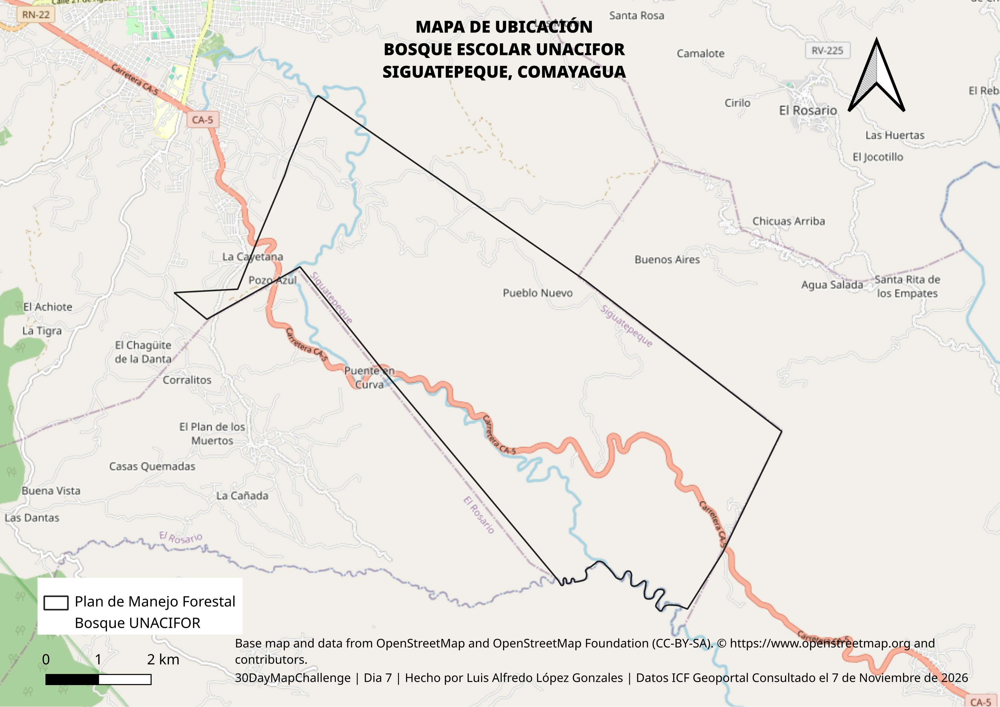

# Day 7 · 10 minute map

Today's theme gives no more than 10 minutes to make the map. I went back to my
student years: the boundary of the school forest of UNACIFOR, the university where I studied, in
Siguatepeque, Comayagua.

Made by hand in QGIS within the 10 minutes (`day07-10minutosmap.qgz`), no AI in
the map.

**Data:** the forest management plan polygon `BP-CO-0318-0689-2021` from ICF's
approved management plans layer (`planes_de_manejo_aprobados_gp`, ICF Geoportal,
retrieved 2026-11-07); basemap © OpenStreetMap contributors.
