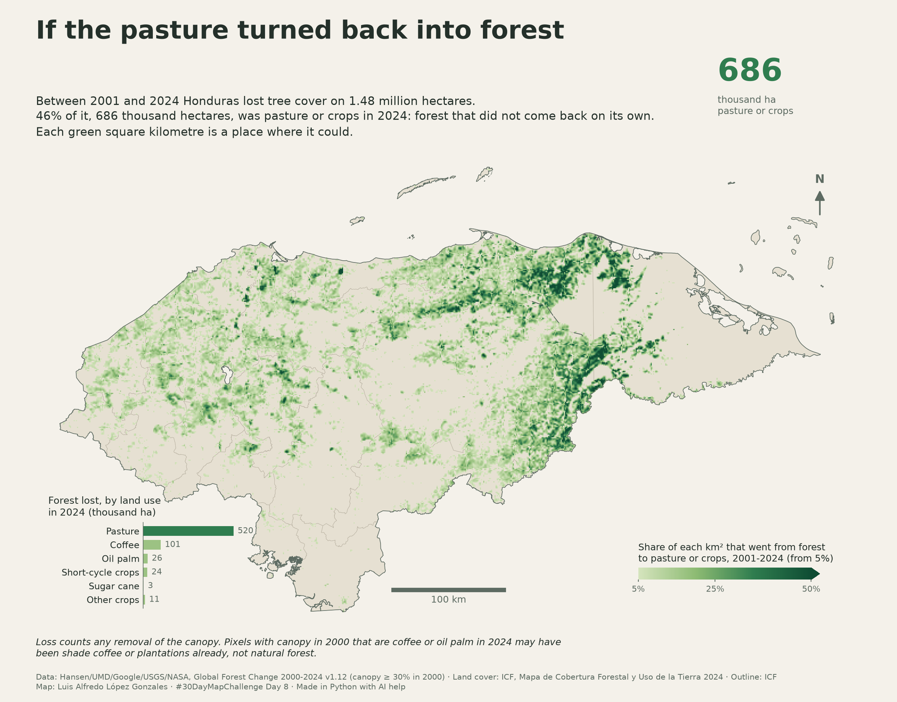

# If the pasture turned back into forest

Today's theme asks for a map of something which could be. This one draws
**where Honduras had forest in 2000, lost its tree cover between 2001 and
2024, and had pasture or crops in 2024**: the forest that did not come back on
its own, and the places where it could, if that land were given back to it.

Two sources are crossed. Tree cover loss comes from the Global Forest Change
dataset, version 1.12 [@hansen2013]: a 30 m grid that marks, for each pixel,
the year its tree canopy was removed. Loss alone is not deforestation: it also
counts pine harvested under a management plan, the pine bark beetle outbreak
of 2014-2017 [@icf-gorgojo-2014-2017] and fire, and much of that forest grows
back. What the land was in 2024 comes from ICF's forest and land cover map of
Honduras for 2024 [@icf-mapa-forestal-2024], a 10 m grid. A lost pixel that
the 2024 map calls pasture or a crop is forest that became farmland.

The country's outline comes from ICF's departments layer
[@icf-limite-departamentos].

```python
import os
import subprocess
import sys
import tempfile
from pathlib import Path

import geopandas as gpd
import matplotlib.pyplot as plt
from matplotlib.colors import LinearSegmentedColormap
import numpy as np
import rasterio
from rasterio.features import geometry_mask
from rasterio.warp import Resampling, reproject
from rasterio.windows import Window

sys.path.append("../..")  # maps/, for the shared scale bar and north arrow
from cartography import add_north_arrow, add_scale_bar

WFS = "https://geoserver.icf.gob.hn/icfpub/wfs"
CRS = 32616  # WGS 84 / UTM zone 16N, the ICF layers' own CRS, in metres

departments = gpd.read_file(
    f"{WFS}?service=WFS&version=2.0.0&request=GetFeature"
    "&typeNames=limite_departamentos_gp&outputFormat=application/json"
).to_crs(CRS)
land = departments.union_all()
land_ll = gpd.GeoSeries([land], crs=CRS).to_crs(4326).iloc[0]
print(f"{len(departments)} departments, bounds {np.round(land_ll.bounds, 2)}")
```

## Tree cover loss, 2001-2024

The tile `20N_090W` (10-20° N, 80-90° W) covers the whole country. Two of its
layers are clipped to Honduras: the tree canopy cover in 2000 and the year of
loss. A pixel counts as forest when its canopy covered at least 30% in 2000,
the threshold Global Forest Watch uses by default, and as lost when it has a
year of loss. Each pixel is about 30 × 30 m, and its true area is computed
from its latitude.

```python
GFC = (
    "/vsicurl/https://storage.googleapis.com/earthenginepartners-hansen/"
    "GFC-2024-v1.12/Hansen_GFC-2024-v1.12_{layer}_20N_090W.tif"
)
work = Path(tempfile.mkdtemp())
minx, miny, maxx, maxy = land_ll.bounds
for layer in ("treecover2000", "lossyear"):
    subprocess.run(
        ["gdal_translate", "-q", "-projwin", str(minx), str(maxy), str(maxx)]
        + [str(miny), GFC.format(layer=layer), str(work / f"{layer}.tif")],
        check=True,
    )
```

## Land cover in 2024

ICF's map is not served by its GeoServer; it is downloaded from the ICF
geoportal (`geoportal.icf.gob.hn`) and read from the path in the
`MAPA_FORESTAL_2024` environment variable. Its 10 m pixels are put on the
30 m grid of the loss data, each 30 m pixel taking the class most of its
10 m pixels have.

```python
ICF_2024 = Path(os.environ.get("MAPA_FORESTAL_2024", "MapaForestal_2024.tif"))
PASTURE = [14]  # Pastizales
CROPS = {  # ICF class: label for the chart
    9: ("Coffee", "Café"),
    6: ("Short-cycle crops", "Cultivos de ciclo corto"),
    12: ("Oil palm", "Palma africana"),
    8: ("Sugar cane", "Caña de azúcar"),
    7: ("Other crops", "Otros cultivos"),  # bananas and plantains
    11: ("Other crops", "Otros cultivos"),  # fruit trees
    24: ("Other crops", "Otros cultivos"),  # rice
}
FARMLAND = PASTURE + list(CROPS)

with rasterio.open(work / "treecover2000.tif") as grid:
    bounds, res = grid.bounds, grid.res
subprocess.run(
    ["gdalwarp", "-q", "-r", "mode", "-multi", "-wo", "NUM_THREADS=ALL_CPUS"]
    + ["-te", *map(str, bounds), "-tr", *map(str, res)]
    + ["-co", "COMPRESS=LZW", str(ICF_2024), str(work / "cover2024.tif")],
    check=True,
)
```

## Forest that became farmland

The pixels are summed into cells of 40 × 40 pixels (0.01°, about 1.1 km a
side), keeping for each cell the hectares of forest lost that were pasture or
crops in 2024. The sum runs by bands of rows, so the whole grid never sits in
memory at once.

```python
CANOPY = 30  # % canopy cover in 2000 to count as forest
B = 40  # pixels per cell side
R = 6_371_007.2  # authalic Earth radius, m

with (
    rasterio.open(work / "treecover2000.tif") as tc,
    rasterio.open(work / "lossyear.tif") as ly,
    rasterio.open(work / "cover2024.tif") as cv,
):
    H, W = tc.height // B * B, tc.width // B * B
    step = abs(tc.transform.a)
    cell_transform = tc.transform * tc.transform.scale(B, B)
    farm_cells = np.zeros((H // B, W // B), dtype="float32")
    by_class = np.zeros(256)  # hectares lost, by ICF class in 2024
    forest_2000 = 0.0
    for r0 in range(0, H, B * 25):
        window = Window(0, r0, W, min(B * 25, H - r0))
        h = int(window.height)
        t = tc.window_transform(window)
        inside = ~geometry_mask([land_ll], (h, W), t)
        cover, year = tc.read(1, window=window), ly.read(1, window=window)
        cls = cv.read(1, window=window)
        top = t.f + np.arange(h) * t.e  # latitude of each row's top edge
        row_ha = (
            R**2
            * np.deg2rad(step)
            * (np.sin(np.deg2rad(top)) - np.sin(np.deg2rad(top + t.e)))
            / 1e4
        )
        area = np.broadcast_to(row_ha[:, None], (h, W))
        forest = inside & (cover >= CANOPY)
        lost = forest & (year > 0)
        forest_2000 += area[forest].sum()
        by_class += np.bincount(cls[lost], weights=area[lost], minlength=256)
        farm = lost & np.isin(cls, FARMLAND)
        farm_cells[r0 // B : (r0 + h) // B] = (
            np.where(farm, area, 0).reshape(h // B, B, W // B, B).sum(axis=(1, 3))
        )

total_loss = by_class.sum()
pasture_ha = by_class[PASTURE].sum()
crops_ha = by_class[list(CROPS)].sum()
farm_ha = pasture_ha + crops_ha
print(f"Forest in 2000 (canopy ≥ {CANOPY}%): {forest_2000 / 1e6:.2f} M ha")
print(f"Tree cover lost 2001-2024: {total_loss / 1e6:.2f} M ha")
print(
    f"  pasture or crops in 2024: {farm_ha / 1e6:.2f} M ha "
    f"({farm_ha / total_loss:.0%} of the loss)"
)
print(f"    pasture: {pasture_ha / 1e3:.0f} k ha")
print(f"    crops:   {crops_ha / 1e3:.0f} k ha")
```

What the rest of the loss was in 2024, by ICF class:

```python
names = {
    1: "Broadleaf evergreen forest",
    2: "Coniferous forest",
    3: "Mixed forest",
    4: "Broadleaf deciduous forest",
    5: "Mangrove",
    13: "Shrubland",
    14: "Pasture",
    15: "Pine savanna",
    16: "Wetland",
    19: "Settlement",
    20: "Bare soil",
}
names |= {k: en for k, (en, _) in CROPS.items()}
for k in np.argsort(by_class)[::-1][:14]:
    if by_class[k] > 0:
        print(f"{k:3d} {names.get(k, '?'):28s} {by_class[k] / 1e3:7.1f} k ha")
```

## The map

The cells are reprojected to UTM at 1 km and drawn in green: the darker the
cell, the larger its share of forest turned into pasture or crops. Cells under
5% are left out, so the map shows where the change was more than scattered.
Seen this way, each green cell is a place where the forest could come back.

```python
CELL = 1_000
MIN_SHARE = 0.05  # cells under this share are not drawn
xlim, ylim = (225_000, 950_000), (1_430_000, 1_850_000)
grid_transform = rasterio.transform.from_origin(xlim[0], ylim[1], CELL, CELL)
shape = ((ylim[1] - ylim[0]) // CELL, (xlim[1] - xlim[0]) // CELL)

# Share of each cell's area; a 0.01° cell is about 120 ha at this latitude.
lat_c = cell_transform.f + (np.arange(farm_cells.shape[0]) + 0.5) * cell_transform.e
cell_ha = (R * np.deg2rad(B * step)) ** 2 * np.cos(np.deg2rad(lat_c)) / 1e4
share = farm_cells / cell_ha[:, None]
share_utm = np.full(shape, np.nan, dtype="float32")
reproject(
    share.astype("float32"),
    share_utm,
    src_transform=cell_transform,
    src_crs=4326,
    dst_transform=grid_transform,
    dst_crs=CRS,
    resampling=Resampling.average,
    dst_nodata=np.nan,
)
share_utm[share_utm < MIN_SHARE] = np.nan  # leave out cells with almost none
print(f"{np.isfinite(share_utm).sum():,} km² with at least {MIN_SHARE:.0%}")

# Hectares per crop label, for the chart
crop_ha = {}
for k, labels in CROPS.items():
    crop_ha[labels] = crop_ha.get(labels, 0) + by_class[k]
bars = [(("Pasture", "Pastizales"), pasture_ha)] + sorted(
    crop_ha.items(), key=lambda kv: -kv[1] if kv[0][0] != "Other crops" else 0
)

BG, LAND, INK, INK_2, LINE = "#f4f1ea", "#e6e0d2", "#24302a", "#5d6b62", "#b9b2a2"
GREENS = LinearSegmentedColormap.from_list(
    "regrow", ["#d5e4bd", "#8dbb73", "#2f7d4f", "#0f4d34"]
)
pct = round(farm_ha / total_loss * 100)

TEXT = {
    "en": {
        "title": "If the pasture turned back into forest",
        "subtitle": (
            f"Between 2001 and 2024 Honduras lost tree cover on {total_loss / 1e6:.2f} "
            f"million hectares.\n{pct}% of it, {farm_ha / 1e3:,.0f} thousand hectares, "
            "was pasture or crops in 2024: forest that did not come back on its own.\n"
            "Each green square kilometre is a place where it could."
        ),
        "note": (
            "Loss counts any removal of the canopy. Pixels with canopy in 2000 that "
            "are coffee or oil palm in 2024 may have\nbeen shade coffee or plantations "
            "already, not natural forest."
        ),
        "legend": "Share of each km² that went from forest\nto pasture or crops, 2001-2024 (from 5%)",
        "chart": "Forest lost, by land use\nin 2024 (thousand ha)",
        "farm": "thousand ha\npasture or crops",
        "credits": (
            "Data: Hansen/UMD/Google/USGS/NASA, Global Forest Change 2000-2024 v1.12 "
            f"(canopy ≥ {CANOPY}% in 2000) · Land cover: ICF, Mapa de Cobertura Forestal "
            "y Uso de la Tierra 2024 · Outline: ICF\n"
            "Map: Luis Alfredo López Gonzales · #30DayMapChallenge Day 8 · "
            "Made in Python with AI help"
        ),
        "lang": 0,
    },
    "es": {
        "title": "Si el potrero volviera a ser bosque",
        "subtitle": (
            f"Entre 2001 y 2024 Honduras perdió cobertura arbórea en {total_loss / 1e6:.2f} "
            f"millones de hectáreas.\nEl {pct}%, {farm_ha / 1e3:,.0f} mil hectáreas, "
            "era pasto o cultivo en 2024: bosque que no volvió por sí solo.\n"
            "Cada kilómetro cuadrado verde es un lugar donde podría volver."
        ),
        "note": (
            "La pérdida cuenta cualquier remoción del dosel. Píxeles con dosel en 2000 "
            "que en 2024 son café o palma pueden\nhaber sido café con sombra o "
            "plantaciones, no bosque natural."
        ),
        "legend": "Parte de cada km² que pasó de bosque\na pasto o cultivo, 2001-2024 (desde 5%)",
        "chart": "Bosque perdido, por uso\nen 2024 (miles de ha)",
        "farm": "mil ha de\npasto o cultivo",
        "credits": (
            "Datos: Hansen/UMD/Google/USGS/NASA, Global Forest Change 2000-2024 "
            f"v1.12 (dosel ≥ {CANOPY}% en 2000) · Cobertura: ICF, Mapa de Cobertura "
            "Forestal y Uso de la Tierra 2024 · Contorno: ICF\n"
            "Mapa: Luis Alfredo López Gonzales · #30DayMapChallenge Día 8 · "
            "Hecho en Python con ayuda de IA"
        ),
        "lang": 1,
    },
}


def draw_chart(ax: plt.Axes, text: dict) -> None:
    """Forest lost by land use in 2024, as an inset in the Pacific corner."""
    inset = ax.inset_axes([0.13, 0.02, 0.115, 0.18])
    inset.set_facecolor("none")
    labels = [lab[text["lang"]] for lab, _ in bars][::-1]
    values = [v / 1e3 for _, v in bars][::-1]
    colors = ["#9cc283"] * (len(bars) - 1) + ["#2f7d4f"]
    inset.barh(range(len(values)), values, height=0.7, color=colors)
    inset.set_yticks(range(len(values)), labels=labels)
    for y, v in enumerate(values):
        inset.annotate(
            f"{v:,.0f}",
            (v, y),
            xytext=(4, 0),
            textcoords="offset points",
            va="center",
            fontsize=8,
            color=INK_2,
        )
    inset.text(
        -1.0,
        1.04,
        text["chart"],
        transform=inset.transAxes,
        fontsize=9.5,
        color=INK,
        va="bottom",
    )
    inset.set_xticks([])
    inset.tick_params(labelsize=8.5, colors=INK, length=0)
    for side in ("top", "right", "bottom"):
        inset.spines[side].set_visible(False)
    inset.spines["left"].set_color(INK_2)
    inset.spines["left"].set_linewidth(0.6)


def draw_number(fig: plt.Figure, text: dict) -> None:
    """The figure of the story, under the title."""
    fig.text(
        0.80,
        0.885,
        f"{farm_ha / 1e3:,.0f}",
        fontsize=30,
        fontweight="bold",
        color="#2f7d4f",
        ha="left",
        va="baseline",
    )
    fig.text(0.80, 0.865, text["farm"], fontsize=9, color=INK_2, va="top")


def draw_map(lang: str) -> plt.Figure:
    """Draw the map with its text in `lang` ("en" or "es")."""
    text = TEXT[lang]
    fig = plt.figure(figsize=(12, 9.4), facecolor=BG)
    ax = fig.add_axes([0.04, 0.10, 0.92, 0.72])
    ax.set_facecolor(BG)
    departments.plot(ax=ax, color=LAND, edgecolor=LINE, linewidth=0.35, zorder=1)
    image = ax.imshow(
        share_utm,
        extent=(*xlim, *ylim),
        cmap=GREENS,
        vmin=MIN_SHARE,
        vmax=0.5,
        interpolation="nearest",
        zorder=2,
    )
    gpd.GeoSeries([land], crs=CRS).boundary.plot(
        ax=ax, color=INK_2, linewidth=0.6, zorder=3
    )
    ax.set_xlim(xlim)
    ax.set_ylim(ylim)
    ax.set_aspect("equal")
    ax.set_axis_off()

    cax = ax.inset_axes([0.73, 0.08, 0.22, 0.025])
    bar = fig.colorbar(image, cax=cax, orientation="horizontal", extend="max")
    bar.set_ticks([0.05, 0.25, 0.5], labels=["5%", "25%", "50%"])
    bar.ax.tick_params(labelsize=8, colors=INK_2, length=2)
    bar.outline.set_visible(False)
    cax.set_title(text["legend"], fontsize=9, color=INK, loc="left")

    draw_chart(ax, text)
    add_scale_bar(ax, loc="lower center", color=INK_2)
    add_north_arrow(ax, color=INK_2)

    fig.text(0.04, 0.945, text["title"], fontsize=24, fontweight="bold", color=INK)
    fig.text(
        0.04,
        0.80,
        text["subtitle"],
        fontsize=11,
        color=INK,
        va="bottom",
        linespacing=1.4,
    )
    draw_number(fig, text)
    fig.text(0.04, 0.065, text["note"], fontsize=9, color=INK, style="italic")
    fig.text(0.04, 0.018, text["credits"], fontsize=7.5, color=INK_2)
    return fig


for lang in ("en", "es"):
    fig = draw_map(lang)
    fig.savefig(f"day08-utopia-{lang}.png", dpi=200, facecolor=BG)
    plt.close(fig)
```



## References

::: {#refs}
:::
