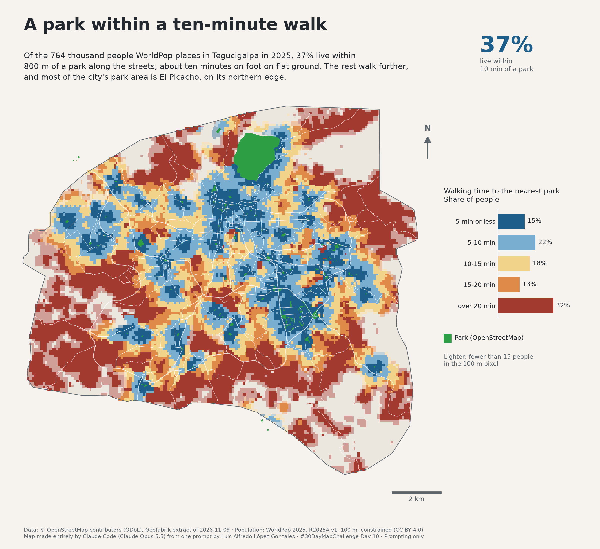

# A park within a ten-minute walk

Today's theme asks the AI to make the map from start to finish, in a chat
window or on the command line. This one was made by Claude Code (Anthropic's
Claude Opus 5.5 model) in a terminal, from a single prompt: *"haz el mapa del
dia, hoy es 10"* ("make today's map, today is the 10th"). The topic, the data,
the method, this notebook and the map were the model's choices; the only
human step was reviewing it before publishing.

The question: **how many people in Tegucigalpa live within a ten-minute walk
of a park?** Ten minutes is taken as 800 m along the street network, the
distance an adult covers at 4.8 km/h on flat ground. Tegucigalpa is not flat,
so on its hills the same distance takes longer.

Three sources are crossed. Parks, streets and footpaths, and the city's
boundary come from OpenStreetMap [@openstreetmap], read from the Geofabrik
extract of Honduras [@geofabrik-honduras]. Where people live comes from
WorldPop's 2025 population estimate [@worldpop-r2025a], a 100 m grid that
spreads each census area's people over its built-up pixels.

```python
import subprocess
import sys
import tempfile
from pathlib import Path

import geopandas as gpd
import matplotlib.pyplot as plt
import numpy as np
import rasterio
import shapely
from matplotlib.colors import BoundaryNorm, ListedColormap, to_rgb
from rasterio.mask import mask
from rasterio.warp import Resampling, reproject
from scipy.sparse import coo_matrix
from scipy.sparse.csgraph import dijkstra
from scipy.spatial import cKDTree

sys.path.append("../..")  # maps/, for the shared scale bar and north arrow
from cartography import add_north_arrow, add_scale_bar

CRS = 32616  # WGS 84 / UTM zone 16N, in metres
PBF_URL = "https://download.geofabrik.de/central-america/honduras-latest.osm.pbf"
POP_URL = (
    "https://data.worldpop.org/GIS/Population/Global_2015_2030/R2025A/2025/HND/"
    "v1/100m/constrained/hnd_pop_2025_CN_100m_R2025A_v1.tif"
)

work = Path(tempfile.mkdtemp())
pbf, pop_tif = work / "honduras.osm.pbf", work / "hnd_pop_2025.tif"
for url, path in ((PBF_URL, pbf), (POP_URL, pop_tif)):
    subprocess.run(["curl", "-sSL", "-o", str(path), url], check=True)
print(f"OSM extract: {pbf.stat().st_size / 1e6:.0f} MB")
```

## The city

OpenStreetMap maps Tegucigalpa as a city boundary (`admin_level` 7) inside
the Distrito Central municipality: the urban area, without the municipality's
rural villages. Streets and parks are read up to 1.5 km beyond it, so a
neighbourhood on the edge can reach a park just outside.

```python
city = gpd.read_file(
    pbf, layer="multipolygons", where="name = 'Tegucigalpa' AND admin_level = '7'"
).to_crs(CRS)
area = city.geometry.iloc[0]
study = area.buffer(1_500)
bbox = tuple(gpd.GeoSeries([study], crs=CRS).to_crs(4326).total_bounds)
print(f"Tegucigalpa: {area.area / 1e6:.0f} km²")
```

## The walking network

Every OpenStreetMap way with a `highway` tag counts as walkable (streets,
service roads, footways, paths and steps), except motorways, roads under
construction and ways tagged `foot=no` or `access=private`. The ways are split
where they cross, and each piece becomes an edge of a graph weighted by its
length. Splitting at every crossing also joins a bridge to the street under
it; at this scale that error is small.

```python
EXCLUDED = ["motorway", "motorway_link", "construction", "proposed", "raceway"]
lines = gpd.read_file(
    pbf, layer="lines", bbox=bbox, columns=["highway", "other_tags"]
).to_crs(CRS)
tags = lines["other_tags"].fillna("")
lines = lines[
    lines["highway"].notna()
    & ~lines["highway"].isin(EXCLUDED)
    & ~tags.str.contains('"foot"=>"no"|"access"=>"private"')
    & lines.intersects(study)
]

segments = shapely.get_parts(shapely.node(shapely.union_all(lines.geometry.values)))
ends = np.vstack(
    [
        shapely.get_coordinates(shapely.get_point(segments, 0)),
        shapely.get_coordinates(shapely.get_point(segments, -1)),
    ]
)
nodes, index = np.unique(np.round(ends, 1), axis=0, return_inverse=True)
index = index.ravel()
u, v = index[: len(segments)], index[len(segments) :]
length = shapely.length(segments)
graph = coo_matrix(
    (np.r_[length, length], (np.r_[u, v], np.r_[v, u])), shape=(len(nodes),) * 2
).tocsr()
node_tree = cKDTree(nodes)
print(f"{len(lines):,} ways → {len(segments):,} edges, {len(nodes):,} nodes")
print(lines["highway"].value_counts().head(6).to_string())
```

## The parks

A park is an area tagged `leisure=park`, plus Parque Naciones Unidas El
Picacho, which OpenStreetMap tags as a nature reserve. Sports pitches,
private gardens and parks tagged `access=private` are left out. A park can be
entered from any node of the network within 25 m of its edge; a park with no
node that close is entered from the nearest one.

```python
parks = gpd.read_file(
    pbf,
    layer="multipolygons",
    bbox=bbox,
    where="leisure = 'park' OR (leisure = 'nature_reserve' AND name LIKE 'Parque%')",
    columns=["name", "leisure", "other_tags"],
).to_crs(CRS)
parks = parks[
    parks.intersects(study)
    & ~parks["other_tags"].fillna("").str.contains('"access"=>"(?:private|no)"')
]
parks["geometry"] = parks.geometry.make_valid()

node_points = gpd.GeoDataFrame(geometry=gpd.points_from_xy(*nodes.T), crs=CRS)
edges = gpd.GeoDataFrame(geometry=parks.buffer(25).values, crs=CRS)
entrances = set(gpd.sjoin(node_points, edges, predicate="within").index)
for park in parks.geometry:
    _, nearest = node_tree.query(shapely.get_coordinates(park.boundary)[::10])
    if not entrances.intersection(nearest):
        _, i = node_tree.query(shapely.get_coordinates(park.representative_point()))
        entrances.add(int(i[0]))
entrances = np.array(sorted(entrances))

inside = parks[parks.intersects(area)]
picacho = inside["leisure"].eq("nature_reserve")
print(f"{len(inside)} parks inside the city, {len(entrances):,} entrance nodes")
print(f"  El Picacho: {inside[picacho].area.sum() / 1e4:,.0f} ha")
print(f"  the other {(~picacho).sum()}: {inside[~picacho].area.sum() / 1e4:,.0f} ha")
```

## Walking distance from every home

One search from all the park entrances at once gives, for every node, the
distance along the network to the nearest park. Each populated WorldPop
pixel is joined to its nearest node, and its distance is the straight line
to that node plus the walk from there.

```python
WALK = 80  # metres per minute, 4.8 km/h
to_park = dijkstra(graph, indices=entrances, min_only=True, limit=4_000)

with rasterio.open(pop_tif) as src:
    city_ll = gpd.GeoSeries([area], crs=CRS).to_crs(src.crs).iloc[0]
    pop, pop_transform = mask(src, [city_ll], crop=True, filled=True, nodata=0)
    pop_crs = src.crs
pop = np.where(pop[0] > 0, pop[0], 0)

rows, cols = np.nonzero(pop)
xs, ys = rasterio.transform.xy(pop_transform, rows, cols)
homes = gpd.GeoSeries(gpd.points_from_xy(xs, ys), crs=pop_crs).to_crs(CRS)
snap, nearest = node_tree.query(np.c_[homes.x, homes.y])
minutes = (snap + to_park[nearest]) / WALK
people = pop[rows, cols]

total = people.sum()
within = people[minutes <= 10].sum()
print(f"People in Tegucigalpa (WorldPop 2025): {total:,.0f}")
print(f"Within 10 minutes of a park: {within:,.0f} ({within / total:.0%})")
for limit in (5, 15, 20):
    print(f"  within {limit:2d} min: {people[minutes <= limit].sum() / total:.0%}")
print(f"Homes more than 200 m from the network: {people[snap > 200].sum() / total:.1%}")
```

## The map

Each populated 100 m pixel is coloured by its walking time to the nearest
park. The colours go from blue (five minutes or less) to dark red (more than
twenty), and the bar chart beside the map counts the people in each band.
Pixels with fewer than 15 people are drawn lighter, so the sparse edges of the
city do not weigh as much as its dense neighbourhoods.

```python
BANDS = [0, 5, 10, 15, 20, np.inf]
COLORS = ["#1d5f8a", "#79aed0", "#f2d38a", "#e08a4a", "#a33a2f"]
SPARSE = 15  # people per pixel; fewer are drawn lighter
band = np.digitize(minutes, BANDS[1:-1], right=True)
share = np.bincount(band, weights=people, minlength=5) / total

grid = np.full(pop.shape, -1, dtype="int8")
grid[rows, cols] = band + 5 * (people < SPARSE)
xmin, ymin, xmax, ymax = (np.array(area.bounds) / 1_000).round() * 1_000
xmin, ymin, xmax, ymax = xmin - 1_000, ymin - 1_000, xmax + 1_000, ymax + 1_000
CELL = 50
grid_utm = np.full(
    (int((ymax - ymin) // CELL), int((xmax - xmin) // CELL)), -1, dtype="int8"
)
reproject(
    grid,
    grid_utm,
    src_transform=pop_transform,
    src_crs=pop_crs,
    dst_transform=rasterio.transform.from_origin(xmin, ymax, CELL, CELL),
    dst_crs=CRS,
    resampling=Resampling.nearest,
    src_nodata=-1,
    dst_nodata=-1,
)
image = np.ma.masked_less(grid_utm, 0)
main_roads = lines[
    lines["highway"].isin(["trunk", "primary", "secondary", "tertiary"])
].clip(area)

BG, INK, INK_2, LINE, PARK = "#f6f3ee", "#23292e", "#5b646b", "#c9c2b6", "#2e9e44"


def lighter(color: str, keep: float = 0.45) -> tuple:
    """`color` mixed with the background, keeping `keep` of it."""
    rgb, bg = np.array(to_rgb(color)), np.array(to_rgb(BG))
    return tuple(rgb * keep + bg * (1 - keep))


TEXT = {
    "en": {
        "title": "A park within a ten-minute walk",
        "subtitle": (
            f"Of the {total / 1e3:,.0f} thousand people WorldPop places in "
            f"Tegucigalpa in 2025, {within / total:.0%} live within\n800 m of a "
            "park along the streets, about ten minutes on foot on flat ground. "
            "The rest walk further,\nand most of the city's park area is "
            "El Picacho, on its northern edge."
        ),
        "legend": "Walking time to the nearest park",
        "bands": ["5 min or less", "5-10 min", "10-15 min", "15-20 min", "over 20 min"],
        "chart": "Share of people",
        "park": "Park (OpenStreetMap)",
        "sparse": f"Lighter: fewer than {SPARSE} people\nin the 100 m pixel",
        "number": "live within\n10 min of a park",
        "credits": (
            "Data: © OpenStreetMap contributors (ODbL), Geofabrik extract of "
            "2026-11-09 · Population: WorldPop 2025, R2025A v1, 100 m, "
            "constrained (CC BY 4.0)\n"
            "Map made entirely by Claude Code (Claude Opus 5.5) from one prompt "
            "by Luis Alfredo López Gonzales · #30DayMapChallenge Day 10 · "
            "Prompting only"
        ),
    },
    "es": {
        "title": "Un parque a diez minutos a pie",
        "subtitle": (
            f"De las {total / 1e3:,.0f} mil personas que WorldPop ubica en "
            f"Tegucigalpa en 2025, el {within / total:.0%} vive a menos\nde 800 m "
            "de un parque por las vías, unos diez minutos a pie en terreno "
            "plano. El resto camina más,\ny la mayor parte del área de parques "
            "de la ciudad es El Picacho, en su borde norte."
        ),
        "legend": "Tiempo a pie al parque más cercano",
        "bands": [
            "5 min o menos",
            "5-10 min",
            "10-15 min",
            "15-20 min",
            "más de 20 min",
        ],
        "chart": "Parte de la población",
        "park": "Parque (OpenStreetMap)",
        "sparse": f"Más claro: menos de {SPARSE} personas\nen el píxel de 100 m",
        "number": "vive a 10 min\nde un parque",
        "credits": (
            "Datos: © colaboradores de OpenStreetMap (ODbL), extracto de "
            "Geofabrik del 2026-11-09 · Población: WorldPop 2025, R2025A v1, "
            "100 m, restringida (CC BY 4.0)\n"
            "Mapa hecho por completo por Claude Code (Claude Opus 5.5) a partir "
            "de un prompt de Luis Alfredo López Gonzales · #30DayMapChallenge "
            "Día 10 · Prompting only"
        ),
    },
}


def draw_legend(fig: plt.Figure, text: dict) -> None:
    """Walking-time bands as a bar chart of the people in each."""
    inset = fig.add_axes([0.83, 0.42, 0.12, 0.2])
    inset.set_facecolor("none")
    y = np.arange(5)[::-1]
    inset.barh(y, share * 100, height=0.72, color=COLORS)
    inset.set_yticks(y, labels=text["bands"])
    for yi, s in zip(y, share):
        inset.annotate(
            f"{s:.0%}",
            (s * 100, yi),
            xytext=(4, 0),
            textcoords="offset points",
            va="center",
            fontsize=9,
            color=INK,
        )
    inset.set_xlim(0, share.max() * 100 * 1.3)
    inset.set_xticks([])
    inset.tick_params(labelsize=9, colors=INK, length=0)
    for side in ("top", "right", "bottom"):
        inset.spines[side].set_visible(False)
    inset.spines["left"].set_color(INK_2)
    inset.spines["left"].set_linewidth(0.6)
    inset.set_title(
        f"{text['legend']}\n{text['chart']}",
        fontsize=10,
        color=INK,
        loc="left",
        x=-0.75,
        pad=10,
    )
    inset.add_patch(
        plt.Rectangle(
            (-0.75, -0.22),
            0.1,
            0.08,
            transform=inset.transAxes,
            color=PARK,
            clip_on=False,
        )
    )
    inset.text(
        -0.6,
        -0.18,
        text["park"],
        transform=inset.transAxes,
        fontsize=9,
        color=INK,
        va="center",
    )
    inset.text(
        -0.75,
        -0.32,
        text["sparse"],
        transform=inset.transAxes,
        fontsize=8.5,
        color=INK_2,
        va="top",
    )


def draw_map(lang: str) -> plt.Figure:
    """Draw the map with its text in `lang` ("en" or "es")."""
    text = TEXT[lang]
    fig = plt.figure(figsize=(12, 11), facecolor=BG)
    ax = fig.add_axes([0.01, 0.06, 0.74, 0.78])
    ax.set_facecolor(BG)
    gpd.GeoSeries([area], crs=CRS).plot(ax=ax, color="#ece7de", zorder=0)
    ax.imshow(
        image,
        extent=(xmin, xmax, ymin, ymax),
        cmap=ListedColormap(COLORS + [lighter(c) for c in COLORS]),
        norm=BoundaryNorm(np.arange(-0.5, 10), 10),
        interpolation="nearest",
        zorder=1,
    )
    main_roads.plot(ax=ax, color="white", linewidth=0.5, alpha=0.8, zorder=2)
    parks.clip(study).plot(ax=ax, color=PARK, edgecolor=PARK, linewidth=0.4, zorder=3)
    gpd.GeoSeries([area], crs=CRS).boundary.plot(
        ax=ax, color=INK_2, linewidth=0.8, zorder=4
    )
    ax.set_xlim(xmin, xmax)
    ax.set_ylim(ymin, ymax)
    ax.set_aspect("equal")
    ax.set_axis_off()

    draw_legend(fig, text)
    add_scale_bar(ax, loc="lower right", color=INK_2)
    add_north_arrow(ax, color=INK_2)

    fig.text(0.04, 0.945, text["title"], fontsize=24, fontweight="bold", color=INK)
    fig.text(0.04, 0.855, text["subtitle"], fontsize=11, color=INK, linespacing=1.4)
    fig.text(
        0.80,
        0.905,
        f"{within / total:.0%}",
        fontsize=32,
        fontweight="bold",
        color=COLORS[0],
    )
    fig.text(0.80, 0.895, text["number"], fontsize=9.5, color=INK_2, va="top")
    fig.text(0.04, 0.02, text["credits"], fontsize=7.5, color=INK_2)
    return fig


for lang in ("en", "es"):
    fig = draw_map(lang)
    fig.savefig(f"day10-prompting-only-{lang}.png", dpi=200, facecolor=BG)
    plt.close(fig)
```



## References

::: {#refs}
:::
