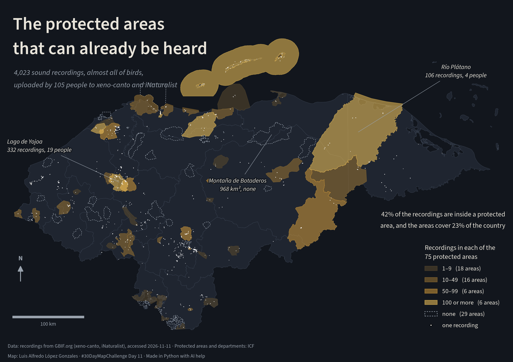

# The protected areas that can already be heard

Today's theme is sound. This map looks at **where Honduras has been recorded**:
every georeferenced sound recording from the country that GBIF holds, most of
them bird songs that birders upload to xeno-canto and iNaturalist, set against
the protected areas declared by ICF. Some areas have hundreds of recordings;
others, some of them large, have none.

GBIF [@gbif-occurrence-sound-hn] gathers the recordings from several datasets;
the two that bring almost all of them are xeno-canto [@xeno-canto-gbif] and
iNaturalist's research-grade observations [@inaturalist-gbif]. The protected
areas are ICF's layer of declared protected areas
[@icf-areas-protegidas-declaradas], and the outline of the country comes from
its departments layer [@icf-limite-departamentos], both from the ICF GeoServer
[@icf-geoserver].

```python
import sys

import geopandas as gpd
import matplotlib.pyplot as plt
import pandas as pd
import requests
from matplotlib import patheffects
from matplotlib.lines import Line2D
from matplotlib.patches import Patch

sys.path.append("../..")  # maps/, for the shared scale bar and north arrow
from cartography import add_north_arrow, add_scale_bar

WFS = "https://geoserver.icf.gob.hn/icfpub/wfs"
CRS = 32616  # WGS 84 / UTM zone 16N, the ICF layers' own CRS, in metres


def icf_layer(name: str) -> gpd.GeoDataFrame:
    """Read one layer from the ICF GeoServer, in UTM 16N."""
    return gpd.read_file(
        f"{WFS}?service=WFS&version=2.0.0&request=GetFeature"
        f"&typeNames={name}&outputFormat=application/json"
    ).to_crs(CRS)


departments = icf_layer("limite_departamentos_gp")
land = departments.union_all()
```

## The recordings

GBIF's occurrence search returns every record from Honduras with a sound file
attached (`mediaType=Sound`), 300 per page. Each record keeps its place, its
year, its species and who recorded it.

```python
GBIF = "https://api.gbif.org/v1/occurrence/search"
QUERY = {"country": "HN", "mediaType": "Sound", "limit": 300}
FIELDS = [
    "decimalLatitude",
    "decimalLongitude",
    "year",
    "species",
    "class",
    "datasetKey",
    "recordedBy",
]

rows, offset = [], 0
while True:
    page = requests.get(GBIF, params=QUERY | {"offset": offset}, timeout=60).json()
    rows += [{f: r.get(f) for f in FIELDS} for r in page["results"]]
    offset += QUERY["limit"]
    if page["endOfRecords"]:
        break
records = pd.DataFrame(rows).dropna(subset=["decimalLatitude"])
print(f"{page['count']:,} records with sound, {len(records):,} with coordinates")
```

A few records fall in the sea or outside the country. The ones kept are those
on land (or within 2 km of the coast) and those inside a protected area, since
some areas are marine.

```python
areas = icf_layer("areas_protegidas_declarada_gp").dissolve("nomb_ap").reset_index()
protected = areas.union_all()
points = gpd.GeoDataFrame(
    records,
    geometry=gpd.points_from_xy(records.decimalLongitude, records.decimalLatitude),
    crs=4326,
).to_crs(CRS)
points = points[points.within(land.buffer(2_000)) | points.within(protected)]

datasets = points.datasetKey.value_counts()
birds = (points["class"] == "Aves").mean()
print(f"{len(points):,} recordings kept, {birds:.0%} of birds")
print(f"{points.species.nunique()} species, {points.recordedBy.nunique()} people")
for key, n in datasets.items():
    title = requests.get(f"https://api.gbif.org/v1/dataset/{key}", timeout=60).json()
    print(f"{n:6,} {title['title']}")
```

## Recordings by protected area

Each recording is placed in the protected area it falls in. Some areas are
several polygons under one name; they are merged first, so each name counts
once.

```python
joined = gpd.sjoin(points, areas[["nomb_ap", "geometry"]], predicate="within")
counts = joined.groupby("nomb_ap").agg(
    n=("species", "size"), people=("recordedBy", "nunique")
)
areas = areas.merge(counts, left_on="nomb_ap", right_index=True, how="left")
areas = areas.fillna({"n": 0, "people": 0})
areas["km2"] = areas.area / 1e6

inside = points.within(protected).mean()
covered = protected.intersection(land).area / land.area
heard = (areas.n > 0).sum()
print(
    f"{len(areas)} protected areas, {heard} with recordings, {len(areas) - heard} with none"
)
print(
    f"{inside:.0%} of the recordings are inside one; they cover {covered:.0%} of the land"
)
areas.sort_values("n", ascending=False)[["nomb_ap", "n", "people", "km2"]].head(10)
```

The largest areas with no recording at all:

```python
silent = areas[areas.n == 0]
silent.sort_values("km2", ascending=False)[["nomb_ap", "km2"]].head(8).round(0)
```

## The map

Each protected area is coloured by how many recordings it has, in four
classes; the areas with none keep only a dashed outline. A white dot marks
each recording. The background is dark, as for listening in the dark.

```python
BG, LAND, EDGE = "#12161d", "#1f2530", "#3a4352"
TXT, MUTED = "#e8e4da", "#9aa3ae"
CLASSES = [  # lower bound, upper bound, colour, label (en, es)
    (1, 10, "#5a4a2e", ("1–9", "1–9")),
    (10, 50, "#9a7433", ("10–49", "10–49")),
    (50, 100, "#d39b3a", ("50–99", "50–99")),
    (100, float("inf"), "#f6c75a", ("100 or more", "100 o más")),
]
HALO = [patheffects.withStroke(linewidth=3, foreground=BG)]
plt.rcParams["font.family"] = "Source Sans 3"

x0, y0, x1, y1 = land.bounds
xlim, ylim = (x0 - 20e3, x1 + 20e3), (y0 - 45e3, 1.90e6)
per_class = [((areas.n >= lo) & (areas.n < hi)).sum() for lo, hi, *_ in CLASSES]
people = points.recordedBy.nunique()


def area_row(name: str) -> pd.Series:
    return areas.loc[areas.nomb_ap == name].iloc[0]


yojoa = area_row("Lago de Yojoa")
platano = area_row("Río Plátano")
botaderos = area_row("Montaña de Botaderos Carlos Escaleras Mejía")

TEXT = {
    "en": {
        "title": "The protected areas\nthat can already be heard",
        "subtitle": (
            f"{len(points):,} sound recordings, almost all of birds,\n"
            f"uploaded by {people} people to xeno-canto and iNaturalist"
        ),
        "notes": [
            (
                yojoa,
                f"Lago de Yojoa\n{yojoa.n:.0f} recordings, {yojoa.people:.0f} people",
            ),
            (
                platano,
                f"Río Plátano\n{platano.n:.0f} recordings, {platano.people:.0f} people",
            ),
            (botaderos, f"Montaña de Botaderos\n{botaderos.km2:,.0f} km², none"),
        ],
        "share": (
            f"{inside:.0%} of the recordings are inside a protected\n"
            f"area, and the areas cover {covered:.0%} of the country"
        ),
        "legend": f"Recordings in each of the\n{len(areas)} protected areas",
        "areas": "areas",
        "none": "none",
        "dot": "one recording",
        "credits": (
            "Data: recordings from GBIF.org (xeno-canto, iNaturalist), accessed "
            "2026-11-11 · Protected areas and departments: ICF\n"
            "Map: Luis Alfredo López Gonzales · #30DayMapChallenge Day 11 · "
            "Made in Python with AI help"
        ),
        "lang": 0,
    },
    "es": {
        "title": "Las áreas protegidas\nque ya se escuchan",
        "subtitle": (
            f"{len(points):,} grabaciones de sonido, casi todas de aves,\n"
            f"subidas por {people} personas a xeno-canto e iNaturalist"
        ),
        "notes": [
            (
                yojoa,
                f"Lago de Yojoa\n{yojoa.n:.0f} grabaciones, {yojoa.people:.0f} personas",
            ),
            (
                platano,
                f"Río Plátano\n{platano.n:.0f} grabaciones, {platano.people:.0f} personas",
            ),
            (botaderos, f"Montaña de Botaderos\n{botaderos.km2:,.0f} km², ninguna"),
        ],
        "share": (
            f"El {inside:.0%} de las grabaciones está dentro de un área\n"
            f"protegida, y las áreas cubren el {covered:.0%} del país"
        ),
        "legend": f"Grabaciones en cada una de las\n{len(areas)} áreas protegidas",
        "areas": "áreas",
        "none": "ninguna",
        "dot": "una grabación",
        "credits": (
            "Datos: grabaciones de GBIF.org (xeno-canto, iNaturalist), consultado "
            "2026-11-11 · Áreas protegidas y departamentos: ICF\n"
            "Mapa: Luis Alfredo López Gonzales · #30DayMapChallenge Día 11 · "
            "Hecho en Python con ayuda de IA"
        ),
        "lang": 1,
    },
}
# Where each note's text sits, in metres, and how it aligns
NOTE_XY = [((x0 - 10e3, 1.695e6), "left"), ((x1 - 60e3, 1.80e6), "center")]
NOTE_XY += [((560e3, 1.64e6), "center")]


def draw_legend(ax: plt.Axes, text: dict) -> None:
    """Classes with the number of areas in each, then the silent ones and a dot."""
    handles = [
        Patch(
            facecolor=col,
            alpha=0.55,
            edgecolor=col,
            label=f"{labels[text['lang']]}   ({k} {text['areas']})",
        )
        for (*_, col, labels), k in zip(CLASSES, per_class)
    ]
    handles += [
        Patch(
            facecolor="none",
            edgecolor=MUTED,
            linestyle=(0, (2, 2)),
            label=f"{text['none']}   ({len(silent)} {text['areas']})",
        ),
        Line2D(
            [],
            [],
            marker="o",
            color="none",
            markerfacecolor="white",
            markersize=3,
            label=text["dot"],
        ),
    ]
    legend = ax.legend(
        handles=handles,
        title=text["legend"],
        loc="lower right",
        bbox_to_anchor=(0.985, 0.075),
        frameon=False,
        labelcolor=TXT,
        fontsize=10.5,
        title_fontsize=11.5,
        alignment="left",
    )
    legend.get_title().set_color(TXT)


def draw_map(lang: str) -> plt.Figure:
    """Draw the map with its text in `lang` ("en" or "es")."""
    text = TEXT[lang]
    width = 12
    height = width * (ylim[1] - ylim[0]) / (xlim[1] - xlim[0])
    fig = plt.figure(figsize=(width, height), facecolor=BG)
    ax = fig.add_axes([0, 0, 1, 1])
    ax.set_facecolor(BG)
    departments.plot(ax=ax, color=LAND, edgecolor=EDGE, linewidth=0.4)
    silent.plot(
        ax=ax, facecolor="none", edgecolor=MUTED, linewidth=0.8, linestyle=(0, (2, 2))
    )
    for lo, hi, col, _ in CLASSES:
        group = areas[(areas.n >= lo) & (areas.n < hi)]
        group.plot(ax=ax, color=col, alpha=0.55, edgecolor=col, linewidth=0.6)
    points.plot(ax=ax, color="white", markersize=1.2, alpha=0.7, linewidth=0)
    ax.set_xlim(xlim)
    ax.set_ylim(ylim)
    ax.set_aspect("equal")
    ax.set_axis_off()

    for (row, label), (xy, ha) in zip(text["notes"], NOTE_XY):
        anchor = row.geometry.representative_point()
        ax.annotate(
            label,
            xy=(anchor.x, anchor.y),
            xytext=xy,
            color=TXT,
            fontsize=10.5,
            style="italic",
            ha=ha,
            va="center",
            path_effects=HALO,
            arrowprops=dict(arrowstyle="-", color=MUTED, linewidth=0.6),
        )

    # The title sits over the Caribbean, beside the map, not in a header band
    ax.text(
        0.025,
        0.965,
        text["title"],
        transform=ax.transAxes,
        color=TXT,
        fontsize=30,
        weight="semibold",
        va="top",
        linespacing=1.05,
    )
    ax.text(
        0.027,
        0.815,
        text["subtitle"],
        transform=ax.transAxes,
        color=MUTED,
        fontsize=12.5,
        va="top",
        linespacing=1.25,
        style="italic",
    )
    ax.text(
        0.985,
        0.36,
        text["share"],
        transform=ax.transAxes,
        color=TXT,
        fontsize=11.5,
        ha="right",
        va="bottom",
        linespacing=1.25,
    )
    draw_legend(ax, text)

    bar = add_scale_bar(ax, loc="lower left", color=MUTED, share=0.15)
    bar.set_bbox_to_anchor((0.01, 0.075), transform=ax.transAxes)
    add_north_arrow(ax, xy=(0.04, 0.27), color=MUTED, size=0.05)
    ax.text(
        0.015,
        0.012,
        text["credits"],
        transform=ax.transAxes,
        color=MUTED,
        fontsize=8.5,
        linespacing=1.5,
    )
    return fig


for lang in ("en", "es"):
    fig = draw_map(lang)
    fig.savefig(f"day11-sound-{lang}.png", dpi=200, facecolor=BG)
    plt.close(fig)
```



## What the map doesn't say

A protected area with no recording is not a silent place: it is a place where
nobody has uploaded a recording. The map shows where people go to listen, and
a few of them make most of the recordings.

```python
top = points.recordedBy.value_counts()
print(
    f"The 5 people with the most recordings made {top.head(5).sum() / len(points):.0%} of them"
)
```

## References

::: {#refs}
:::
