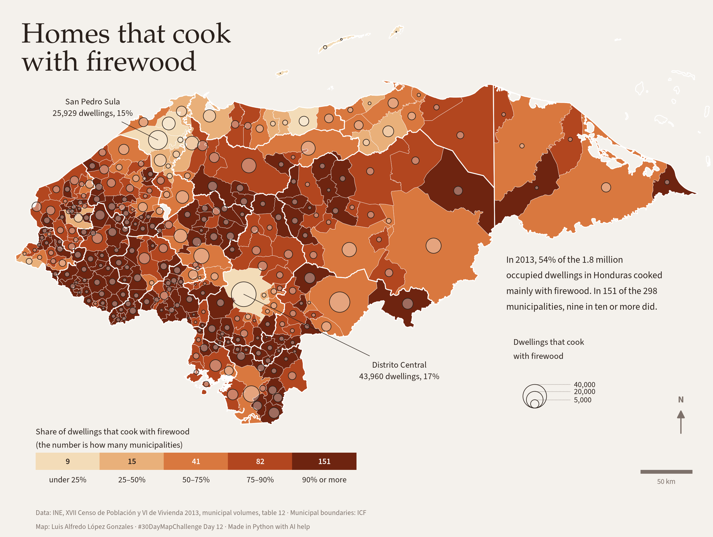

# Homes that cook with firewood

Today's theme is power. In Honduras, the power that cooks dinner in most homes
is firewood. This map shows, for each of the 298 municipalities, the share of
occupied dwellings that cooked mainly with firewood in the 2013 census, and how
many dwellings that share stands for.

The figures come from the municipal volumes of the XVII Population and VI
Housing Census 2013 published by INE, table 12 (*Viviendas particulares
ocupadas, por energía utilizada para cocinar*). The municipal boundaries are
ICF's layer [@icf-limite-municipios], from the ICF GeoServer [@icf-geoserver].

```python
import re
import subprocess
import sys
import unicodedata
from pathlib import Path

import geopandas as gpd
import matplotlib.pyplot as plt
import numpy as np
import pandas as pd
import requests
from matplotlib.lines import Line2D
from matplotlib.patches import Patch

sys.path.append("../..")  # maps/, for the shared scale bar and north arrow
from cartography import add_north_arrow, add_scale_bar

WFS = "https://geoserver.icf.gob.hn/icfpub/wfs"
CRS = 32616  # WGS 84 / UTM zone 16N, the ICF layers' own CRS, in metres


def icf_layer(name: str) -> gpd.GeoDataFrame:
    """Read one layer from the ICF GeoServer, in UTM 16N."""
    return gpd.read_file(
        f"{WFS}?service=WFS&version=2.0.0&request=GetFeature"
        f"&typeNames={name}&outputFormat=application/json"
    ).to_crs(CRS)


municipalities = icf_layer("limite_municipales_gp")
departments = icf_layer("limite_departamentos_gp")
```

## The census tables

INE publishes one PDF per municipality, named `NNN-Department-Municipality.pdf`,
in its WordPress media library. The list comes from the site's media API; the
volumes are the PDFs whose cover says *Censo de Población* 2013.

Table 12 opens with the rows for the country, the department and the
municipality, each followed by its urban and rural rows, so the municipality is
the seventh row with numbers. Reading the PDFs needs `pdftotext` (poppler). The
result is saved as `cooking-2013.csv`, so the map can be redrawn without
downloading the 298 volumes (about 240 MB).

```python
CSV = Path("cooking-2013.csv")
CACHE = Path("tomos")  # the PDFs, not tracked by git
MEDIA = "https://ine.gob.hn/wp-json/wp/v2/media"
COLUMNS = ["total", "firewood", "kerosene", "propane", "electricity", "other", "none"]


def volume_urls() -> list[str]:
    """Every PDF in INE's media library whose name starts with a volume number."""
    urls, page = [], 1
    while True:
        params = {"mime_type": "application/pdf", "per_page": 100, "page": page}
        r = requests.get(MEDIA, params=params | {"_fields": "source_url"}, timeout=60)
        if r.status_code != 200 or not r.json():
            break
        urls += [x["source_url"] for x in r.json()]
        page += 1
    return sorted(u for u in set(urls) if re.search(r"/\d{1,3}-[^/]+\.pdf$", u))


def read_volume(pdf: Path) -> dict | None:
    """The department code and the municipality's row of table 12, or None."""
    text = subprocess.run(
        ["pdftotext", "-layout", str(pdf), "-"], capture_output=True, text=True
    ).stdout
    head = text[:4000]
    if "CENSO DE POBLACI" not in head.upper() or "2013" not in head:
        return None
    code = re.search(r"Municipio\s+(?:del?\s+)?.+?\s*(\d{2})\s*-\s*\d{2}", head)
    start = text.rfind("Cuadro 12:")  # the last one: the first can be the index
    table = text[start : text.find("Cuadro 13:", start)]
    rows = re.findall(r"^\s*(\S.*?)\s{2,}((?:[\d,]+\s+){6}[\d,]+)\s*$", table, re.M)
    name, numbers = rows[6]
    values = [int(n.replace(",", "")) for n in numbers.split()]
    return {"dep": code.group(1), "municipio": name.strip()} | dict(
        zip(COLUMNS, values)
    )


if CSV.exists():
    cooking = pd.read_csv(CSV, dtype={"dep": str})
else:
    CACHE.mkdir(exist_ok=True)
    records = []
    for url in volume_urls():
        pdf = CACHE / url.rsplit("/", 1)[1]
        if not pdf.exists():
            pdf.write_bytes(requests.get(url, timeout=120).content)
        if (row := read_volume(pdf)) is not None:
            records.append(row)
    cooking = pd.DataFrame(records)
    cooking.to_csv(CSV, index=False)
print(f"{len(cooking)} municipalities read")
```

Each volume's cover gives a municipal code, but in 24 volumes that code belongs
to another municipality of the same department. The join uses the department
and the municipality's name in the table instead, written without accents or
spaces; five names are spelled differently in the two sources.

```python
SPELLING = {  # INE's name → ICF's name, both normalised
    "vallecillo": "vallecillos",
    "villedamorales": "ramonvilledamorales",
    "fraternidad": "lafraternidad",
    "guayupe": "guayape",
    "sanpedrodecopan": "sanpedro",
}


def key(name: str) -> str:
    plain = unicodedata.normalize("NFKD", name).encode("ascii", "ignore").decode()
    plain = re.sub(r"[^a-z]", "", plain.lower())
    return SPELLING.get(plain, plain)


cooking["key"] = cooking.dep + cooking.municipio.map(key)
municipalities["key"] = municipalities.cod_muni.str[:2] + municipalities.nombre.map(key)
assert cooking.key.is_unique and set(cooking.key) == set(municipalities.key)
municipalities = municipalities.merge(cooking[["key", *COLUMNS]], on="key")
municipalities["share"] = municipalities.firewood / municipalities.total

total, firewood = cooking.total.sum(), cooking.firewood.sum()
print(f"{total:,} dwellings, {firewood:,} with firewood ({firewood / total:.1%})")
print(f"median municipality: {municipalities.share.median():.0%}")
```

In about 20 volumes the total and the sum of its columns differ by one
dwelling; the sum of the 298 municipalities is 8 dwellings short of the
country's total. Neither changes the map.

The municipalities with the most dwellings that cook with firewood, and the
ones where the share is lowest:

```python
cols = ["nombre", "firewood", "total", "share"]
display(municipalities.nlargest(6, "firewood")[cols].round(2))
display(municipalities.nsmallest(6, "share")[cols].round(2))
```

## The map

Each municipality is coloured by its share of dwellings that cook with
firewood, in five classes. On top, a circle at each municipality has an area
proportional to the number of those dwellings: the colour says how common
firewood is there, the circle says how many homes that is.

```python
PAPER, INK, MUTED, LINE = "#f4f1ec", "#2a211c", "#7d716a", "#ffffff"
CLASSES = [  # lower bound, colour
    (0.00, "#f3dcb8"),
    (0.25, "#e9b07a"),
    (0.50, "#d9783f"),
    (0.75, "#b2461f"),
    (0.90, "#6e2410"),
]
CIRCLES = [40_000, 20_000, 5_000]  # dwellings, for the legend
MAX_SIZE = 900  # marker area in points² for the largest municipality
plt.rcParams["font.family"] = "Source Sans 3"
SERIF = "P052"

x0, y0, x1, y1 = municipalities.total_bounds
xlim, ylim = (x0 - 15e3, x1 + 15e3), (y0 - 110e3, y1 + 25e3)
municipalities["class"] = np.digitize(
    municipalities.share, [lo for lo, _ in CLASSES[1:]]
)
per_class = municipalities["class"].value_counts().reindex(range(5), fill_value=0)
biggest = municipalities.firewood.max()
above90 = (municipalities.share >= 0.9).sum()


def size(n):
    """Marker area (points²) proportional to the number of dwellings."""
    return MAX_SIZE * np.asarray(n) / biggest


def number(n: float, lang: str) -> str:
    """Thousands with a comma in English and a thin space in Spanish."""
    return f"{n:,.0f}".replace(",", " " if lang == "es" else ",")


def pct(p: float, lang: str) -> str:
    """A rounded percentage, with the space Spanish puts before the sign."""
    return f"{p:.0%}".replace("%", "\u202f%" if lang == "es" else "%")


def row(name: str) -> pd.Series:
    return municipalities.loc[municipalities.nombre == name].iloc[0]


capital, sps = row("Distrito Central"), row("San Pedro Sula")

TEXT = {
    "en": {
        "title": "Homes that cook\nwith firewood",
        "subtitle": (
            f"In 2013, {firewood / total:.0%} of the {total / 1e6:.1f} million\n"
            "occupied dwellings in Honduras cooked\n"
            "mainly with firewood. In "
            f"{above90} of the 298\nmunicipalities, nine in ten or more did."
        ),
        "share": "Share of dwellings that cook with firewood\n"
        "(the number is how many municipalities)",
        "classes": ["under 25%", "25–50%", "50–75%", "75–90%", "90% or more"],
        "circles": "Dwellings that cook\nwith firewood",
        "note": "{name}\n{n} dwellings, {p}",
        "credits": (
            "Data: INE, XVII Censo de Población y VI de Vivienda 2013, municipal "
            "volumes, table 12 · Municipal boundaries: ICF\n"
            "Map: Luis Alfredo López Gonzales · #30DayMapChallenge Day 12 · "
            "Made in Python with AI help"
        ),
    },
    "es": {
        "title": "Viviendas que\ncocinan con leña",
        "subtitle": (
            f"En 2013, el {pct(firewood / total, 'es')} de los "
            f"{total / 1e6:.1f} millones\n".replace(".", ",")
            + "de viviendas ocupadas de Honduras cocinaba\n"
            "principalmente con leña. En "
            f"{above90} de los 298\nmunicipios, lo hacían nueve de cada diez o más."
        ),
        "share": "Porcentaje de viviendas que cocinan con leña\n"
        "(el número es cuántos municipios)",
        "classes": [
            "menos de 25\u202f%",
            "25–50\u202f%",
            "50–75\u202f%",
            "75–90\u202f%",
            "90\u202f% o más",
        ],
        "circles": "Viviendas que cocinan\ncon leña",
        "note": "{name}\n{n} viviendas, {p}",
        "credits": (
            "Datos: INE, XVII Censo de Población y VI de Vivienda 2013, tomos "
            "municipales, cuadro 12 · Límites municipales: ICF\n"
            "Mapa: Luis Alfredo López Gonzales · #30DayMapChallenge Día 12 · "
            "Hecho en Python con ayuda de IA"
        ),
    },
}
NOTES = [(capital, (0.56, 0.31)), (sps, (0.13, 0.80))]  # text position, axes fraction


def draw_classes(fig: plt.Figure, text: dict) -> None:
    """A strip with the five classes, each with its number of municipalities."""
    strip = fig.add_axes([0.05, 0.125, 0.45, 0.032])
    for i, (_, col) in enumerate(CLASSES):
        strip.add_patch(plt.Rectangle((i, 0), 1, 1, color=col))
        light = i < 2
        strip.text(
            i + 0.5,
            0.5,
            f"{per_class[i]}",
            ha="center",
            va="center",
            fontsize=10,
            color=INK if light else LINE,
            weight="semibold",
        )
        strip.text(
            i + 0.5,
            -0.25,
            text["classes"][i],
            ha="center",
            va="top",
            fontsize=10,
            color=INK,
        )
    strip.set_xlim(0, 5)
    strip.set_ylim(0, 1)
    strip.set_axis_off()
    strip.set_title(
        text["share"], loc="left", fontsize=10.5, color=INK, pad=6, linespacing=1.15
    )


def draw_circles(ax: plt.Axes, fig: plt.Figure, text: dict, lang: str) -> None:
    """Nested circles sharing a base line, each labelled at its top."""
    base_x, base_y = 0.75, 0.24  # axes fraction
    height_pt = fig.get_figheight() * 72
    for n in CIRCLES:
        r = np.sqrt(size(n)) / 2 / height_pt  # radius as a fraction of the height
        ax.scatter(
            [base_x],
            [base_y + r],
            s=size(n),
            transform=ax.transAxes,
            facecolor="none",
            edgecolor=INK,
            linewidth=0.7,
            zorder=4,
        )
        ax.plot(
            [base_x, base_x + 0.05],
            [base_y + 2 * r] * 2,
            transform=ax.transAxes,
            color=MUTED,
            lw=0.5,
            ls=(0, (1, 1)),
        )
        ax.text(
            base_x + 0.055,
            base_y + 2 * r,
            number(n, lang),
            transform=ax.transAxes,
            fontsize=9.5,
            color=INK,
            va="center",
        )
    ax.text(
        base_x - 0.03,
        base_y + 0.085,
        text["circles"],
        transform=ax.transAxes,
        fontsize=10.5,
        color=INK,
        va="bottom",
        linespacing=1.15,
    )


def draw_map(lang: str) -> plt.Figure:
    """Draw the map with its text in `lang` ("en" or "es")."""
    text = TEXT[lang]
    width = 12
    height = width * (ylim[1] - ylim[0]) / (xlim[1] - xlim[0])
    fig = plt.figure(figsize=(width, height), facecolor=PAPER)
    ax = fig.add_axes([0, 0, 1, 1])
    ax.set_facecolor(PAPER)
    for k, (_, col) in enumerate(CLASSES):
        municipalities[municipalities["class"] == k].plot(
            ax=ax, color=col, edgecolor=LINE, linewidth=0.3
        )
    departments.boundary.plot(ax=ax, color=LINE, linewidth=1.1)

    anchors = municipalities.representative_point()
    order = municipalities.firewood.sort_values(ascending=False).index
    ax.scatter(
        anchors.x[order],
        anchors.y[order],
        s=size(municipalities.firewood[order]),
        facecolor="#ffffff55",
        edgecolor=INK,
        linewidth=0.7,
        zorder=3,
    )
    ax.set_xlim(xlim)
    ax.set_ylim(ylim)
    ax.set_aspect("equal")
    ax.set_axis_off()

    for place, xy in NOTES:
        p = anchors[place.name]
        label = text["note"].format(
            name=place.nombre, n=number(place.firewood, lang), p=pct(place.share, lang)
        )
        ax.annotate(
            label,
            xy=(p.x, p.y),
            xytext=xy,
            textcoords="axes fraction",
            fontsize=10.5,
            color=INK,
            ha="center",
            va="center",
            arrowprops=dict(arrowstyle="-", color=INK, lw=0.6, shrinkA=4, shrinkB=0),
            zorder=5,
        )

    # The title over the Caribbean, the facts in the empty corner to the south-east
    ax.text(
        0.03,
        0.965,
        text["title"],
        transform=ax.transAxes,
        va="top",
        fontsize=34,
        color=INK,
        family=SERIF,
        linespacing=1.0,
    )
    ax.text(
        0.71,
        0.53,
        text["subtitle"],
        transform=ax.transAxes,
        va="top",
        fontsize=11.5,
        color=INK,
        linespacing=1.25,
    )
    draw_classes(fig, text)
    draw_circles(ax, fig, text, lang)

    bar = add_scale_bar(ax, loc="lower right", color=MUTED, share=0.12)
    bar.set_bbox_to_anchor((0.985, 0.075), transform=ax.transAxes)
    add_north_arrow(ax, xy=(0.955, 0.24), color=MUTED, size=0.05)
    ax.text(
        0.05,
        0.015,
        text["credits"],
        transform=ax.transAxes,
        color=MUTED,
        fontsize=8.5,
        linespacing=1.5,
    )
    return fig


for lang in ("en", "es"):
    fig = draw_map(lang)
    fig.savefig(f"day12-power-{lang}.png", dpi=200, facecolor=PAPER)
    plt.close(fig)
```


