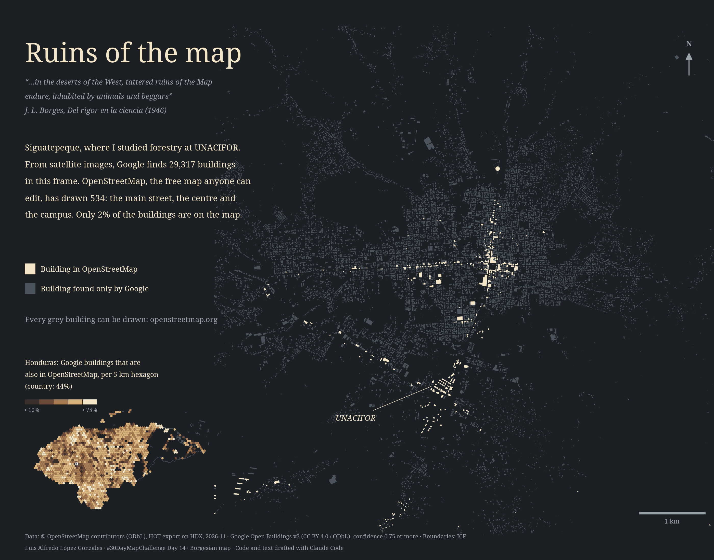

# Ruins of the map

Today's theme is the Borgesian map. In *Del rigor en la ciencia* (1946), Jorge
Luis Borges imagines an empire whose cartographers draw a map the size of the
empire; later generations find it useless and leave it to the weather, and in
the western deserts only tattered ruins of it remain.

OpenStreetMap is the closest thing to that map: a free map drawn building by
building by whoever wants to. This notebook asks how much of it is drawn in
Honduras. The territory is Google Open Buildings v3, every building a model
found in satellite images; the map is every building in OpenStreetMap
[@openstreetmap]. The zoom is Siguatepeque, where I studied forestry at
UNACIFOR.

Data:

- OpenStreetMap buildings for Honduras, from the
  [Humanitarian OpenStreetMap Team export on HDX](https://data.humdata.org/dataset/hotosm_hnd_buildings)
  (GeoParquet, updated weekly; ODbL).
- [Google Open Buildings v3 for Honduras on HDX](https://data.humdata.org/dataset/buildings-google-hnd)
  (footprints with a confidence score; CC BY 4.0 / ODbL).
- Department boundaries from the ICF GeoServer [@icf-limite-departamentos],
  for the outline of the country.

The two building files are about 450 MB together. They are downloaded to a
temporary folder that is deleted at the end of the notebook.

```python
import shutil
import subprocess
import sys
import tempfile
import zipfile
from pathlib import Path

import geopandas as gpd
import matplotlib.pyplot as plt
import numpy as np
import pandas as pd
import pyogrio
import shapely
from matplotlib.colors import BoundaryNorm, ListedColormap
from matplotlib.patches import RegularPolygon
from pyproj import Transformer

sys.path.append("../..")  # maps/, for the shared scale bar and north arrow
from cartography import add_north_arrow, add_scale_bar

CRS = 32616  # WGS 84 / UTM zone 16N, in metres
OSM_URL = (
    "https://production-raw-data-api.s3.amazonaws.com/ISO3/HND/_layers/osm/"
    "buildings.parquet"
)
GOOGLE_URL = (
    "https://data.humdata.org/dataset/f9c2e8ce-41b1-4aca-844b-7f80a3b45a3f/"
    "resource/8838016f-a860-4327-b554-06142d770d4d/download/hnd_buildings.gdb.zip"
)
DEPARTMENTS_URL = (
    "https://geoserver.icf.gob.hn/icfpub/wfs?service=WFS&version=2.0.0"
    "&request=GetFeature&typeNames=limite_departamentos_gp"
    "&outputFormat=application/json"
)

work = Path(tempfile.mkdtemp())
osm_file, google_zip = work / "osm_buildings.parquet", work / "hnd_buildings.gdb.zip"
for url, path in ((OSM_URL, osm_file), (GOOGLE_URL, google_zip)):
    subprocess.run(["curl", "-sSL", "-o", str(path), url], check=True)
google_gdb = work / "hnd_buildings.gdb"  # the zip holds the folder's files
with zipfile.ZipFile(google_zip) as z:
    z.extractall(google_gdb)
for path in (osm_file, google_zip):
    print(f"{path.name}: {path.stat().st_size / 1e6:.0f} MB")
```

## The territory and the map

Google gives each footprint a confidence between 0.65 and 1; only those of
0.75 or more are kept, which drops most false positives (rocks, sheds,
shadows) at the cost of some small houses. Each Google building is reduced to
its centroid.

```python
CONFIDENCE = 0.75
to_utm = Transformer.from_crs(4326, CRS, always_xy=True)

google = pyogrio.read_dataframe(google_gdb, columns=["confidence"], use_arrow=True)
print(f"Google buildings: {len(google):,}")
google = google[google["confidence"] >= CONFIDENCE]
centroids = shapely.centroid(google.geometry.values)
gx, gy = to_utm.transform(shapely.get_x(centroids), shapely.get_y(centroids))
print(f"  with confidence ≥ {CONFIDENCE}: {len(google):,}")

osm = pd.read_parquet(osm_file, columns=["name", "geom"])
osm_geom = shapely.from_wkb(osm["geom"].values)
osm_geom = shapely.transform(
    osm_geom, lambda c: np.column_stack(to_utm.transform(c[:, 0], c[:, 1]))
)
print(f"OpenStreetMap buildings: {len(osm):,}")
```

## Which Google buildings are on the map

Counting polygons would mislead: in some towns OpenStreetMap draws a whole
block as one building, and Google splits it into houses. So the measure is per
Google building: it is on the map if an OpenStreetMap building lies within
3 m of its centroid, which allows for small shifts between the imagery each
source traced.

```python
tree = shapely.STRtree(osm_geom)
points = shapely.points(gx, gy)
found, _ = tree.query_nearest(points, max_distance=3, return_distance=True)
on_map = np.zeros(len(points), bool)
on_map[found[0]] = True
print(f"Google buildings with an OSM building: {on_map.mean():.0%}")
```

## The country in hexagons

Honduras is split into hexagons of 5 km a side, and each one gets the share
of its Google buildings that are on the map. Hexagons with fewer than 20
Google buildings are left out, since a share of a handful says little.

```python
SIDE = 5_000  # hexagon side, m
MIN_BUILDINGS = 20


def hex_cell(x: np.ndarray, y: np.ndarray, side: float) -> tuple:
    """Axial coordinates (q, r) of the pointy-top hexagon holding each point."""
    q = (np.sqrt(3) / 3 * x - y / 3) / side
    r = (2 / 3 * y) / side
    s = -q - r
    rq, rr, rs = np.round(q), np.round(r), np.round(s)
    dq, dr, ds = abs(rq - q), abs(rr - r), abs(rs - s)
    fix_q = (dq > dr) & (dq > ds)
    fix_r = ~fix_q & (dr > ds)
    rq[fix_q] = (-rr - rs)[fix_q]
    rr[fix_r] = (-rq - rs)[fix_r]
    return rq.astype(int), rr.astype(int)


q, r = hex_cell(np.asarray(gx), np.asarray(gy), SIDE)
hexes = (
    pd.DataFrame({"q": q, "r": r, "on_map": on_map})
    .groupby(["q", "r"])["on_map"]
    .agg(["size", "mean"])
    .rename(columns={"size": "google", "mean": "share"})
    .reset_index()
)
hexes = hexes[hexes["google"] >= MIN_BUILDINGS]
hexes["x"] = SIDE * np.sqrt(3) * (hexes["q"] + hexes["r"] / 2)
hexes["y"] = SIDE * 1.5 * hexes["r"]
print(f"{len(hexes):,} hexagons with {MIN_BUILDINGS}+ Google buildings")
print(f"  above 90% on the map: {(hexes['share'] > 0.9).sum()}")
print(f"  below 10%: {(hexes['share'] < 0.1).sum()}")

departments = gpd.read_file(DEPARTMENTS_URL).to_crs(CRS)
country = departments.union_all()
```

## Siguatepeque

The zoom is a frame of about 7.5 by 7.7 km around the city. Here the
footprints themselves are drawn: every Google building, and on top of it
every OpenStreetMap building.

```python
FRAME = (-87.87, 14.56, -87.80, 14.63)  # lon/lat
fx0, fy0 = to_utm.transform(FRAME[0], FRAME[1])
fx1, fy1 = to_utm.transform(FRAME[2], FRAME[3])
frame = shapely.box(fx0, fy0, fx1, fy1)

google_city = pyogrio.read_dataframe(google_gdb, bbox=FRAME, use_arrow=True)
google_city = google_city[google_city["confidence"] >= CONFIDENCE].to_crs(CRS)
google_city = google_city[google_city.intersects(frame)]
in_frame = shapely.contains_xy(frame, gx, gy)

osm_city = gpd.GeoDataFrame(
    {"name": osm["name"].values}, geometry=osm_geom, crs=CRS
).iloc[tree.query(frame, predicate="intersects")]

city_google, city_share = in_frame.sum(), on_map[in_frame].mean()
print(f"Google buildings in the frame: {city_google:,}")
print(f"OSM buildings in the frame: {len(osm_city):,}")
print(f"Google buildings with an OSM building: {city_share:.1%}")

campus = osm_city[osm_city["name"].isin(["Rectoria", "Cafeteria UNACIFOR"])]
campus_xy = campus.union_all().centroid
```

## The map

The Google footprints are drawn faint, as the territory nobody has traced
yet; the OpenStreetMap buildings are drawn in light ink over them. In
Siguatepeque the map is a few shreds: the main street, the centre and the
UNACIFOR campus. The inset places it in the country.

```python
plt.rcParams["font.family"] = "Noto Serif"
NIGHT, GHOST, INK, MUTED = "#1c2024", "#4b545c", "#f3e6c8", "#9aa3aa"
SHARE_COLORS = ["#3a2f2a", "#6b4a3a", "#a87a52", "#d9b27c", "#f3e6c8"]
SHARE_BANDS = [0, 0.1, 0.25, 0.5, 0.75, 1.0001]


def pct(x: float, lang: str) -> str:
    """A share as a whole percentage; Spanish puts a space before the sign."""
    return f"{x:.0%}".replace("%", " %") if lang == "es" else f"{x:.0%}"


def number(n: int, lang: str) -> str:
    """Thousands separated by a comma (en) or a space (es)."""
    s = f"{n:,}"
    return s.replace(",", " ") if lang == "es" else s


TEXT = {
    "en": {
        "title": "Ruins of the map",
        "quote": (
            "“…in the deserts of the West, tattered ruins of the Map\n"
            "endure, inhabited by animals and beggars”\n"
            "J. L. Borges, Del rigor en la ciencia (1946)"
        ),
        "story": (
            "Siguatepeque, where I studied forestry at UNACIFOR.\n"
            "From satellite images, Google finds {google} buildings\n"
            "in this frame. OpenStreetMap, the free map anyone can\n"
            "edit, has drawn {osm}: the main street, the centre and\n"
            "the campus. Only {share} of the buildings are on the map."
        ),
        "on_map": "Building in OpenStreetMap",
        "ghost": "Building found only by Google",
        "inset": (
            "Honduras: Google buildings that are\n"
            "also in OpenStreetMap, per 5 km hexagon\n"
            "(country: {national})"
        ),
        "bands": ["< 10%", "10-25%", "25-50%", "50-75%", "> 75%"],
        "campus": "UNACIFOR",
        "invite": "Every grey building can be drawn: openstreetmap.org",
        "credits": (
            "Data: © OpenStreetMap contributors (ODbL), HOT export on HDX, "
            "2026-11 · Google Open Buildings v3 (CC BY 4.0 / ODbL), "
            "confidence 0.75 or more · Boundaries: ICF\n"
            "Luis Alfredo López Gonzales · #30DayMapChallenge Day 14 · "
            "Borgesian map · Code and text drafted with Claude Code"
        ),
    },
    "es": {
        "title": "Ruinas del mapa",
        "quote": (
            "“…en los desiertos del Oeste perduran despedazadas Ruinas\n"
            "del Mapa, habitadas por Animales y por Mendigos”\n"
            "J. L. Borges, Del rigor en la ciencia (1946)"
        ),
        "story": (
            "Siguatepeque, donde estudié en la UNACIFOR.\n"
            "En imágenes de satélite, Google encuentra {google}\n"
            "edificios en este recuadro. OpenStreetMap, el mapa libre\n"
            "que cualquiera puede editar, ha dibujado {osm}: la calle\n"
            "principal, el centro y el campus. Solo el {share} de los\n"
            "edificios está en el mapa."
        ),
        "on_map": "Edificio en OpenStreetMap",
        "ghost": "Edificio que solo encuentra Google",
        "inset": (
            "Honduras: edificios de Google que también\n"
            "están en OpenStreetMap, por hexágono de 5 km\n"
            "(país: {national})"
        ),
        "bands": ["< 10%", "10-25%", "25-50%", "50-75%", "> 75%"],
        "campus": "UNACIFOR",
        "invite": "Cada edificio gris se puede dibujar: openstreetmap.org",
        "credits": (
            "Datos: © colaboradores de OpenStreetMap (ODbL), exportación de HOT "
            "en HDX, 2026-11 · Google Open Buildings v3 (CC BY 4.0 / ODbL), "
            "confianza de 0,75 o más · Límites: ICF\n"
            "Luis Alfredo López Gonzales · #30DayMapChallenge Día 14 · "
            "Borgesian map · Código y texto redactados con Claude Code"
        ),
    },
}


def draw_inset(fig: plt.Figure, text: dict, lang: str) -> None:
    """Honduras in hexagons coloured by the share on the map, Siguatepeque marked."""
    ax = fig.add_axes([0.035, 0.07, 0.27, 0.22])
    ax.set_facecolor("none")
    gpd.GeoSeries([country], crs=CRS).plot(
        ax=ax, facecolor="none", edgecolor=GHOST, linewidth=0.5
    )
    band = np.digitize(hexes["share"], SHARE_BANDS[1:-1])
    for (x, y), b in zip(hexes[["x", "y"]].values, band):
        ax.add_patch(
            RegularPolygon(
                (x, y), 6, radius=SIDE * 0.98, facecolor=SHARE_COLORS[b], lw=0
            )
        )
    ax.add_patch(
        plt.Rectangle(
            (fx0, fy0),
            fx1 - fx0,
            fy1 - fy0,
            facecolor="none",
            edgecolor="white",
            linewidth=1.2,
            zorder=3,
        )
    )
    ax.set_aspect("equal")
    ax.set_axis_off()
    ax.autoscale_view()
    ax.text(
        0.0,
        1.1,
        text["inset"].format(national=pct(on_map.mean(), lang)),
        transform=ax.transAxes,
        color=INK,
        fontsize=9.5,
        va="bottom",
        linespacing=1.3,
    )
    for i, (color, label) in enumerate(zip(SHARE_COLORS, text["bands"])):
        ax.add_patch(
            plt.Rectangle(
                (i * 0.075, 1.0),
                0.07,
                0.04,
                transform=ax.transAxes,
                color=color,
                clip_on=False,
            )
        )
        if i in (0, 4):
            ax.text(
                0.035 + i * 0.075,
                0.98,
                label,
                transform=ax.transAxes,
                color=MUTED,
                fontsize=7.5,
                ha="center",
                va="top",
            )


def draw_map(lang: str) -> plt.Figure:
    """Draw the map with its text in `lang` ("en" or "es")."""
    text = TEXT[lang]
    fig = plt.figure(figsize=(14, 11), facecolor=NIGHT)
    ax = fig.add_axes([0.3, 0.0, 0.7, 1.0])
    ax.set_facecolor(NIGHT)
    google_city.plot(ax=ax, color=GHOST, linewidth=0, zorder=1)
    osm_city.plot(ax=ax, color=INK, edgecolor=INK, linewidth=0.3, zorder=2)
    ax.set_xlim(fx0, fx1)
    ax.set_ylim(fy0, fy1)
    ax.set_aspect("equal")
    ax.set_axis_off()

    ax.annotate(
        text["campus"],
        xy=(campus_xy.x, campus_xy.y),
        xytext=(campus_xy.x - 900, campus_xy.y - 500),
        color=INK,
        fontsize=11,
        style="italic",
        ha="right",
        va="center",
        arrowprops=dict(arrowstyle="-", color=INK, lw=0.6, shrinkB=6),
        zorder=4,
    )

    fig.text(0.035, 0.94, text["title"], color=INK, fontsize=38, va="top")
    fig.text(
        0.035,
        0.865,
        text["quote"],
        color=MUTED,
        fontsize=10.5,
        style="italic",
        va="top",
        linespacing=1.4,
    )
    fig.text(
        0.035,
        0.75,
        text["story"].format(
            google=number(int(city_google), lang),
            osm=number(len(osm_city), lang),
            share=pct(city_share, lang),
        ),
        color=INK,
        fontsize=12,
        va="top",
        linespacing=1.45,
    )
    for i, (color, label) in enumerate(((INK, text["on_map"]), (GHOST, text["ghost"]))):
        y = 0.52 - i * 0.035
        fig.patches.append(
            plt.Rectangle(
                (0.035, y - 0.009),
                0.014,
                0.018,
                transform=fig.transFigure,
                color=color,
            )
        )
        fig.text(0.057, y, label, color=INK, fontsize=10.5, va="center")
    fig.text(0.035, 0.43, text["invite"], color=MUTED, fontsize=10.5, va="center")

    draw_inset(fig, text, lang)
    add_scale_bar(ax, loc="lower right", color=MUTED, share=0.15)
    add_north_arrow(ax, xy=(0.95, 0.95), color=MUTED, size=0.05)
    fig.text(
        0.035, 0.018, text["credits"], color=MUTED, fontsize=8, linespacing=1.5
    )
    return fig


for lang in ("en", "es"):
    fig = draw_map(lang)
    fig.savefig(f"day14-borgesian-{lang}.png", dpi=200, facecolor=NIGHT)
    plt.close(fig)

shutil.rmtree(work)  # the downloads, about 1 GB unzipped
```


