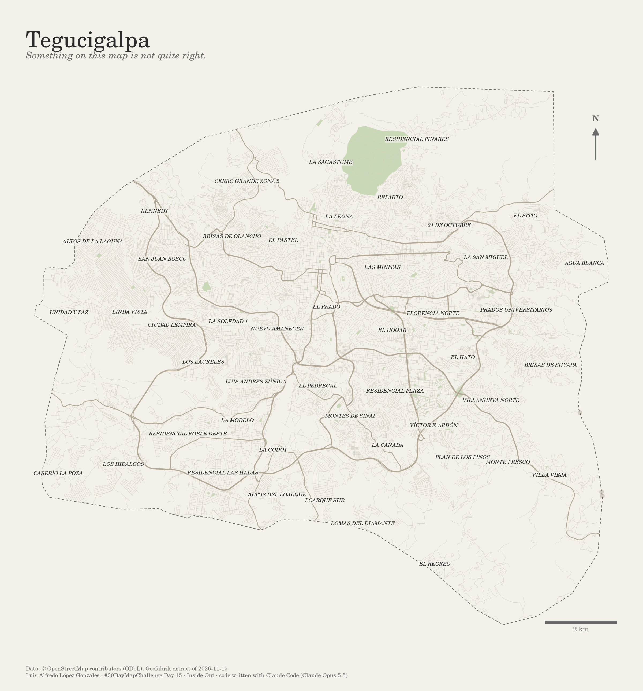

# Tegucigalpa, one neighbourhood out of place

Today's theme says: *"Something on this map is not quite right."* This map of
Tegucigalpa looks like any street map with its neighbourhood names, but one of
them is in the wrong place: Colonia Kennedy, in the south-east of the city, is
labelled at the opposite end. Every other name sits where OpenStreetMap puts
it.

Streets, parks, neighbourhood names and the city's boundary come from
OpenStreetMap [@openstreetmap], read from the Geofabrik extract of Honduras
[@geofabrik-honduras].

```python
import shutil
import subprocess
import sys
import tempfile
from pathlib import Path

import geopandas as gpd
import matplotlib.pyplot as plt
import numpy as np
import shapely

sys.path.append("../..")  # maps/, for the shared scale bar and north arrow
from cartography import add_north_arrow, add_scale_bar

CRS = 32616  # WGS 84 / UTM zone 16N, in metres
PBF_URL = "https://download.geofabrik.de/central-america/honduras-latest.osm.pbf"

work = Path(tempfile.mkdtemp())
pbf = work / "honduras.osm.pbf"
subprocess.run(["curl", "-sSL", "-o", str(pbf), PBF_URL], check=True)
print(f"OSM extract: {pbf.stat().st_size / 1e6:.0f} MB")
```

## The city

OpenStreetMap maps Tegucigalpa as a city boundary (`admin_level` 7) inside the
Distrito Central municipality: the urban area, without the municipality's
rural villages.

```python
city = gpd.read_file(
    pbf, layer="multipolygons", where="name = 'Tegucigalpa' AND admin_level = '7'"
).to_crs(CRS)
area = city.geometry.iloc[0]
bbox = tuple(city.to_crs(4326).total_bounds)

lines = gpd.read_file(pbf, layer="lines", bbox=bbox, columns=["highway"]).to_crs(CRS)
streets = lines[lines["highway"].notna()].clip(area)
MAIN = ["trunk", "primary", "secondary"]
main_roads = streets[streets["highway"].isin(MAIN)]

polygons = gpd.read_file(
    pbf, layer="multipolygons", bbox=bbox, columns=["leisure", "other_tags"]
).to_crs(CRS)
parks = polygons[polygons["leisure"].isin(["park", "nature_reserve"])].clip(area)
print(f"Tegucigalpa: {area.area / 1e6:.0f} km², {len(streets):,} street ways")
```

## The neighbourhood names

OpenStreetMap marks a neighbourhood's name with a point tagged
`place=neighbourhood` or `place=suburb`. There are more than a map can label,
so names are kept from the largest place type down, skipping any closer than
1.2 km to one already kept.

```python
points = gpd.read_file(pbf, layer="points", bbox=bbox, columns=["name", "place"])
places = points[
    points["place"].isin(["suburb", "neighbourhood"]) & points["name"].notna()
].to_crs(CRS)
places = places[places.within(area)]
print(places["place"].value_counts().to_string())

kennedy = places[places["name"].str.contains("Kennedy", case=False)]
print(kennedy[["name", "place"]].to_string())
```

## Moving Colonia Kennedy

The Kennedy label is sent to the other end of the city: along the line from the
real neighbourhood through the centre of the city, to 85% of the way between
the centre and the city's edge.

```python
real = kennedy.geometry.iloc[0]
centre = area.centroid
direction = np.array([centre.x - real.x, centre.y - real.y])
direction /= np.linalg.norm(direction)
origin = np.array(centre.coords[0])
ray = shapely.LineString([origin, origin + direction * 30_000])
crossings = shapely.get_parts(ray.intersection(area.boundary))
reach = min(centre.distance(p) for p in crossings)
fake = shapely.Point(origin + direction * 0.85 * reach)
print(f"Moved {real.distance(fake) / 1_000:.1f} km")

SPACING = 1_200  # metres between kept labels
kept = [("Kennedy", fake)]
order = places.assign(rank=places["place"].map({"suburb": 0, "neighbourhood": 1}))
for name, geom in order.sort_values("rank")[["name", "geometry"]].itertuples(
    index=False
):
    if "Kennedy" in name:
        continue
    if all(geom.distance(g) >= SPACING for _, g in kept):
        kept.append((name, geom))
print(f"{len(kept)} names on the map")
```

## The map

```python
plt.rcParams["font.family"] = "C059"
BG, INK, INK_2, STREET, MAIN_ROAD, PARK = (
    "#f4f1ea",
    "#2b2b2b",
    "#6b6b6b",
    "#d4cec2",
    "#b3a996",
    "#c9d8b6",
)

TEXT = {
    "en": {
        "title": "Tegucigalpa",
        "subtitle": "Something on this map is not quite right.",
        "credits": (
            "Data: © OpenStreetMap contributors (ODbL), Geofabrik extract of "
            "2026-11-15\n"
            "Luis Alfredo López Gonzales · #30DayMapChallenge Day 15 · Inside "
            "Out · code written with Claude Code (Claude Opus 5.5)"
        ),
    },
    "es": {
        "title": "Tegucigalpa",
        "subtitle": "Algo en este mapa no está del todo bien.",
        "credits": (
            "Datos: © colaboradores de OpenStreetMap (ODbL), extracto de "
            "Geofabrik del 2026-11-15\n"
            "Luis Alfredo López Gonzales · #30DayMapChallenge Día 15 · Inside "
            "Out · código escrito con Claude Code (Claude Opus 5.5)"
        ),
    },
}


def label(name: str) -> str:
    """Neighbourhood name as printed: no "Colonia"/"Barrio" prefix, upper case."""
    for prefix in ("Colonia ", "Col. ", "Barrio "):
        name = name.removeprefix(prefix)
    return name.upper()


def draw_map(lang: str) -> plt.Figure:
    """Draw the map with its text in `lang` ("en" or "es")."""
    text = TEXT[lang]
    xmin, ymin, xmax, ymax = area.buffer(500).bounds
    width = 12
    fig = plt.figure(
        figsize=(width, width * (ymax - ymin) / (xmax - xmin) + 1.6), facecolor=BG
    )
    ax = fig.add_axes([0, 0.07, 1, 0.83])
    ax.set_facecolor(BG)
    parks.plot(ax=ax, color=PARK, linewidth=0, zorder=1)
    streets.plot(ax=ax, color=STREET, linewidth=0.3, zorder=2)
    main_roads.plot(ax=ax, color=MAIN_ROAD, linewidth=1.0, zorder=3)
    gpd.GeoSeries([area], crs=CRS).boundary.plot(
        ax=ax, color=INK_2, linewidth=0.8, linestyle=(0, (4, 3)), zorder=4
    )
    for name, geom in kept:
        ax.text(
            geom.x,
            geom.y,
            label(name),
            fontsize=7,
            color=INK,
            ha="center",
            va="center",
            style="italic",
            zorder=5,
            bbox={"facecolor": BG, "edgecolor": "none", "alpha": 0.7, "pad": 0.6},
        )
    ax.set_xlim(xmin, xmax)
    ax.set_ylim(ymin, ymax)
    ax.set_aspect("equal")
    ax.set_axis_off()

    add_scale_bar(ax, loc="lower right", color=INK_2)
    add_north_arrow(ax, color=INK_2)

    fig.text(0.04, 0.955, text["title"], fontsize=30, color=INK, va="top")
    fig.text(0.04, 0.915, text["subtitle"], fontsize=13, color=INK_2, style="italic")
    fig.text(0.04, 0.02, text["credits"], fontsize=7.5, color=INK_2)
    return fig


for lang in ("en", "es"):
    fig = draw_map(lang)
    fig.savefig(f"day15-inside-out-{lang}.png", dpi=200, facecolor=BG)
    plt.close(fig)

shutil.rmtree(work)  # the downloaded OSM extract
```



## References

::: {#refs}
:::
