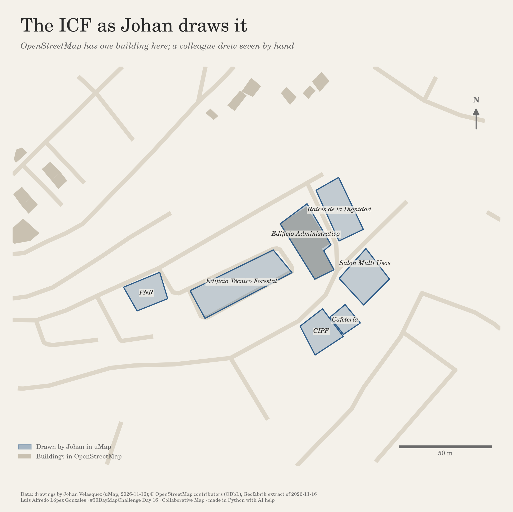

# The ICF as a colleague draws it

Today's theme says: *"Do a map with a friend, colleague or a stranger. AI
doesn't count as a friend."*

I made a map in uMap, centred on the ICF offices in Tegucigalpa, and sent its
edit link to Johan, a colleague. From his phone, he drew by hand the buildings
of the compound he knows and named them. His layer was exported from uMap as
GeoJSON (`collaborative-map.geojson`).

The buildings, streets and paths around them come from OpenStreetMap
[@openstreetmap], read from the Geofabrik extract of Honduras
[@geofabrik-honduras].

```python
import shutil
import subprocess
import sys
import tempfile
from pathlib import Path

import geopandas as gpd
import matplotlib.pyplot as plt

sys.path.append("../..")  # maps/, for the shared scale bar and north arrow
from cartography import add_north_arrow, add_scale_bar

CRS = 32616  # WGS 84 / UTM zone 16N, in metres
PBF_URL = "https://download.geofabrik.de/central-america/honduras-latest.osm.pbf"

work = Path(tempfile.mkdtemp())
pbf = work / "honduras.osm.pbf"
subprocess.run(["curl", "-sSL", "-o", str(pbf), PBF_URL], check=True)
print(f"OSM extract: {pbf.stat().st_size / 1e6:.0f} MB")
```

## Johan's drawings

Seven polygons. The first one he drew has no name in the export: it is the
CIPF (the ICF's forest research centre), which he named only in the layer.

```python
johan = gpd.read_file("collaborative-map.geojson").to_crs(CRS)
johan["name"] = johan["name"].fillna("CIPF")
johan["area_m2"] = johan.area.round()
johan[["name", "area_m2"]]
```

## What OpenStreetMap has there

```python
view = johan.union_all().envelope.buffer(60)
bbox = tuple(gpd.GeoSeries([view], crs=CRS).to_crs(4326).total_bounds)

polygons = gpd.read_file(
    pbf, layer="multipolygons", bbox=bbox, columns=["name", "building"]
).to_crs(CRS)
buildings = polygons[polygons["building"].notna()].clip(view)

lines = gpd.read_file(pbf, layer="lines", bbox=bbox, columns=["highway"]).to_crs(CRS)
streets = lines[lines["highway"].notna()].clip(view)
print(f"{len(buildings)} OSM buildings in the view")
```

For each of Johan's buildings, the share of it that an OSM building covers:

```python
osm = buildings.union_all()
johan["in_osm"] = (johan.intersection(osm).area / johan.area).round(2)
johan[["name", "in_osm"]]
```

Only his *Edificio Administrativo* is in OpenStreetMap, as the one building
tagged *Instituto de Conservación Forestal*. The other six are not mapped.

## The map

```python
plt.rcParams["font.family"] = "C059"
BG, INK, INK_2, STREET, BUILDING, JOHAN = (
    "#f4f1ea",
    "#2b2b2b",
    "#6b6b6b",
    "#ddd6c8",
    "#c9c1b1",
    "#2f5d8a",
)

TEXT = {
    "en": {
        "title": "The ICF as Johan draws it",
        "subtitle": (
            "OpenStreetMap has one building here; a colleague drew seven by hand"
        ),
        "legend_johan": "Drawn by Johan in uMap",
        "legend_osm": "Buildings in OpenStreetMap",
        "credits": (
            "Data: drawings by Johan Velasquez (uMap, 2026-11-16); © OpenStreetMap "
            "contributors (ODbL), Geofabrik extract of 2026-11-16\n"
            "Luis Alfredo López Gonzales · #30DayMapChallenge Day 16 · "
            "Collaborative Map · made in Python with AI help"
        ),
    },
    "es": {
        "title": "El ICF según Johan",
        "subtitle": (
            "OpenStreetMap tiene un edificio aquí; un colega dibujó siete a mano"
        ),
        "legend_johan": "Dibujado por Johan Velasquez en uMap",
        "legend_osm": "Edificios en OpenStreetMap",
        "credits": (
            "Datos: dibujos de Johan (uMap, 2026-11-16); © colaboradores de "
            "OpenStreetMap (ODbL), extracto de Geofabrik del 2026-11-16\n"
            "Luis Alfredo López Gonzales · #30DayMapChallenge Día 16 · "
            "Collaborative Map · hecho en Python con ayuda de IA"
        ),
    },
}


def draw_map(lang: str) -> plt.Figure:
    """Draw the map with its text in `lang` ("en" or "es")."""
    text = TEXT[lang]
    xmin, ymin, xmax, ymax = view.bounds
    width = 10
    fig = plt.figure(
        figsize=(width, width * (ymax - ymin) / (xmax - xmin) + 1.8), facecolor=BG
    )
    ax = fig.add_axes([0, 0.09, 1, 0.78])
    ax.set_facecolor(BG)
    streets.plot(ax=ax, color=STREET, linewidth=6, zorder=1)
    buildings.plot(ax=ax, color=BUILDING, linewidth=0, zorder=2)
    johan.plot(ax=ax, facecolor=JOHAN, alpha=0.25, edgecolor="none", zorder=3)
    johan.boundary.plot(ax=ax, color=JOHAN, linewidth=1.6, zorder=4)
    for name, geom in zip(johan["name"], johan.geometry):
        p = geom.representative_point()
        ax.text(
            p.x,
            p.y,
            name,
            fontsize=9,
            color=INK,
            ha="center",
            va="center",
            style="italic",
            wrap=True,
            zorder=5,
            bbox={"facecolor": BG, "edgecolor": "none", "alpha": 0.75, "pad": 0.8},
        )
    ax.set_xlim(xmin, xmax)
    ax.set_ylim(ymin, ymax)
    ax.set_aspect("equal")
    ax.set_axis_off()

    add_scale_bar(ax, loc="lower right", color=INK_2)
    add_north_arrow(ax, color=INK_2)

    handles = [
        plt.Rectangle((0, 0), 1, 1, facecolor=JOHAN, alpha=0.4, edgecolor=JOHAN),
        plt.Rectangle((0, 0), 1, 1, facecolor=BUILDING, edgecolor="none"),
    ]
    ax.legend(
        handles,
        [text["legend_johan"], text["legend_osm"]],
        loc="lower left",
        frameon=False,
        fontsize=9,
        labelcolor=INK_2,
    )

    fig.text(0.04, 0.965, text["title"], fontsize=26, color=INK, va="top")
    fig.text(0.04, 0.905, text["subtitle"], fontsize=12, color=INK_2, style="italic")
    fig.text(0.04, 0.02, text["credits"], fontsize=7, color=INK_2)
    return fig


for lang in ("en", "es"):
    fig = draw_map(lang)
    fig.savefig(f"day16-collaborative-map-{lang}.png", dpi=200, facecolor=BG)
    plt.close(fig)

shutil.rmtree(work)  # the downloaded OSM extract
```



## References

::: {#refs}
:::
