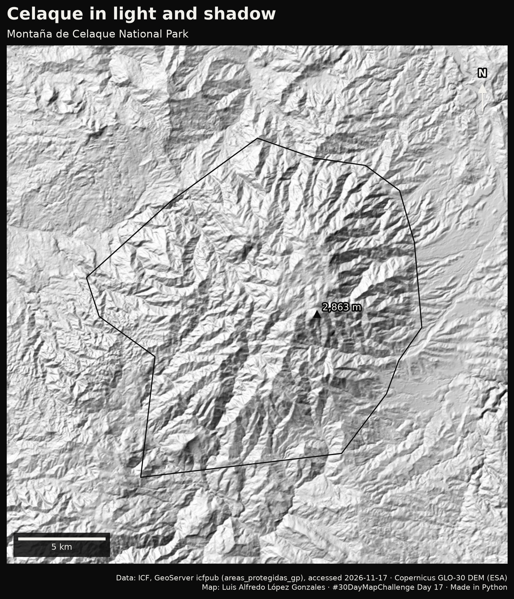
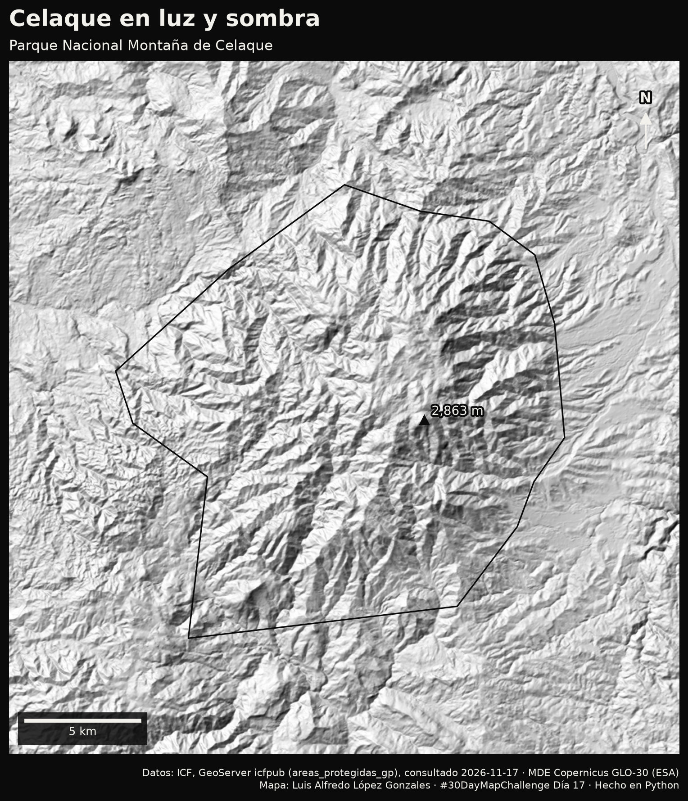

# Celaque in light and shadow

Today's theme: *"Play with visual effects. What can you map with just light and
shadows?"*

**Montaña de Celaque National Park**, in western Honduras, holds the highest
point of the country. Its boundary and zones come from ICF's protected areas
layer [@icf-areas-protegidas]; the terrain is the Copernicus GLO-30 elevation
model [@copernicus-dem], read straight from its public bucket and reprojected
to UTM at 30 m.

```python
import subprocess
import sys
import tempfile
from pathlib import Path

import geopandas as gpd
import matplotlib.pyplot as plt
from matplotlib import patheffects
from matplotlib.colors import LightSource
import numpy as np
import rasterio

sys.path.append("../..")  # maps/, for the shared scale bar and north arrow
from cartography import add_north_arrow, add_scale_bar

WFS = "https://geoserver.icf.gob.hn/icfpub/wfs"
CRS = 32616  # WGS 84 / UTM zone 16N, in metres
TILE = "Copernicus_DSM_COG_10_N14_00_W089_00_DEM"
BUCKET = "/vsicurl/https://copernicus-dem-30m.s3.amazonaws.com"
CELL, MARGIN = 30, 5_000

url = (
    f"{WFS}?service=WFS&version=2.0.0&request=GetFeature"
    "&typeNames=areas_protegidas_gp&outputFormat=application/json"
)
protected = gpd.read_file(url).to_crs(CRS)
celaque = protected[protected.nomb_ap == "Montaña de Celaque"]

xmin, ymin, xmax, ymax = celaque.total_bounds
extent = [round(v, -3) for v in (xmin - MARGIN, ymin - MARGIN, xmax + MARGIN, ymax + MARGIN)]
dem_path = Path(tempfile.mkdtemp()) / "dem.tif"
subprocess.run(
    ["gdalwarp", "-q", "-t_srs", f"EPSG:{CRS}", "-tr", str(CELL), str(CELL)]
    + ["-te", *map(str, extent), "-r", "bilinear", f"{BUCKET}/{TILE}/{TILE}.tif", str(dem_path)],
    check=True,
)
with rasterio.open(dem_path) as src:
    dem = src.read(1)
print(f"DEM: {dem.shape[1]} x {dem.shape[0]} cells, {dem.min():.0f} to {dem.max():.0f} m")
```

## Light from one side

A hillshade lights the terrain from a single sun, here from the north-west and
45° above the horizon, the usual choice for maps (light from the top left reads
as relief, not as a mould). Slopes facing it turn bright, slopes facing away
turn dark; nothing else is drawn.

The model is a *surface* model, so its highest cell includes the tree tops:
it reads a few metres above the summit's official height.

```python
shade = LightSource(azdeg=315, altdeg=45).hillshade(dem, vert_exag=1.5, dx=CELL, dy=CELL)
peak_row, peak_col = np.unravel_index(dem.argmax(), dem.shape)
peak_x = extent[0] + (peak_col + 0.5) * CELL
peak_y = extent[3] - (peak_row + 0.5) * CELL

TEXT = {
    "en": {
        "title": "Celaque in light and shadow",
        "park": "Montaña de Celaque National Park",
        "peak": f"{dem.max():,.0f} m",
        "credits": "Data: ICF, GeoServer icfpub (areas_protegidas_gp), accessed 2026-11-17 · "
        "Copernicus GLO-30 DEM (ESA)\nMap: Luis Alfredo López Gonzales · "
        "#30DayMapChallenge Day 17 · Made in Python",
    },
    "es": {
        "title": "Celaque en luz y sombra",
        "park": "Parque Nacional Montaña de Celaque",
        "peak": f"{dem.max():,.0f} m",
        "credits": "Datos: ICF, GeoServer icfpub (areas_protegidas_gp), consultado 2026-11-17 · "
        "MDE Copernicus GLO-30 (ESA)\nMapa: Luis Alfredo López Gonzales · "
        "#30DayMapChallenge Día 17 · Hecho en Python",
    },
}
DARK, LIGHT = "#0b0b0b", "#f2f1ec"
HALO = [patheffects.withStroke(linewidth=3, foreground=DARK)]

for lang, text in TEXT.items():
    fig, ax = plt.subplots(figsize=(10, 10), facecolor=DARK)
    ax.imshow(shade, cmap="gray", extent=[extent[0], extent[2], extent[1], extent[3]])
    celaque.dissolve().boundary.plot(ax=ax, color=DARK, linewidth=1.2)
    ax.plot(peak_x, peak_y, marker="^", color=DARK, markersize=7)
    ax.annotate(text["peak"], (peak_x, peak_y), xytext=(6, 4), textcoords="offset points", color=LIGHT, fontsize=10, path_effects=HALO)
    ax.text(0, 1.05, text["title"], transform=ax.transAxes, fontsize=18, fontweight="bold", color=LIGHT)
    ax.text(0, 1.015, text["park"], transform=ax.transAxes, fontsize=11, color=LIGHT)
    ax.text(1, -0.02, text["credits"], transform=ax.transAxes, ha="right", va="top", fontsize=8, color=LIGHT)
    ax.set_axis_off()
    add_scale_bar(ax, loc="lower left", color=LIGHT, background=DARK)
    add_north_arrow(ax, xy=(0.95, 0.93), color=LIGHT, halo=DARK)
    fig.savefig(f"day17-celaque-{lang}.png", dpi=200, bbox_inches="tight", facecolor=DARK)
    plt.close(fig)
```

::: {layout-ncol=2}



:::

## References

::: {#refs}
:::
