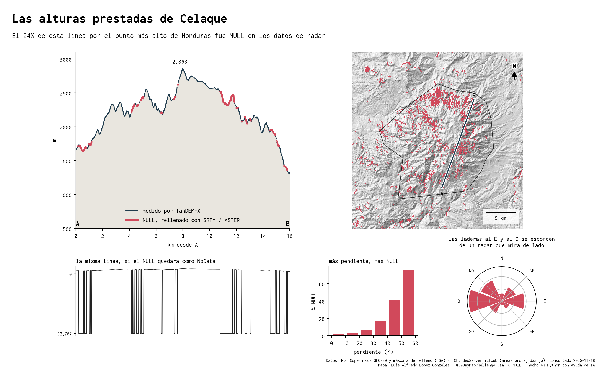

# Celaque's borrowed heights

Today's theme is *NULL*, with no description.

A digital elevation model looks like one seamless surface, but it is stitched.
The Copernicus GLO-30 model [@copernicus-dem] comes from TanDEM-X, a pair of
radar satellites. Where the radar could not get a height, the pixel was void,
NULL, and the producer filled it with a height from an older model (SRTM,
ASTER and others). The model ships with a *filling mask* that tells, pixel by
pixel, which heights were measured and which were borrowed
[@copernicus-dem-handbook, table 7].

This notebook reads that mask over **Montaña de Celaque National Park**, in
western Honduras, where the highest point of the country is. The park boundary
comes from ICF's protected areas layer [@icf-areas-protegidas]. The question:
how much of Celaque's terrain is borrowed, and where?

```python
import subprocess
import sys
import tempfile
from pathlib import Path

import geopandas as gpd
import matplotlib.pyplot as plt
import numpy as np
import pandas as pd
import rasterio
from matplotlib.colors import LightSource, ListedColormap
from rasterio.features import geometry_mask

sys.path.append("../..")  # maps/, for the shared scale bar and north arrow
from cartography import add_north_arrow, add_scale_bar

WFS = "https://geoserver.icf.gob.hn/icfpub/wfs"
CRS = 32616  # WGS 84 / UTM zone 16N, in metres
TILE = "Copernicus_DSM_COG_10_N14_00_W089_00_DEM"
BUCKET = "/vsicurl/https://copernicus-dem-30m.s3.amazonaws.com"
FLM_PATH = f"{BUCKET}/{TILE}/AUXFILES/{TILE.removesuffix('_DEM')}_FLM.tif"
CELL, MARGIN = 30, 5_000

url = (
    f"{WFS}?service=WFS&version=2.0.0&request=GetFeature"
    "&typeNames=areas_protegidas_gp&outputFormat=application/json"
)
protected = gpd.read_file(url).to_crs(CRS)
celaque = protected[protected.nomb_ap == "Montaña de Celaque"].dissolve()

xmin, ymin, xmax, ymax = celaque.total_bounds
extent = [
    round(v, -3) for v in (xmin - MARGIN, ymin - MARGIN, xmax + MARGIN, ymax + MARGIN)
]
folder = Path(tempfile.mkdtemp())


def warp(source: str, name: str, resampling: str) -> np.ndarray:
    """Cut and reproject one raster to the park's UTM grid at 30 m."""
    path = folder / f"{name}.tif"
    subprocess.run(
        ["gdalwarp", "-q", "-t_srs", f"EPSG:{CRS}", "-tr", str(CELL), str(CELL)]
        + ["-te", *map(str, extent), "-r", resampling, source, str(path)],
        check=True,
    )
    with rasterio.open(path) as src:
        return src.read(1), src.transform


dem, transform = warp(f"{BUCKET}/{TILE}/{TILE}.tif", "dem", "bilinear")
flm, _ = warp(FLM_PATH, "flm", "near")  # categories: nearest neighbour only
inside = ~geometry_mask(celaque.geometry, dem.shape, transform)
print(
    f"DEM: {dem.shape[1]} x {dem.shape[0]} cells, {dem.min():.0f} to {dem.max():.0f} m"
)
```

## What the filling mask says

Each pixel of the mask holds a code. The ones found here:

```python
CODES = {
    0: "void (no data)",
    1: "edited, not filled",
    2: "TanDEM-X, not edited",
    3: "filled from ASTER",
    4: "filled from SRTM90",
    5: "filled from SRTM30",
}
counts = pd.Series(flm[inside]).value_counts().sort_index()
table = pd.DataFrame(
    {
        "meaning": counts.index.map(CODES),
        "pixels": counts,
        "share (%)": (100 * counts / counts.sum()).round(1),
    }
)
table.index.name = "code"
table
```

```python
filled = np.isin(flm, [3, 4, 5])
print(f"Borrowed heights inside the park: {100 * filled[inside].mean():.1f}%")
```

No pixel is left void: every NULL was filled before release. The released
model hides its gaps; only the mask shows them.

## A line across the summit

A 16 km profile through the highest cell, at an azimuth of 20°, crosses the
park from south-southwest to north-northeast. Each 10 m step along it reads the
nearest cell of the model and of the mask.

```python
AZIMUTH, HALF = 20, 8_000
peak_row, peak_col = np.unravel_index(dem.argmax(), dem.shape)
steps = np.linspace(-HALF, HALF, 1601)
rows = (peak_row - np.cos(np.radians(AZIMUTH)) * steps / CELL).round().astype(int)
cols = (peak_col + np.sin(np.radians(AZIMUTH)) * steps / CELL).round().astype(int)
z, borrowed = dem[rows, cols], filled[rows, cols]
km = (steps + HALF) / 1000
line_x = extent[0] + (cols + 0.5) * CELL
line_y = extent[3] - (rows + 0.5) * CELL
line_share = 100 * borrowed.mean()
print(f"Borrowed along the line: {line_share:.0f}%")
```

## Why there: steep, and facing east or west

The borrowed heights are not spread at random. Slope and aspect, taken from
the model itself, show where they gather (inside the park):

```python
gy, gx = np.gradient(dem.astype(float), CELL)
slope = np.degrees(np.arctan(np.hypot(gx, gy)))
aspect = np.degrees(np.arctan2(-gx, gy)) % 360  # downslope bearing; rows run south

SLOPE_BINS = np.arange(0, 70, 10)
slope_share = pd.Series(
    [
        100 * filled[inside & (slope >= lo) & (slope < lo + 10)].mean()
        for lo in SLOPE_BINS[:-1]
    ],
    index=[f"{lo}-{lo + 10}°" for lo in SLOPE_BINS[:-1]],
    name="borrowed (%)",
).round(1)

SECTORS = ["N", "NE", "E", "SE", "S", "SW", "W", "NW"]
sector = ((aspect + 22.5) // 45).astype(int) % 8
sloped = inside & (slope > 5)  # flat cells have no meaningful aspect
aspect_share = pd.Series(
    [100 * filled[sloped & (sector == i)].mean() for i in range(8)],
    index=SECTORS,
    name="borrowed (%)",
).round(1)
pd.concat([slope_share, aspect_share], keys=["slope", "aspect"])
```

The steeper the slope, the more of it is borrowed, and slopes facing east or
west lose far more than those facing north or south. That fits how the radar
works: TanDEM-X flies on a near-polar orbit, so over Honduras it passes
roughly north to south and looks sideways, to the east or the west. A steep
face turned toward the radar folds onto itself in the image (*layover*); a
steep face turned away from it gets no signal at all (*radar shadow*). Either
way there is no reliable height. Faces looking north or south are seen
side-on and come through.

One caveat: slope and aspect are computed from the same model, filled pixels
included, so they carry the borrowed heights in them.

## What NULL looks like when nobody fills it

In its European 10 m instance, the same model keeps pixels without height as
NoData, coded **-32,767** [@copernicus-dem-handbook]. The last panel draws the
profile as it would read if the borrowed cells were left at that value and
nobody masked them: every gap becomes a cliff 32 km deep. This is a
simulation; the GLO-30 cells used here were all filled.

## The map

```python
plt.rcParams["font.family"] = "Inconsolata"
BORROWED, MEASURED, INK, GROUND = "#d1495b", "#1f3b4d", "#222222", "#e9e6df"
shade = LightSource(azdeg=315, altdeg=45).hillshade(
    dem, vert_exag=1.5, dx=CELL, dy=CELL
)
map_extent = [extent[0], extent[2], extent[1], extent[3]]

TEXT = {
    "en": {
        "title": "Celaque's borrowed heights",
        "subtitle": f"{line_share:.0f}% of this line across the highest point of Honduras "
        "was NULL in the radar data",
        "measured": "measured by TanDEM-X",
        "filled": "NULL, filled from SRTM / ASTER",
        "km": "km from A",
        "nodata": "same line, if NULL stayed NoData",
        "slope_title": "steeper, more NULL",
        "slope_x": "slope (°)",
        "share": "% NULL",
        "rose": "slopes facing E or W hide\nfrom a radar that looks sideways",
        "sectors": SECTORS,
        "credits": "Data: Copernicus GLO-30 DEM and filling mask (ESA) · ICF, GeoServer icfpub "
        "(areas_protegidas_gp), accessed 2026-11-18\nMap: Luis Alfredo López Gonzales · "
        "#30DayMapChallenge Day 18 NULL · made in Python with AI help",
    },
    "es": {
        "title": "Las alturas prestadas de Celaque",
        "subtitle": f"El {line_share:.0f}% de esta línea por el punto más alto de Honduras "
        "fue NULL en los datos de radar",
        "measured": "medido por TanDEM-X",
        "filled": "NULL, rellenado con SRTM / ASTER",
        "km": "km desde A",
        "nodata": "la misma línea, si el NULL quedara como NoData",
        "slope_title": "más pendiente, más NULL",
        "slope_x": "pendiente (°)",
        "share": "% NULL",
        "rose": "las laderas al E y al O se esconden\nde un radar que mira de lado",
        "sectors": ["N", "NE", "E", "SE", "S", "SO", "O", "NO"],
        "credits": "Datos: MDE Copernicus GLO-30 y máscara de relleno (ESA) · ICF, GeoServer icfpub "
        "(areas_protegidas_gp), consultado 2026-11-18\nMapa: Luis Alfredo López Gonzales · "
        "#30DayMapChallenge Día 18 NULL · hecho en Python con ayuda de IA",
    },
}


def clean(ax, sides=("top", "right")):
    for side in sides:
        ax.spines[side].set_visible(False)


for lang, text in TEXT.items():
    fig = plt.figure(figsize=(14, 8.6))
    grid = fig.add_gridspec(
        3, 3, width_ratios=[2.4, 1, 1], top=0.86, bottom=0.1, hspace=0.55, wspace=0.3
    )

    ax = fig.add_subplot(grid[:2, 0])  # profile
    ax.fill_between(km, 0, z, color=GROUND)
    ax.plot(
        km,
        np.where(borrowed, np.nan, z),
        color=MEASURED,
        lw=1.4,
        label=text["measured"],
    )
    ax.plot(
        km, np.where(borrowed, z, np.nan), color=BORROWED, lw=2.6, label=text["filled"]
    )
    ax.annotate(
        f"{dem.max():,.0f} m",
        (km[800], z[800]),
        xytext=(0, 8),
        textcoords="offset points",
        ha="center",
    )
    ax.set(xlim=(0, 16), ylim=(500, 3100), xlabel=text["km"], ylabel="m")
    ax.text(0, 520, "A", fontsize=12, fontweight="bold", va="bottom", ha="left")
    ax.text(16, 520, "B", fontsize=12, fontweight="bold", va="bottom", ha="right")
    ax.legend(loc="lower center", frameon=False)
    clean(ax)

    ax = fig.add_subplot(grid[2, 0])  # NoData, simulated
    ax.plot(km, np.where(borrowed, -32767, z), color=INK, lw=0.8)
    ax.set(xlim=(0, 16), ylim=(-34000, 4000), xticks=[])
    ax.set_yticks([-32767, 0], ["-32,767", "0"], fontsize=8)
    ax.set_title(text["nodata"], fontsize=10, loc="left")
    clean(ax, ("top", "right", "bottom"))

    ax = fig.add_subplot(grid[:2, 1:])  # map
    ax.imshow(shade, cmap="gray", extent=map_extent, alpha=0.85)
    ax.imshow(
        np.ma.masked_where(~filled, flm),
        cmap=ListedColormap([BORROWED]),
        extent=map_extent,
        interpolation="nearest",
    )
    celaque.boundary.plot(ax=ax, color=INK, lw=0.8)
    ax.plot(line_x, line_y, color="white", lw=3.5)
    ax.plot(line_x, line_y, color=MEASURED, lw=1.6)
    ax.annotate(
        "A",
        (line_x[0], line_y[0]),
        xytext=(0, -4),
        textcoords="offset points",
        ha="center",
        va="top",
        fontsize=11,
        fontweight="bold",
    )
    ax.annotate(
        "B",
        (line_x[-1], line_y[-1]),
        xytext=(0, 4),
        textcoords="offset points",
        ha="center",
        va="bottom",
        fontsize=11,
        fontweight="bold",
    )
    ax.set_axis_off()
    add_scale_bar(ax, background="white")
    add_north_arrow(ax, halo="white")

    ax = fig.add_subplot(grid[2, 1])  # slope
    ax.bar(SLOPE_BINS[:-1] + 5, slope_share, width=8, color=BORROWED)
    ax.set_xticks(SLOPE_BINS)
    ax.set(xlabel=text["slope_x"], ylabel=text["share"])
    ax.set_title(text["slope_title"], fontsize=10, loc="left")
    clean(ax)

    ax = fig.add_subplot(grid[2, 2], projection="polar")  # aspect
    angles = np.radians(np.arange(0, 360, 45))
    ax.bar(angles, aspect_share, width=np.radians(40), color=BORROWED)
    ax.set_theta_zero_location("N")
    ax.set_theta_direction(-1)
    ax.set_xticks(angles, text["sectors"], fontsize=8)
    ax.set_yticklabels([])
    ax.set_title(text["rose"], fontsize=10, pad=14)

    fig.text(0.02, 0.97, text["title"], fontsize=22, fontweight="bold", va="top")
    fig.text(0.02, 0.915, text["subtitle"], fontsize=12, va="top")
    fig.text(0.98, 0.015, text["credits"], fontsize=7.5, ha="right", va="bottom")
    fig.savefig(f"day18-borrowed-heights-{lang}.png", dpi=200, facecolor="white")
    plt.close(fig)
```

::: {layout-ncol=2}



:::

## What to take from it

GLO-30 is the free global model most people reach for, and in Celaque it is
mostly TanDEM-X. But the parts that matter most in mountains, the steep east
and west faces, are where it borrows the most, from older and coarser models.
Anyone deriving slopes, watersheds or a hiking profile there is partly using
SRTM and ASTER without knowing it. The filling mask is in the same bucket as
the model (`AUXFILES/`); it is worth one look before trusting the steep parts.

## References

::: {#refs}
:::
