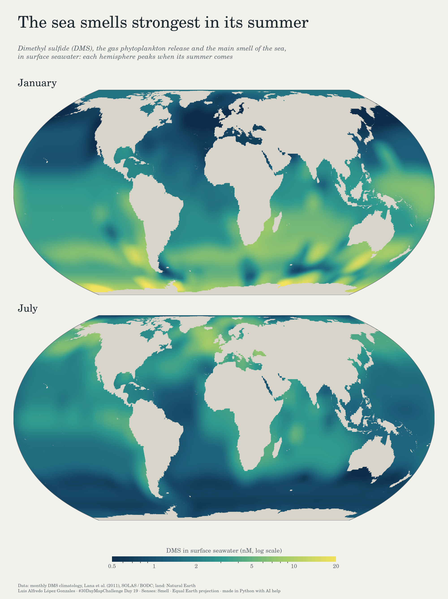

# The sea smells strongest in its summer

Today's theme asks: *"How do you map things which your nose can sense? What
does a smelly map look like?"*

The smell of the sea at the coast is, for the most part, dimethyl sulfide
(DMS). Phytoplankton make a sulfur compound (DMSP) that bacteria and the algae
themselves break down into DMS. Part of it escapes from the water to the air,
and that is what the nose picks up. Where the surface water holds more DMS,
the sea smells stronger.

The data is the monthly climatology of DMS in surface seawater by Lana et al.
[@lana2011], published by SOLAS at the British Oceanographic Data Centre. It
interpolates more than 47,000 measurements onto a 1° grid, with one map for each month of an average year. It is not one year's
sea, but its usual cycle. Land comes from Natural Earth [@naturalearth].

```python
import io
import zipfile
from urllib.request import urlopen

import geopandas as gpd
import matplotlib.pyplot as plt
import numpy as np
import pandas as pd
from matplotlib.colors import LinearSegmentedColormap, LogNorm
from rasterio.features import rasterize
from rasterio.transform import from_origin
from rasterio.warp import Resampling, reproject
from shapely.geometry import Polygon

DMS_URL = (
    "https://www.bodc.ac.uk/solas_integration/implementation_products/"
    "group1/documents/dmsclimatology.zip"
)
LAND_URL = "https://naciscdn.org/naturalearth/50m/physical/ne_50m_land.zip"
CRS = "EPSG:8857"  # Equal Earth: every cell keeps its true area

with zipfile.ZipFile(io.BytesIO(urlopen(DMS_URL).read())) as archive:
    names = sorted(archive.namelist())
    dms = {
        name.split("_")[-1]
        .removesuffix(".csv"): pd.read_csv(archive.open(name), header=None)
        .to_numpy(float)
        for name in names
    }
print(sorted(dms), dms["JAN"].shape)
```

Each month is a 180 × 360 table in nanomoles per litre (nM): the first row is
89.5° N and the first column 179.5° W. Land cells are empty.

```python
LAT = 89.5 - np.arange(180)


january, july = dms["JAN"], dms["JUL"]
```

## Each hemisphere in its summer

The mean concentration north and south of the equator, weighting each cell by
its area (cells get smaller towards the poles):

```python
def hemisphere_mean(grid: np.ndarray, north: bool) -> float:
    weight = np.cos(np.radians(LAT))[:, None] * np.ones_like(grid)
    keep = ~np.isnan(grid) & ((LAT > 0) if north else (LAT < 0))[:, None]
    return float((grid * weight)[keep].sum() / weight[keep].sum())


pd.DataFrame(
    {
        "north": [hemisphere_mean(g, True) for g in (january, july)],
        "south": [hemisphere_mean(g, False) for g in (january, july)],
    },
    index=["January", "July"],
).round(2)
```

In January, the southern summer, the southern ocean holds almost three times
more DMS than the northern one; in July the order turns. Phytoplankton grow
with the long days and the light of summer, and DMS follows them. The
strongest smell of the whole year is the Southern Ocean around Antarctica in
January.

Some regions show one flat colour: the climatology starts from the mean of
each ocean province (Longhurst's biogeographic provinces) and adjusts it with
the measurements nearby, so where there are few (the Arctic in winter, parts
of the subtropics) the province value is what remains.

## The map

Both months are drawn with the same colour scale. It is logarithmic, because
DMS goes from less than 1 nM in the open subtropical ocean to more than 20 nM
in polar blooms. The grids are reprojected to Equal Earth so the polar seas
are not inflated.

```python
with urlopen(LAND_URL) as response:
    land = gpd.read_file(io.BytesIO(response.read())).to_crs(CRS)

# The edge of the world in Equal Earth, drawn from its meridians at ±180°
edge_lat = np.linspace(-90, 90, 181)
outline = gpd.GeoSeries(
    [
        Polygon(
            list(zip(np.full(181, -180.0), edge_lat))
            + list(zip(np.full(181, 180.0), edge_lat[::-1]))
        )
    ],
    crs=4326,
).to_crs(CRS)
xmin, ymin, xmax, ymax = outline.total_bounds

WIDTH = 1800
HEIGHT = round(WIDTH * (ymax - ymin) / (xmax - xmin))
dst_transform = from_origin(xmin, ymax, (xmax - xmin) / WIDTH, (ymax - ymin) / HEIGHT)
# Pixels outside the edge of the world have no place on Earth: masked
inside = rasterize(outline, out_shape=(HEIGHT, WIDTH), transform=dst_transform) == 1


def to_equal_earth(grid: np.ndarray) -> np.ndarray:
    out = np.full((HEIGHT, WIDTH), np.nan)
    reproject(
        grid,
        out,
        src_transform=from_origin(-180, 90, 1, 1),
        src_crs="EPSG:4326",
        dst_transform=dst_transform,
        dst_crs=CRS,
        src_nodata=np.nan,
        dst_nodata=np.nan,
        resampling=Resampling.nearest,
    )
    out[~inside] = np.nan
    return out


panels = {"jan": to_equal_earth(january), "jul": to_equal_earth(july)}
```

```python
plt.rcParams["font.family"] = "C059"
BG, INK, INK_2, LAND = "#f3f1ec", "#1f2a33", "#5f6b73", "#d9d4c9"
SEA = LinearSegmentedColormap.from_list(
    "sea", ["#0d2c4a", "#1d5e7a", "#2f9a8f", "#9cc96b", "#f2e15c"]
)
NORM = LogNorm(vmin=0.5, vmax=20, clip=True)
TICKS = [0.5, 1, 2, 5, 10, 20]

TEXT = {
    "en": {
        "title": "The sea smells strongest in its summer",
        "subtitle": (
            "Dimethyl sulfide (DMS), the gas phytoplankton release and the main "
            "smell of the sea,\nin surface seawater: each hemisphere peaks when "
            "its summer comes"
        ),
        "jan": "January",
        "jul": "July",
        "legend": "DMS in surface seawater (nM, log scale)",
        "credits": (
            "Data: monthly DMS climatology, Lana et al. (2011), SOLAS / BODC; "
            "land: Natural Earth\n"
            "Luis Alfredo López Gonzales · #30DayMapChallenge Day 19 · "
            "Senses: Smell · Equal Earth projection · made in Python with AI help"
        ),
    },
    "es": {
        "title": "El mar huele más fuerte en su verano",
        "subtitle": (
            "Sulfuro de dimetilo (DMS), el gas que libera el fitoplancton y el "
            "olor principal del mar,\nen el agua superficial: cada hemisferio "
            "llega a su máximo cuando le toca el verano"
        ),
        "jan": "Enero",
        "jul": "Julio",
        "legend": "DMS en el agua superficial (nM, escala logarítmica)",
        "credits": (
            "Datos: climatología mensual de DMS, Lana et al. (2011), SOLAS / "
            "BODC; tierra: Natural Earth\n"
            "Luis Alfredo López Gonzales · #30DayMapChallenge Día 19 · "
            "Senses: Smell · proyección Equal Earth · hecho en Python con "
            "ayuda de IA"
        ),
    },
}


def draw_map(lang: str) -> plt.Figure:
    """Draw January above July with the text in `lang` ("en" or "es")."""
    text = TEXT[lang]
    map_w = 9.4  # inches
    map_h = map_w * (ymax - ymin) / (xmax - xmin)
    fig_w, fig_h = 10, 2.0 + 2 * (map_h + 0.45) + 1.3
    fig = plt.figure(figsize=(fig_w, fig_h), facecolor=BG)

    def from_top(top: float, height: float, left: float, width: float) -> list:
        """Axes position in figure fractions, from inches measured from the top."""
        return [left / fig_w, 1 - (top + height) / fig_h, width / fig_w, height / fig_h]

    for i, key in enumerate(("jan", "jul")):
        top = 2.0 + i * (map_h + 0.45)
        ax = fig.add_axes(from_top(top, map_h, 0.3, map_w))
        ax.set_axis_off()
        outline.plot(ax=ax, facecolor=LAND, edgecolor="none", zorder=0)
        image = ax.imshow(
            panels[key], extent=(xmin, xmax, ymin, ymax), cmap=SEA, norm=NORM, zorder=1
        )
        land.plot(ax=ax, color=LAND, linewidth=0, zorder=2)
        outline.boundary.plot(ax=ax, color=INK_2, linewidth=0.6, zorder=3)
        ax.set_xlim(xmin, xmax)
        ax.set_ylim(ymin, ymax)
        fig.text(
            0.4 / fig_w, 1 - (top - 0.08) / fig_h, text[key], fontsize=16, color=INK
        )

    cax = fig.add_axes(from_top(fig_h - 0.95, 0.12, 2.5, 5))
    bar = fig.colorbar(image, cax=cax, orientation="horizontal", ticks=TICKS)
    bar.ax.set_xticklabels([f"{t:g}" for t in TICKS], color=INK_2, fontsize=9)
    bar.outline.set_visible(False)
    bar.ax.tick_params(length=0)
    cax.set_title(text["legend"], fontsize=10, color=INK_2, pad=6)

    fig.text(
        0.4 / fig_w, 1 - 0.35 / fig_h, text["title"], fontsize=26, color=INK, va="top"
    )
    fig.text(
        0.4 / fig_w,
        1 - 1.0 / fig_h,
        text["subtitle"],
        fontsize=11,
        color=INK_2,
        style="italic",
        va="top",
    )
    fig.text(0.4 / fig_w, 0.15 / fig_h, text["credits"], fontsize=7, color=INK_2)
    return fig


for lang in ("en", "es"):
    fig = draw_map(lang)
    fig.savefig(f"day19-smell-of-the-sea-{lang}.png", dpi=200, facecolor=BG)
    plt.close(fig)
```



## References

::: {#refs}
:::
