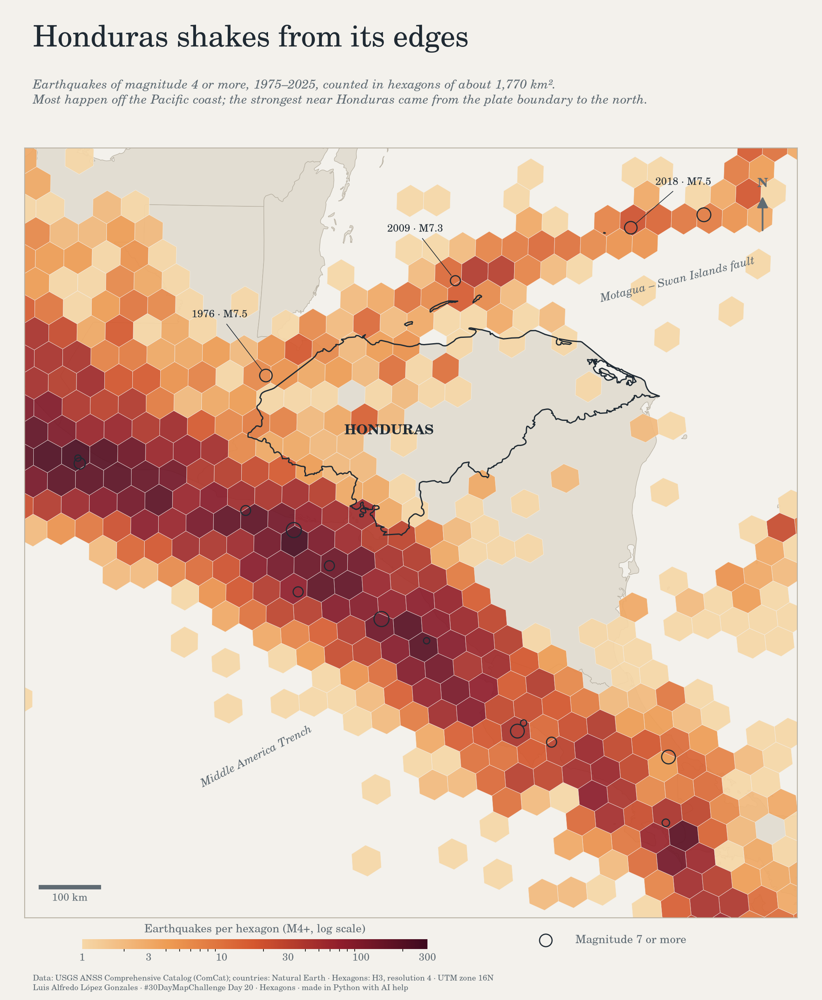

# Honduras shakes from its edges

Today's theme is *Hexagons*. Earthquakes are points, and over 50 years they
pile up on top of each other: counted in hexagons, the piles become a surface
that shows where the ground moves.

The data is the earthquake catalog of the U.S. Geological Survey, the ANSS
Comprehensive Catalog (ComCat) [@usgs-comcat]: every earthquake of magnitude 4
or more between 1975 and 2025 around Central America. The hexagons are Uber's
H3 grid at resolution 4 (about 1,770 km² each). Countries come from Natural
Earth [@naturalearth].

```python
import io
import sys
import zipfile
from urllib.parse import urlencode
from urllib.request import urlopen

import geopandas as gpd
import h3
import matplotlib.pyplot as plt
import numpy as np
import pandas as pd
from matplotlib.colors import LinearSegmentedColormap, LogNorm
from shapely.geometry import Polygon

sys.path.append("../..")  # maps/, for the shared scale bar and north arrow
from cartography import add_north_arrow, add_scale_bar

CRS = 32616  # WGS 84 / UTM zone 16N, in metres
BBOX = dict(minlongitude=-94, maxlongitude=-76, minlatitude=6, maxlatitude=19)
QUERY = dict(
    format="csv",
    starttime="1975-01-01",
    endtime="2026-01-01",
    minmagnitude=4,
    orderby="time-asc",
    **BBOX,
)
URL = "https://earthquake.usgs.gov/fdsnws/event/1/query?" + urlencode(QUERY)
COUNTRIES_URL = (
    "https://naciscdn.org/naturalearth/10m/cultural/ne_10m_admin_0_countries.zip"
)

quakes = pd.read_csv(URL)
quakes = gpd.GeoDataFrame(
    quakes,
    geometry=gpd.points_from_xy(quakes.longitude, quakes.latitude),
    crs=4326,
)
with urlopen(COUNTRIES_URL) as response:
    countries = gpd.read_file(io.BytesIO(response.read()))
print(len(quakes), quakes.time.min()[:10], quakes.time.max()[:10])
```

## Inside each country

How many of those earthquakes had their epicentre inside each country's land,
and how many reached magnitude 6:

```python
CENTRAL_AMERICA = ["GTM", "BLZ", "SLV", "HND", "NIC", "CRI", "PAN"]
land = countries[countries.ADM0_A3.isin(CENTRAL_AMERICA)].set_index("ADM0_A3")
inside = gpd.sjoin(quakes, land[["NAME_EN", "geometry"]], predicate="within")
area_km2 = land.to_crs(CRS).area / 1e6
pd.DataFrame(
    {
        "M4+": inside.groupby("NAME_EN").size(),
        "M6+": inside[inside.mag >= 6].groupby("NAME_EN").size(),
        "area_km2": area_km2.set_axis(land.NAME_EN).round(-2),
    }
).fillna(0).astype(int).sort_values("M4+", ascending=False)
```

Guatemala, which is about the size of Honduras, had ten times more earthquakes
on its land, and 19 of magnitude 6 or more; Honduras had none. Most of the
region's earthquakes happen off the Pacific coast, where the Cocos plate
sinks under the Caribbean plate (the Middle America Trench), and many of those
are deep. Honduras sits away from the trench.

But Honduras has a second edge, to the north: the boundary between the
Caribbean and North American plates, which runs along the Motagua fault in
Guatemala and then under the sea as the Swan Islands fault. The plates slide
past each other there, at shallow depth. The strongest earthquakes nearest to
Honduras came from that edge:

```python
honduras = land.loc[["HND"]].to_crs(CRS).geometry.iloc[0]
strong = quakes[quakes.mag >= 7].to_crs(CRS)
strong["km_to_honduras"] = (strong.distance(honduras) / 1000).round()
strong.sort_values("km_to_honduras")[
    ["time", "mag", "depth", "place", "km_to_honduras"]
].head(6)
```

The three closest, all within 50 km of Honduras, are the 1976 Guatemala
earthquake on the Motagua fault (M7.5, more than 20,000 dead), the 2009
earthquake north of Guanaja (M7.3) and the 2018 Swan Islands earthquake
(M7.5).

One caution: the catalog sees more small earthquakes as the seismic networks
grow (there are more M4 events in the 2010s than in the 1980s), so the counts
are what was recorded, not a constant rate. The large ones (M7 and more) are
complete for the whole period.

## Hexagons

Each earthquake goes into the H3 cell that holds its epicentre, and each cell
is drawn as a polygon:

```python
RES = 4
quakes["cell"] = [
    h3.latlng_to_cell(lat, lon, RES)
    for lat, lon in zip(quakes.latitude, quakes.longitude)
]
counts = quakes.groupby("cell").size().rename("n").reset_index()
hexes = gpd.GeoDataFrame(
    counts,
    geometry=[
        Polygon([(lon, lat) for lat, lon in h3.cell_to_boundary(c)])
        for c in counts.cell
    ],
    crs=4326,
).to_crs(CRS)
print(len(hexes), "cells;", hexes.n.describe()[["50%", "max"]].to_dict())
```

## The map

```python
plt.rcParams["font.family"] = "C059"
BG, INK, INK_2 = "#f3f1ec", "#1f2a33", "#5f6b73"
LAND, BORDER, SEA = "#e2ddd2", "#b9b2a4", "#f3f1ec"
QUAKE = LinearSegmentedColormap.from_list(
    "quake", ["#f6d7a7", "#ee9b53", "#d4562e", "#8f1d2c", "#3d0a1f"]
)
NORM = LogNorm(vmin=1, vmax=300, clip=True)
TICKS = [1, 3, 10, 30, 100, 300]

# Map frame in UTM 16N, from the corners of a lon/lat box
frame = gpd.GeoSeries(
    [Polygon([(-92.6, 7.3), (-81.2, 7.3), (-81.2, 18.6), (-92.6, 18.6)])],
    crs=4326,
).to_crs(CRS)
x0, y0, x1, y1 = frame.total_bounds
region = countries.clip((-97, 3, -76, 22)).to_crs(
    CRS
)  # clip first: UTM breaks far away
strong_in = strong.clip(frame)

# The three strong ones from the northern edge, labelled on the map
LABELS = {
    "1976": dict(dx=-30_000, dy=95_000, ha="right"),
    "2009": dict(dx=-20_000, dy=80_000, ha="right"),
    "2018": dict(dx=40_000, dy=70_000, ha="left"),
}

TEXT = {
    "en": {
        "title": "Honduras shakes from its edges",
        "subtitle": (
            "Earthquakes of magnitude 4 or more, 1975–2025, counted in hexagons "
            "of about 1,770 km².\nMost happen off the Pacific coast; the strongest "
            "near Honduras came from the plate boundary to the north."
        ),
        "honduras": "HONDURAS",
        "trench": "Middle America Trench",
        "fault": "Motagua – Swan Islands fault",
        "strong": "Magnitude 7 or more",
        "legend": "Earthquakes per hexagon (M4+, log scale)",
        "credits": (
            "Data: USGS ANSS Comprehensive Catalog (ComCat); countries: Natural "
            "Earth · Hexagons: H3, resolution 4 · UTM zone 16N\n"
            "Luis Alfredo López Gonzales · #30DayMapChallenge Day 20 · "
            "Hexagons · made in Python with AI help"
        ),
    },
    "es": {
        "title": "Honduras tiembla desde sus bordes",
        "subtitle": (
            "Sismos de magnitud 4 o más, 1975–2025, contados en hexágonos de unos "
            "1,770 km².\nLa mayoría ocurre frente a la costa del Pacífico; los más "
            "fuertes cerca de Honduras vinieron del límite de placas al norte."
        ),
        "honduras": "HONDURAS",
        "trench": "Fosa Mesoamericana",
        "fault": "Falla Motagua – Islas del Cisne",
        "strong": "Magnitud 7 o más",
        "legend": "Sismos por hexágono (M4+, escala logarítmica)",
        "credits": (
            "Datos: USGS ANSS Comprehensive Catalog (ComCat); países: Natural "
            "Earth · Hexágonos: H3, resolución 4 · UTM zona 16N\n"
            "Luis Alfredo López Gonzales · #30DayMapChallenge Día 20 · "
            "Hexagons · hecho en Python con ayuda de IA"
        ),
    },
}


def draw_map(lang: str) -> plt.Figure:
    """Draw the hexagons with the text in `lang` ("en" or "es")."""
    text = TEXT[lang]
    map_w = 9.4
    map_h = map_w * (y1 - y0) / (x1 - x0)
    fig_w, fig_h = 10, 1.55 + map_h + 1.25
    fig = plt.figure(figsize=(fig_w, fig_h), facecolor=BG)
    ax = fig.add_axes([0.3 / fig_w, 1.0 / fig_h, map_w / fig_w, map_h / fig_h])
    ax.set_facecolor(SEA)

    region.plot(ax=ax, color=LAND, edgecolor=BORDER, linewidth=0.5, zorder=1)
    hexes.plot(
        ax=ax,
        column="n",
        cmap=QUAKE,
        norm=NORM,
        edgecolor=BG,
        linewidth=0.3,
        alpha=0.92,
        zorder=2,
    )
    gpd.GeoSeries([honduras], crs=CRS).boundary.plot(
        ax=ax, color=INK, linewidth=1.1, zorder=3
    )
    ax.scatter(
        strong_in.geometry.x,
        strong_in.geometry.y,
        s=(strong_in.mag - 6.5) ** 2 * 120,
        facecolor="none",
        edgecolor=INK,
        linewidth=1.0,
        zorder=4,
    )
    for _, row in strong_in.iterrows():
        year = row.time[:4]
        if year in LABELS and row.km_to_honduras < 60:
            spec = LABELS[year]
            ax.annotate(
                f"{year} · M{row.mag:.1f}",
                xy=(row.geometry.x, row.geometry.y),
                xytext=(row.geometry.x + spec["dx"], row.geometry.y + spec["dy"]),
                ha=spec["ha"],
                fontsize=9,
                color=INK,
                arrowprops=dict(arrowstyle="-", color=INK, lw=0.6, shrinkB=6),
                zorder=5,
            )

    hx, hy = honduras.representative_point().coords[0]
    ax.text(
        hx,
        hy,
        text["honduras"],
        fontsize=12,
        color=INK,
        ha="center",
        va="center",
        zorder=5,
        fontweight="bold",
    )
    ax.text(
        0.30,
        0.17,
        text["trench"],
        transform=ax.transAxes,
        fontsize=10,
        color=INK_2,
        style="italic",
        rotation=27,
        ha="center",
    )
    ax.text(
        0.845,
        0.80,
        text["fault"],
        transform=ax.transAxes,
        fontsize=10,
        color=INK_2,
        style="italic",
        rotation=14,
        ha="center",
    )

    ax.set_xlim(x0, x1)
    ax.set_ylim(y0, y1)
    ax.set_xticks([])
    ax.set_yticks([])
    ax.set_xlabel("")
    ax.set_ylabel("")
    for spine in ax.spines.values():
        spine.set_color(BORDER)
    add_scale_bar(ax, loc="lower left", color=INK_2, share=0.15)
    add_north_arrow(ax, xy=(0.955, 0.94), color=INK_2, size=0.05)

    cax = fig.add_axes([1.0 / fig_w, 0.62 / fig_h, 4.2 / fig_w, 0.12 / fig_h])
    bar = fig.colorbar(
        plt.cm.ScalarMappable(norm=NORM, cmap=QUAKE),
        cax=cax,
        orientation="horizontal",
        ticks=TICKS,
    )
    bar.ax.set_xticklabels([f"{t:g}" for t in TICKS], color=INK_2, fontsize=9)
    bar.outline.set_visible(False)
    bar.ax.tick_params(length=0)
    cax.set_title(text["legend"], fontsize=10, color=INK_2, pad=6)
    lax = fig.add_axes([6.4 / fig_w, 0.5 / fig_h, 3 / fig_w, 0.45 / fig_h])
    lax.set_axis_off()
    lax.scatter(
        [0.08],
        [0.5],
        s=(7.5 - 6.5) ** 2 * 120,
        facecolor="none",
        edgecolor=INK,
        linewidth=1.0,
    )
    lax.text(0.2, 0.5, text["strong"], va="center", fontsize=10, color=INK_2)
    lax.set_xlim(0, 1)
    lax.set_ylim(0, 1)

    fig.text(
        0.4 / fig_w, 1 - 0.3 / fig_h, text["title"], fontsize=26, color=INK, va="top"
    )
    fig.text(
        0.4 / fig_w,
        1 - 0.95 / fig_h,
        text["subtitle"],
        fontsize=11,
        color=INK_2,
        style="italic",
        va="top",
    )
    fig.text(0.4 / fig_w, 0.12 / fig_h, text["credits"], fontsize=7, color=INK_2)
    return fig


for lang in ("en", "es"):
    fig = draw_map(lang)
    fig.savefig(f"day20-earthquakes-{lang}.png", dpi=200, facecolor=BG)
    plt.close(fig)
```



## References

::: {#refs}
:::
