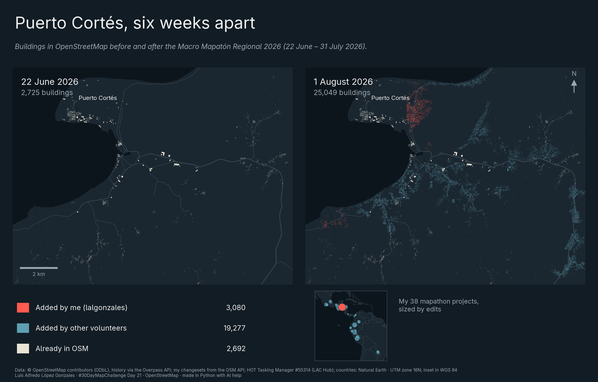

# Puerto Cortés, six weeks apart

Today's theme is *OpenStreetMap*, and the day can also be used to edit it.
This map looks back at edits: the *Macro Mapatón Regional Anticipatorio 2026*
(MARE), run by the Humanitarian OpenStreetMap Team (HOT) and its hub for Latin
America and the Caribbean (LAC Hub) in eight countries, from 22 June to 31 July
2026, with certificates from UN Volunteers [@hot-mare-2026]. Volunteers traced
buildings from satellite imagery in areas exposed to disasters, through tasks
in the HOT Tasking Manager; in Honduras it was coordinated on the ground with
COPECO, the national contingency commission. I took part from Honduras, and
most of my edits went to Puerto Cortés, on the north coast, in the project
*Mapatón Regional 2026 Honduras Valle de Sula - Ríos* (#55314). HOT's ranking
of the mapathon put me tenth among its mappers.

OpenStreetMap keeps its history [@openstreetmap], so the map can be drawn as
it was on any date. The buildings come from the Overpass API at two dates:
the start of the mapathon and the day after it closed. My own edits come from
my changesets in the OSM API. The coastline, roads and place names are
today's, as context.

```python
import json
import sys
import time
import xml.etree.ElementTree as ET
from collections import defaultdict
from urllib.parse import urlencode
from urllib.request import Request, urlopen

import geopandas as gpd
import matplotlib.pyplot as plt
import pandas as pd
from shapely.geometry import LineString, Point, Polygon, box
from shapely.ops import linemerge, split

sys.path.append("../..")  # maps/, for the shared scale bar and north arrow
from cartography import add_north_arrow, add_scale_bar

CRS = 32616  # WGS 84 / UTM zone 16N, in metres
USER = "lalgonzales"
HASHTAG = "#2026_LATAM_Mapaton"
BEFORE, AFTER = "2026-06-22T06:00:00Z", "2026-08-01T06:00:00Z"  # local midnight
BBOX = (15.765, -87.985, 15.870, -87.845)  # south, west, north, east
HEADERS = {"User-Agent": "30DayMapChallenge notebook"}
OSM_API = "https://api.openstreetmap.org/api/0.6"
OVERPASS = "https://overpass-api.de/api/interpreter"
COUNTRIES_URL = (
    "https://naciscdn.org/naturalearth/50m/cultural/ne_50m_admin_0_countries.zip"
)


def get(url: str, data: bytes | None = None) -> bytes:
    """Fetch a URL, retrying with backoff when the server is busy."""
    for wait in (0, 15, 30, 60, 120):
        time.sleep(wait)
        try:
            with urlopen(Request(url, data=data, headers=HEADERS)) as response:
                return response.read()
        except OSError as error:
            print("retrying:", error)
    raise RuntimeError(f"could not fetch {url}")


def overpass(query: str) -> list[dict]:
    """Run an Overpass query (JSON output) and return its elements."""
    body = json.loads(get(OVERPASS, urlencode({"data": query}).encode()))
    if body.get("remark"):
        raise RuntimeError(body["remark"])
    return body["elements"]
```

## My changesets

The OSM API returns at most 100 changesets per request, newest first, so the
list is read page by page, moving the end of the time window back each time:

```python
def my_changesets(start: str, end: str) -> pd.DataFrame:
    """Every changeset of USER created between `start` and `end`."""
    rows = {}
    while True:
        url = f"{OSM_API}/changesets?display_name={USER}&time={start},{end}"
        page = ET.fromstring(get(url)).findall("changeset")
        for c in page:
            tags = {t.get("k"): t.get("v") for t in c.findall("tag")}
            rows[c.get("id")] = {
                "id": int(c.get("id")),
                "created": c.get("created_at"),
                "changes": int(c.get("changes_count")),
                "hashtags": tags.get("hashtags", ""),
                **{
                    k: float(c.get(k) or "nan")
                    for k in ("min_lon", "min_lat", "max_lon", "max_lat")
                },
            }
        if len(page) < 100:
            break
        end = min(c.get("created_at") for c in page)
    return pd.DataFrame(rows.values())


changesets = my_changesets("2026-06-20T00:00:00Z", "2026-08-02T00:00:00Z")
mapathon = changesets[changesets.hashtags.str.contains(HASHTAG)].copy()
mapathon["project"] = mapathon.hashtags.str.extract(r"hotosm-project-(\d+)")[0]
mapathon["lon"] = (mapathon.min_lon + mapathon.max_lon) / 2
mapathon["lat"] = (mapathon.min_lat + mapathon.max_lat) / 2
print(
    len(mapathon),
    "changesets,",
    mapathon.changes.sum(),
    "changes,",
    mapathon.project.nunique(),
    "projects",
)
```

A *change* is any element created, modified or deleted, and most are nodes:
a building traced as a rectangle is one way and four nodes. The projects
spread over the region; each one is a point at the mean centre of its
changesets:

```python
projects = (
    mapathon.groupby("project")
    .agg(
        changesets=("id", "size"),
        changes=("changes", "sum"),
        lon=("lon", "mean"),
        lat=("lat", "mean"),
    )
    .sort_values("changes", ascending=False)
)
projects.head(8)
```

## Puerto Cortés

The changesets whose centre falls in the Puerto Cortés frame are downloaded
in full (each one is an osmChange file), and the buildings I created are
counted from them:

```python
south, west, north, east = BBOX
here = mapathon[mapathon.lon.between(west, east) & mapathon.lat.between(south, north)]
mine = set()
for changeset in here.id:
    diff = ET.fromstring(get(f"{OSM_API}/changeset/{changeset}/download"))
    for way in diff.iterfind("create/way"):
        if any(t.get("k") == "building" for t in way.iter("tag")):
            mine.add(int(way.get("id")))
    time.sleep(0.3)
print(len(here), "changesets in the frame,", len(mine), "buildings created")
print(here.project.value_counts().to_dict())
```

Most of those changesets belong to project #55314; a few are from two
neighbouring projects of the same mapathon (#55380 and #55413) that cover the
same area.

The buildings as they were at each date, from the Overpass API's history:

```python
def buildings(date: str) -> gpd.GeoDataFrame:
    """Every building way in BBOX as OSM had it on `date`."""
    query = f'[out:json][timeout:300][date:"{date}"];way[building]{BBOX};out ids geom;'
    ways = [w for w in overpass(query) if len(w["geometry"]) > 3]
    return gpd.GeoDataFrame(
        {"id": [w["id"] for w in ways]},
        geometry=[Polygon([(p["lon"], p["lat"]) for p in w["geometry"]]) for w in ways],
        crs=4326,
    ).to_crs(CRS)


before = buildings(BEFORE)
after = buildings(AFTER)
old = set(before.id)
after["who"] = [
    "before" if i in old else "mine" if i in mine else "others" for i in after.id
]
after.who.value_counts()
```

Puerto Cortés went from about 2,700 buildings in OSM to about 25,000 in nearly
six weeks. About 3,000 of the new ones are mine, most of them in one
block of neighbourhoods east of the centre; the rest were traced by the other
volunteers. A few buildings from before were deleted or merged in that time.

## Context: coast, roads and water

```python
ctx = overpass(f"""[out:json][timeout:180];
    (way[natural=coastline](15.70,-88.05,15.95,-87.78);
     way[highway~"^(motorway|trunk|primary|secondary|tertiary)$"]{BBOX};
     way[natural=water]{BBOX};
     node[place~"^(town|suburb)$"]{BBOX};);
    out tags geom;""")


def line(el: dict) -> LineString:
    return LineString([(p["lon"], p["lat"]) for p in el["geometry"]])


def layer(rows: list[dict], geom) -> gpd.GeoDataFrame:
    return gpd.GeoDataFrame(rows, geometry=[geom(r) for r in rows], crs=4326).to_crs(
        CRS
    )


ways = [e for e in ctx if e["type"] == "way"]
coast = layer([w for w in ways if w["tags"].get("natural") == "coastline"], line)
roads = layer([w for w in ways if "highway" in w["tags"]], line)
water = layer(
    [w for w in ways if w["tags"].get("natural") == "water" and len(w["geometry"]) > 3],
    lambda w: Polygon(line(w).coords),
)
places = gpd.GeoDataFrame(
    [
        {"name": e["tags"].get("name"), "place": e["tags"]["place"]}
        for e in ctx
        if e["type"] == "node"
    ],
    geometry=[Point(e["lon"], e["lat"]) for e in ctx if e["type"] == "node"],
    crs=4326,
).to_crs(CRS)
places[["name", "place"]]
```

OSM draws the coastline with the land on the left of each way. To get the
sea, the frame is cut by the coastline, and each piece counts probe points
placed 5 m to each side of every coastline segment: a piece with more points
from the right side than from the left is sea.

```python
frame = gpd.GeoSeries([box(west, south, east, north)], crs=4326).to_crs(CRS)
x0, y0, x1, y1 = frame.total_bounds
shore = linemerge(list(coast.geometry))
pieces = list(split(box(x0, y0, x1, y1), shore).geoms)

right, left = [], []
for part in getattr(shore, "geoms", [shore]):
    coords = list(part.coords)
    for (ax_, ay), (bx, by) in zip(coords[:-1], coords[1:]):
        dx, dy = bx - ax_, by - ay
        norm = (dx**2 + dy**2) ** 0.5 or 1
        mx, my = (ax_ + bx) / 2, (ay + by) / 2
        right.append(Point(mx + 5 * dy / norm, my - 5 * dx / norm))
        left.append(Point(mx - 5 * dy / norm, my + 5 * dx / norm))

sea = gpd.GeoSeries(
    [
        p
        for p in pieces
        if sum(p.contains(q) for q in right) > sum(p.contains(q) for q in left)
    ],
    crs=CRS,
)
len(pieces), len(sea)
```

## The latin american inset

```python
countries = gpd.read_file(COUNTRIES_URL)
latam = countries.cx[-120:-30, -40:35]
proj_pts = gpd.GeoDataFrame(
    projects, geometry=gpd.points_from_xy(projects.lon, projects.lat), crs=4326
)
```

## The map

```python
plt.rcParams["font.family"] = "Adwaita Sans"
BG, INK, INK_2 = "#121c24", "#eef0f0", "#9aa7b0"
SEA, LAND, ROAD, WATER = "#0d151c", "#1b2730", "#3b4a55", "#16232d"
OLD, OTHERS, MINE = "#e9e4d6", "#5f9fb3", "#ff5b4f"

TEXT = {
    "en": {
        "title": "Puerto Cortés, six weeks apart",
        "subtitle": (
            "Buildings in OpenStreetMap before and after the Macro Mapatón Regional "
            "2026 (22 June – 31 July 2026)."
        ),
        "before": "22 June 2026",
        "after": "1 August 2026",
        "count": "{n:,} buildings",
        "old": "Already in OSM",
        "others": "Added by other volunteers",
        "mine": "Added by me (lalgonzales)",
        "inset": "My {n} mapathon projects, sized by edits",
        "credits": (
            "Data: © OpenStreetMap contributors (ODbL), history via the Overpass "
            "API; my changesets from the OSM API; HOT Tasking Manager #55314 (LAC "
            "Hub); countries: Natural Earth · UTM zone 16N; inset in WGS 84\n"
            "Luis Alfredo López Gonzales · #30DayMapChallenge Day 21 · "
            "OpenStreetMap · made in Python with AI help"
        ),
    },
    "es": {
        "title": "Puerto Cortés, seis semanas después",
        "subtitle": (
            "Edificios en OpenStreetMap antes y después del Macro Mapatón Regional "
            "2026 (22 de junio – 31 de julio de 2026)."
        ),
        "before": "22 de junio de 2026",
        "after": "1 de agosto de 2026",
        "count": "{n:,} edificios",
        "old": "Ya estaban en OSM",
        "others": "Agregados por otros voluntarios",
        "mine": "Agregados por mí (lalgonzales)",
        "inset": "Mis {n} proyectos del mapatón, según ediciones",
        "credits": (
            "Datos: © colaboradores de OpenStreetMap (ODbL), historial vía "
            "Overpass API; mis changesets de la API de OSM; HOT Tasking Manager "
            "#55314 (LAC Hub); países: Natural Earth · UTM zona 16N; recuadro en "
            "WGS 84\nLuis Alfredo López Gonzales · #30DayMapChallenge Día 21 · "
            "OpenStreetMap · hecho en Python con ayuda de IA"
        ),
    },
}


def base(ax: plt.Axes) -> None:
    """Sea, water and roads under the buildings."""
    ax.set_facecolor(LAND)
    sea.plot(ax=ax, color=SEA, linewidth=0, zorder=1)
    water.plot(ax=ax, color=WATER, linewidth=0, zorder=1)
    roads.plot(ax=ax, color=ROAD, linewidth=0.6, zorder=2)
    ax.set_xlim(x0, x1)
    ax.set_ylim(y0, y1)
    ax.set_aspect("equal")
    ax.set_xticks([])
    ax.set_yticks([])
    ax.set_xlabel("")
    ax.set_ylabel("")
    for spine in ax.spines.values():
        spine.set_visible(False)


def fmt(n: int, lang: str) -> str:
    s = f"{n:,}"
    return s.replace(",", " ") if lang == "es" else s


def draw_map(lang: str) -> plt.Figure:
    """Draw the two dates side by side, with the text in `lang`."""
    text = TEXT[lang]
    panel_w = 6.6
    panel_h = panel_w * (y1 - y0) / (x1 - x0)
    fig_w, fig_h = 2 * panel_w + 0.9, 1.6 + panel_h + 2.3
    fig = plt.figure(figsize=(fig_w, fig_h), facecolor=BG)
    bottom = 2.3 / fig_h
    axes = [
        fig.add_axes([0.3 / fig_w, bottom, panel_w / fig_w, panel_h / fig_h]),
        fig.add_axes(
            [(0.6 + panel_w) / fig_w, bottom, panel_w / fig_w, panel_h / fig_h]
        ),
    ]
    for ax in axes:
        base(ax)
    before.plot(ax=axes[0], color=OLD, linewidth=0, zorder=3)
    for who, color in (("before", OLD), ("others", OTHERS), ("mine", MINE)):
        after[after.who == who].plot(ax=axes[1], color=color, linewidth=0, zorder=3)
    for ax in axes:  # geopandas labels the axes with the CRS when it plots
        ax.set_xlabel("")
        ax.set_ylabel("")

    for ax, date, n in (
        (axes[0], text["before"], len(before)),
        (axes[1], text["after"], len(after)),
    ):
        ax.text(
            0.03,
            0.96,
            date,
            transform=ax.transAxes,
            fontsize=15,
            color=INK,
            va="top",
            fontweight="bold",
        )
        ax.text(
            0.03,
            0.905,
            text["count"].replace("{n:,}", fmt(n, lang)),
            transform=ax.transAxes,
            fontsize=12,
            color=INK_2,
            va="top",
        )
    town = places[places.place == "town"].geometry.iloc[0]
    for ax in axes:
        ax.annotate(
            "Puerto Cortés",
            xy=(town.x, town.y),
            fontsize=10,
            color=INK,
            ha="center",
            va="bottom",
            xytext=(0, 8),
            textcoords="offset points",
            zorder=5,
        )
    add_scale_bar(axes[0], loc="lower left", color=INK_2, share=0.2)
    add_north_arrow(axes[1], xy=(0.96, 0.95), color=INK_2, size=0.07)

    # Legend with the counts of the after panel
    counts = after.who.value_counts()
    lax = fig.add_axes([0.4 / fig_w, 0.55 / fig_h, 5.5 / fig_w, 1.45 / fig_h])
    lax.set_axis_off()
    lax.set_xlim(0, 1)
    lax.set_ylim(0, 3)
    for row, (who, color) in enumerate(
        (("mine", MINE), ("others", OTHERS), ("before", OLD))
    ):
        y = 2.5 - row
        lax.add_patch(plt.Rectangle((0, y - 0.22), 0.05, 0.44, color=color))
        lax.text(
            0.08,
            y,
            text["old" if who == "before" else who],
            fontsize=12,
            color=INK,
            va="center",
        )
        lax.text(
            0.98,
            y,
            fmt(counts.get(who, 0), lang),
            fontsize=12,
            color=INK,
            va="center",
            ha="right",
        )

    # Inset: the mapathon projects across Latin America
    iax = fig.add_axes([7.4 / fig_w, 0.5 / fig_h, 1.75 / fig_w, 1.65 / fig_h])
    iax.set_facecolor(SEA)
    latam.plot(ax=iax, color=LAND, edgecolor=ROAD, linewidth=0.3)
    sizes = (proj_pts.changes / proj_pts.changes.max()) ** 0.5 * 160
    iax.scatter(
        proj_pts.geometry.x,
        proj_pts.geometry.y,
        s=sizes,
        facecolor=OTHERS,
        edgecolor=BG,
        linewidth=0.4,
        alpha=0.9,
        zorder=3,
    )
    pc = proj_pts.loc["55314"]
    iax.scatter(
        [pc.lon],
        [pc.lat],
        s=sizes.loc["55314"],
        facecolor=MINE,
        edgecolor=BG,
        linewidth=0.4,
        zorder=4,
    )
    iax.set_xlim(-112, -48)
    iax.set_ylim(-32, 30)
    iax.set_aspect("equal")
    iax.set_xticks([])
    iax.set_yticks([])
    iax.set_xlabel("")
    iax.set_ylabel("")
    for spine in iax.spines.values():
        spine.set_color(ROAD)
    fig.text(
        9.4 / fig_w,
        2.0 / fig_h,
        text["inset"].replace("{n}", str(len(projects))).replace(", ", ",\n"),
        fontsize=11,
        color=INK_2,
        va="top",
    )

    fig.text(
        0.35 / fig_w, 1 - 0.3 / fig_h, text["title"], fontsize=28, color=INK, va="top"
    )
    fig.text(
        0.35 / fig_w,
        1 - 1.0 / fig_h,
        text["subtitle"],
        fontsize=12,
        color=INK_2,
        style="italic",
        va="top",
    )
    fig.text(0.35 / fig_w, 0.12 / fig_h, text["credits"], fontsize=7.5, color=INK_2)
    return fig


for lang in ("en", "es"):
    fig = draw_map(lang)
    fig.savefig(f"day21-mapathon-{lang}.png", dpi=200, facecolor=BG)
    plt.close(fig)
```



## References

::: {#refs}
:::
