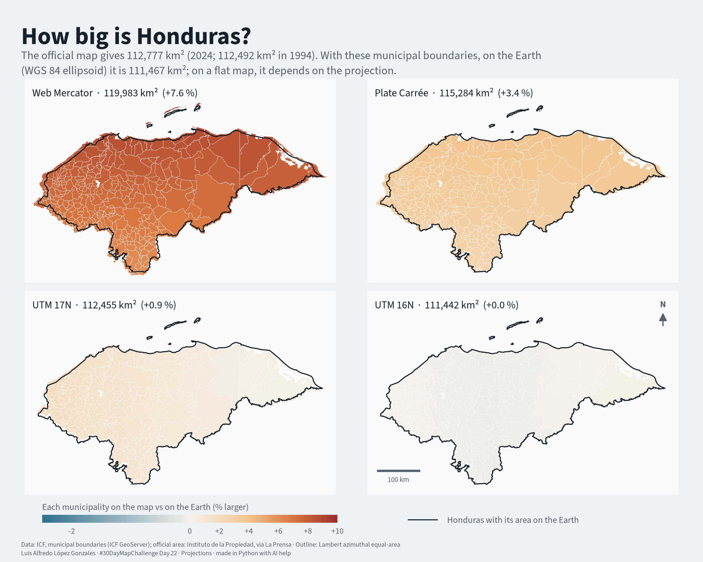

# Projections

Today's theme is *Projections*: the different ways of representing a globe on
a flat surface. Every flat map stretches the Earth somewhere. This notebook
compares the area four common projections give each of Honduras's 298
municipalities with its area on the Earth itself.

How big Honduras is depends on who measures it and how. Its official map,
printed in 1994, gave 112,492 km²; the new official map the Instituto de la
Propiedad presented in April 2024 gives 112,777 km² [@giron2026].

The municipal boundaries are ICF's layer [@icf-limite-municipios], from the
ICF GeoServer [@icf-geoserver].

```python
import geopandas as gpd
import pandas as pd

WFS = "https://geoserver.icf.gob.hn/icfpub/wfs"

municipalities = gpd.read_file(
    f"{WFS}?service=WFS&version=2.0.0&request=GetFeature"
    "&typeNames=limite_municipales_gp&outputFormat=application/json"
)
print(len(municipalities), municipalities.crs)
```

## The reference: area on the Earth

The reference is each municipality's geodesic area: measured on the WGS 84
ellipsoid, the shape of the Earth GPS uses, with no projection at all.

```python
from pyproj import Geod

geod = Geod(ellps="WGS84")
true_km2 = (
    municipalities.to_crs(4326).geometry.apply(
        lambda g: abs(geod.geometry_area_perimeter(g)[0])
    )
    / 1e6
)
print(f"Honduras: {true_km2.sum():,.0f} km²")
```

To draw that outline on a flat map, an equal-area projection keeps every area
as on the Earth: a Lambert azimuthal equal-area projection centred on
Honduras gives the same total.

```python
REFERENCE = "+proj=laea +lat_0=14.8 +lon_0=-86.6 +datum=WGS84 +units=m"
print(f"{municipalities.to_crs(REFERENCE).area.sum() / 1e6:,.0f} km²")
```

## Four projections

- **Web Mercator** (EPSG:3857), the projection of web maps (Google Maps,
  OpenStreetMap). It keeps angles, so it stretches area away from the equator.
- **Plate Carrée** (EPSG:32662), longitude and latitude drawn as a square grid.
- **UTM zone 17N** (EPSG:32617), the zone east of Honduras: most of the
  country lies outside it.
- **UTM zone 16N** (EPSG:32616), the zone that holds almost all of Honduras.

Each projection gives each municipality an area; compared with its area on
the Earth, as a percentage larger (or smaller):

```python
PROJECTIONS = {
    "Web Mercator": "EPSG:3857",
    "Plate Carrée": "EPSG:32662",
    "UTM 17N": "EPSG:32617",
    "UTM 16N": "EPSG:32616",
}
projected = {name: municipalities.to_crs(crs) for name, crs in PROJECTIONS.items()}
difference = pd.DataFrame(
    {name: (gdf.area / 1e6 / true_km2 - 1) * 100 for name, gdf in projected.items()}
)
summary = difference.describe().loc[["min", "50%", "max"]].T
summary["Honduras km²"] = [gdf.area.sum() / 1e6 for gdf in projected.values()]
summary["Honduras %"] = (summary["Honduras km²"] / true_km2.sum() - 1) * 100
summary.round(2)
```

## The map

Four panels, one per projection, each drawn at the same scale in its own
metres. The dark line is Honduras with its area on the Earth (the equal-area
reference, its coast without lagoons), placed on the same centre, so the size each projection adds shows outside
it. Only the UTM 16N panel carries a scale bar: it is the one where a
kilometre on the map is a kilometre on the ground across the country.

```python
import sys

import matplotlib.pyplot as plt
from matplotlib.colors import LinearSegmentedColormap, TwoSlopeNorm
from shapely import Polygon, unary_union
from shapely.affinity import translate

sys.path.append("../..")  # maps/, for the shared scale bar and north arrow
from cartography import add_north_arrow, add_scale_bar

plt.rcParams["font.family"] = "Source Sans 3"
BG, PANEL, INK, INK_2, EDGE = "#eef1f4", "#f9fafb", "#16202a", "#55626e", "#ffffff"
BIGGER = LinearSegmentedColormap.from_list(
    "bigger",
    [
        (0, "#2f6f8f"),
        (0.5, "#f4f1ea"),
        (0.7, "#f2c48d"),
        (0.85, "#d9763f"),
        (1, "#9c2f2a"),
    ],
)
NORM = TwoSlopeNorm(vmin=-2.5, vcenter=0, vmax=10)
TICKS = [-2, 0, 2, 4, 6, 8, 10]


def outline(gdf: gpd.GeoDataFrame):
    """The country's outline, closing the slivers between municipalities."""
    return gdf.union_all().buffer(500).buffer(-500)


def silhouette(geom):
    """Only the outer coast and the islands: lagoons and lakes closed."""
    parts = getattr(geom, "geoms", [geom])
    return unary_union([Polygon(p.exterior) for p in parts]).simplify(300)


reference = silhouette(outline(municipalities.to_crs(REFERENCE)))
outlines = {name: outline(gdf) for name, gdf in projected.items()}
# One half-width and half-height for every panel, from the largest outline
half_w = max(g.bounds[2] - g.bounds[0] for g in outlines.values()) / 2 * 1.06
half_h = max(g.bounds[3] - g.bounds[1] for g in outlines.values()) / 2 * 1.08
HEADER = 0.18 * half_h  # room at the top of each panel for its title


def centre(geom):
    x0, y0, x1, y1 = geom.bounds
    return (x0 + x1) / 2, (y0 + y1) / 2


TEXT = {
    "en": {
        "title": "How big is Honduras?",
        "subtitle": (
            "The official map gives 112,777 km² (2024; 112,492 km² in 1994). With "
            "these municipal boundaries, on the Earth\n(WGS 84 ellipsoid) it is "
            f"{true_km2.sum():,.0f} km²; on a flat map, it depends on the projection."
        ),
        "panel": "{name}  ·  {km2:,.0f} km²  ({pct:+.1f} %)",
        "globe": "Honduras with its area on the Earth",
        "legend": "Each municipality on the map vs on the Earth (% larger)",
        "credits": (
            "Data: ICF, municipal boundaries (ICF GeoServer); official area: "
            "Instituto de la Propiedad, via La Prensa · Outline: Lambert "
            "azimuthal equal-area\n"
            "Luis Alfredo López Gonzales · #30DayMapChallenge Day 22 · "
            "Projections · made in Python with AI help"
        ),
    },
    "es": {
        "title": "¿Cuánto mide Honduras?",
        "subtitle": (
            "El mapa oficial registra 112,777 km² (2024; 112,492 km² en 1994). "
            "Con estos límites municipales, sobre la Tierra\n(elipsoide WGS 84) "
            f"mide {true_km2.sum():,.0f} km²; en un mapa plano, depende de la "
            "proyección."
        ),
        "panel": "{name}  ·  {km2:,.0f} km²  ({pct:+.1f} %)",
        "globe": "Honduras con su área sobre la Tierra",
        "legend": "Cada municipio en el mapa vs. sobre la Tierra (% más grande)",
        "credits": (
            "Datos: ICF, límites municipales (GeoServer del ICF); área oficial: "
            "Instituto de la Propiedad, vía La Prensa · Silueta: Lambert "
            "azimutal de áreas iguales\n"
            "Luis Alfredo López Gonzales · #30DayMapChallenge Día 22 · "
            "Projections · hecho en Python con ayuda de IA"
        ),
    },
}


def draw_map(lang: str) -> plt.Figure:
    """Draw the four panels with the text in `lang` ("en" or "es")."""
    text = TEXT[lang]
    fig, axes = plt.subplots(
        2,
        2,
        figsize=(12, 12 * (half_h + HEADER / 2) / half_w * 0.98 + 1.9),
        facecolor=BG,
    )
    fig.subplots_adjust(
        left=0.02, right=0.98, top=0.86, bottom=0.12, wspace=0.03, hspace=0.04
    )
    for ax, (name, gdf) in zip(axes.flat, projected.items()):
        cx, cy = centre(outlines[name])
        rx, ry = centre(reference)
        ax.set_facecolor(PANEL)
        gdf.assign(diff=difference[name]).plot(
            ax=ax, column="diff", cmap=BIGGER, norm=NORM, edgecolor=EDGE, linewidth=0.25
        )
        gpd.GeoSeries([translate(reference, cx - rx, cy - ry)]).boundary.plot(
            ax=ax, color=INK, linewidth=1.3
        )
        km2 = gdf.area.sum() / 1e6
        ax.text(
            0.025,
            0.965,
            text["panel"].format(
                name=name, km2=km2, pct=round((km2 / true_km2.sum() - 1) * 100, 1) + 0.0
            ),
            transform=ax.transAxes,
            va="top",
            fontsize=13,
            color=INK,
        )
        ax.set_xlim(cx - half_w, cx + half_w)
        ax.set_ylim(cy - half_h, cy + half_h + HEADER)
        ax.set_xticks([])
        ax.set_yticks([])
        ax.set_xlabel("")
        ax.set_ylabel("")
        for spine in ax.spines.values():
            spine.set_visible(False)
        if name == "UTM 16N":
            add_scale_bar(ax, loc="lower left", color=INK_2, share=0.2)
            add_north_arrow(ax, xy=(0.95, 0.9), color=INK_2, size=0.08)

    cax = fig.add_axes([0.06, 0.07, 0.42, 0.014])
    bar = fig.colorbar(
        plt.cm.ScalarMappable(norm=NORM, cmap=BIGGER),
        cax=cax,
        orientation="horizontal",
        ticks=TICKS,
    )
    bar.ax.set_xticklabels([f"{t:+d}" if t else "0" for t in TICKS], color=INK_2)
    bar.outline.set_visible(False)
    bar.ax.tick_params(length=0)
    cax.set_title(text["legend"], fontsize=11, color=INK_2, loc="left", pad=6)
    lax = fig.add_axes([0.58, 0.055, 0.35, 0.04])
    lax.set_axis_off()
    lax.plot([0, 0.12], [0.5, 0.5], color=INK, linewidth=1.3)
    lax.text(0.16, 0.5, text["globe"], va="center", fontsize=11, color=INK_2)
    lax.set_xlim(0, 1)
    lax.set_ylim(0, 1)

    fig.text(
        0.03, 0.965, text["title"], fontsize=30, color=INK, va="top", weight="bold"
    )
    fig.text(0.03, 0.915, text["subtitle"], fontsize=14, color=INK_2, va="top")
    fig.text(0.03, 0.012, text["credits"], fontsize=8, color=INK_2)
    return fig


for lang in ("en", "es"):
    fig = draw_map(lang)
    fig.savefig(f"day22-projections-{lang}.png", dpi=200, facecolor=BG)
    plt.close(fig)
```



## References

::: {#refs}
:::
