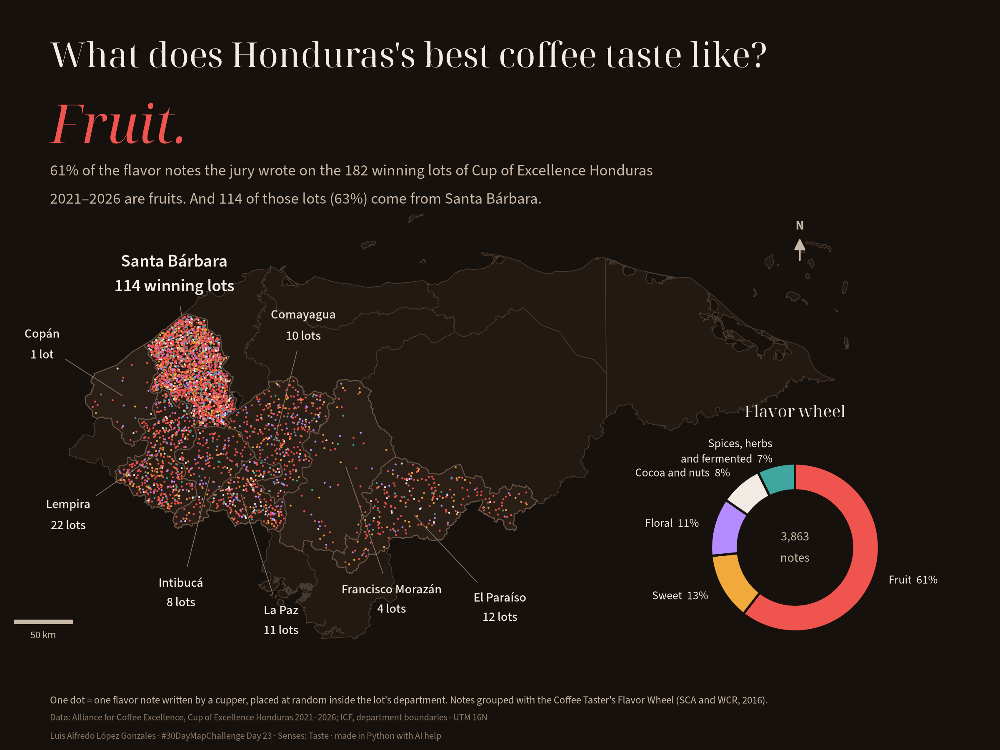

# Senses: Taste

Today's theme is *Senses: Taste*: food, drink or something else you can taste.
This notebook maps what Honduras's best coffees taste like, in the words of
the cuppers who judged them.

Cup of Excellence is a coffee competition: an international jury cups the
lots that pass the national rounds, and the lots it scores highest win and
are sold at an online auction. For each winning lot of Cup of Excellence
Honduras, the Alliance for Coffee Excellence publishes its score, variety,
process and region, and the jury's notes on its aroma and flavor
[@coe-honduras]. Lots link to their own page from 2021, so this map covers
2021–2026.

`coe_lots.py` reads the results tables and the lot pages and writes one row
per lot: year, score, variety, process, department and the jury's notes. The
source names regions, not coordinates, and the finest place every lot has is
its department. Two lots give no department and stay out.

```python
import re
import sys

import geopandas as gpd
import numpy as np
import pandas as pd

lots = pd.read_csv("coe-honduras-lots.csv")
print(len(lots), "winning lots,", lots.year.min(), "–", lots.year.max())
lots.department.value_counts()
```

## The notes

Each cupper writes the flavors they taste; when several cuppers write the
same one, the page shows it once with a count, as in `Caramel (3)`. Each
mention counts once, so a flavor three cuppers agreed on weighs three times.

The notes are grouped with the Coffee Taster's Flavor Wheel of the Specialty
Coffee Association and World Coffee Research, designed by @spencer2016: its top
tier, with *Fruity* split into its four second-tier groups. `families.py`
holds the keyword rules, in English and Spanish, since the cuppers wrote in
both. Words about texture (*juicy*, *creamy*, *clean*) are not flavors and
get no family.

```python
from families import family


def mentions(text: str):
    """Each note in a lot's list, repeated as many times as cuppers wrote it."""
    for note in str(text).split(","):
        note = note.strip()
        repeated = re.match(r"(.*?)\s*\((\d+)\)$", note)
        if repeated:
            yield from [repeated.group(1)] * int(repeated.group(2))
        elif note:
            yield note


notes = pd.DataFrame(
    [
        (lot.department, lot.variety, note, family(note))
        for lot in lots.itertuples()
        for note in mentions(lot.aroma_flavor)
    ],
    columns=["department", "variety", "note", "family"],
)
print(f"{len(notes)} mentions, {notes.family.notna().mean():.0%} with a family")
notes.family.value_counts(normalize=True).round(3)
```

The map folds the families into five groups: the four fruity ones together,
then sweet, floral, cocoa and nuts, and the rest (spices, herbs, fermented,
roasted).

```python
GROUPS = ["fruit", "sweet", "floral", "cocoa", "other"]


def group(fam) -> str | None:
    if not isinstance(fam, str):
        return None
    if fam.startswith("Fruity"):
        return "fruit"
    return {"Sweet": "sweet", "Floral": "floral", "Cocoa & nutty": "cocoa"}.get(
        fam, "other"
    )


tasted = notes.assign(group=notes.family.map(group)).dropna(subset=["group"])
share = tasted.group.value_counts(normalize=True).reindex(GROUPS)
share.round(3)
```

## By department

Santa Bárbara holds most of the winning lots. The mix of flavors changes
little from one department to another: fruit leads everywhere.

```python
by_department = pd.crosstab(tasted.department, tasted.group, normalize="index")
by_department = by_department[GROUPS].mul(100).round()
by_department.insert(0, "lots", lots.department.value_counts())
by_department.sort_values("lots", ascending=False)
```

The variety moves the cup more than the department: Geisha lots get twice
the floral notes of the rest. Intibucá and La Paz lean floral because 7 of
Intibucá's 8 lots and 9 of La Paz's 11 are Geisha.

```python
tasted["geisha"] = tasted.variety.str.contains("ge[i]?sha", case=False)
pd.crosstab(tasted.geisha, tasted.group, normalize="index")[GROUPS].mul(100).round()
```

## The map

A dot-density map: one dot per mention, colored by its group and placed at
random inside the lot's department (seeded, so it draws the same each time).
A dot's place inside the department means nothing; how many dots a department
holds and their colors do. Departments come from ICF's layer
[@icf-limite-departamentos], in UTM 16N.

The five colors follow the flavor wheel's own (fruity red, sweet amber,
floral violet), checked to stay apart for readers with color-vision
deficiency over the dark background, which stands for the coffee in the cup.

```python
departments = gpd.read_file(
    "https://geoserver.icf.gob.hn/icfpub/wfs?service=WFS&version=2.0.0"
    "&request=GetFeature&typeNames=limite_departamentos_gp"
    "&outputFormat=application/json"
)
outline = departments.set_index("depto").geometry

rng = np.random.default_rng(23)
xs, ys, kinds = [], [], []
for dep, rows in tasted.groupby("department"):
    area = outline[dep].buffer(-1500)  # keep dots off the boundary line
    x0, y0, x1, y1 = area.bounds
    x, y = np.empty(0), np.empty(0)
    while len(x) < len(rows):
        cx, cy = rng.uniform(x0, x1, 4 * len(rows)), rng.uniform(y0, y1, 4 * len(rows))
        inside = gpd.points_from_xy(cx, cy).within(area)
        x, y = np.r_[x, cx[inside]], np.r_[y, cy[inside]]
    xs.append(x[: len(rows)])
    ys.append(y[: len(rows)])
    kinds.append(rows.group.to_numpy())
# Shuffled, so no color is always drawn on top
dots = pd.DataFrame(
    {"x": np.concatenate(xs), "y": np.concatenate(ys), "group": np.concatenate(kinds)}
).sample(frac=1, random_state=23)
len(dots)
```

```python
import matplotlib.pyplot as plt

sys.path.append("../..")  # maps/, for the shared scale bar and north arrow
from cartography import add_north_arrow, add_scale_bar

plt.rcParams["font.family"] = "Source Sans 3"
SERIF = "Noto Serif Display"
BG, LAND, WON, LINE = "#17110d", "#211912", "#2a1f17", "#4a3b30"
INK, INK_2, MUTED = "#f4ece2", "#c9b9a8", "#8c7a69"
COLOR = {
    "fruit": "#f0544f",
    "sweet": "#f2a93b",
    "floral": "#b58cff",
    "cocoa": "#f1ebe3",
    "other": "#3fa7a0",
}
# Label offset from each department's inner point, in metres
LABEL_AT = {
    "Santa Bárbara": (-15e3, 85e3),
    "Copán": (-70e3, 45e3),
    "Lempira": (-80e3, -55e3),
    "Intibucá": (-25e3, -100e3),
    "La Paz": (35e3, -110e3),
    "Comayagua": (25e3, 100e3),
    "Francisco Morazán": (40e3, -115e3),
    "El Paraíso": (75e3, -80e3),
}
counts = lots.department.value_counts()
n_lots, n_notes = len(lots), len(tasted)
top = counts.iloc[0]

TEXT = {
    "es": {
        "question": "¿A qué sabe el mejor café de Honduras?",
        "answer": "A fruta.",
        "subtitle": (
            f"{share['fruit']:.0%} de las notas de sabor que el jurado escribió "
            f"sobre los {n_lots} lotes ganadores de la Taza de\nExcelencia Honduras "
            f"2021–2026 son frutas. Y {top} de esos lotes ({top / n_lots:.0%}) "
            "vienen de Santa Bárbara."
        ).replace("%", " %"),
        "lots": ("lote", "lotes", "lotes ganadores"),
        "groups": {
            "fruit": "Fruta",
            "sweet": "Dulce",
            "floral": "Floral",
            "cocoa": "Cacao y nueces",
            "other": "Especias, hierbas\ny fermentados",
        },
        "wheel": "Rueda de sabor",
        "centre": f"{n_notes}\nnotas",
        "note": (
            "Un punto = una nota de sabor escrita por un catador, ubicada al azar "
            "dentro del departamento del lote. Notas agrupadas con la Rueda de "
            "Sabores del Catador de Café (SCA y WCR, 2016)."
        ),
        "credits": (
            "Datos: Alliance for Coffee Excellence, Cup of Excellence Honduras "
            "2021–2026; ICF, límites departamentales · UTM 16N\n"
            "Luis Alfredo López Gonzales · #30DayMapChallenge Día 23 · "
            "Senses: Taste · hecho en Python con ayuda de IA"
        ),
    },
    "en": {
        "question": "What does Honduras's best coffee taste like?",
        "answer": "Fruit.",
        "subtitle": (
            f"{share['fruit']:.0%} of the flavor notes the jury wrote on the "
            f"{n_lots} winning lots of Cup of Excellence Honduras\n2021–2026 are "
            f"fruits. And {top} of those lots ({top / n_lots:.0%}) come from "
            "Santa Bárbara."
        ),
        "lots": ("lot", "lots", "winning lots"),
        "groups": {
            "fruit": "Fruit",
            "sweet": "Sweet",
            "floral": "Floral",
            "cocoa": "Cocoa and nuts",
            "other": "Spices, herbs\nand fermented",
        },
        "wheel": "Flavor wheel",
        "centre": f"{n_notes:,}\nnotes",
        "note": (
            "One dot = one flavor note written by a cupper, placed at random "
            "inside the lot's department. Notes grouped with the Coffee Taster's "
            "Flavor Wheel (SCA and WCR, 2016)."
        ),
        "credits": (
            "Data: Alliance for Coffee Excellence, Cup of Excellence Honduras "
            "2021–2026; ICF, department boundaries · UTM 16N\n"
            "Luis Alfredo López Gonzales · #30DayMapChallenge Day 23 · "
            "Senses: Taste · made in Python with AI help"
        ),
    },
}


def lot_label(dep: str, words: tuple[str, str, str]) -> str:
    n = counts[dep]
    unit = words[2] if dep == "Santa Bárbara" else words[0] if n == 1 else words[1]
    return f"{dep}\n{n} {unit}"


def draw_map(lang: str) -> plt.Figure:
    """Draw the map with the text in `lang` ("en" or "es")."""
    text = TEXT[lang]
    fig = plt.figure(figsize=(12, 9), facecolor=BG)

    ax = fig.add_axes([0.0, 0.08, 0.86, 0.68])
    ax.set_axis_off()
    departments.plot(ax=ax, facecolor=LAND, edgecolor=LINE, linewidth=0.6)
    departments[departments.depto.isin(counts.index)].plot(
        ax=ax, facecolor=WON, edgecolor="#6b5646", linewidth=0.8
    )
    ax.scatter(dots.x, dots.y, s=3, c=dots.group.map(COLOR), linewidths=0, alpha=0.95)
    x0, y0, x1, y1 = departments.total_bounds
    ax.set_xlim(x0 - 60e3, x1 + 10e3)
    ax.set_ylim(y0 - 15e3, y1 - 20e3)
    ax.set_aspect("equal")
    for dep, (dx, dy) in LABEL_AT.items():
        p = outline[dep].representative_point()
        big = dep == "Santa Bárbara"
        ax.annotate(
            lot_label(dep, text["lots"]),
            (p.x, p.y),
            (p.x + dx, p.y + dy),
            color=INK,
            fontsize=15 if big else 11,
            fontweight="semibold" if big else "medium",
            ha="center",
            va="center",
            linespacing=1.15,
            arrowprops=dict(arrowstyle="-", color=MUTED, lw=0.6, shrinkA=3, shrinkB=0),
        )
    add_scale_bar(ax, loc="lower left", color=INK_2, share=0.12)
    add_north_arrow(ax, xy=(0.93, 0.95), color=INK_2)

    wheel = fig.add_axes([0.69, 0.13, 0.21, 0.28])
    wedges, _ = wheel.pie(
        share.values,
        colors=[COLOR[g] for g in GROUPS],
        startangle=90,
        counterclock=False,
        wedgeprops=dict(width=0.32, edgecolor=BG, linewidth=2),
    )
    for wedge, g in zip(wedges, GROUPS):
        angle = np.deg2rad((wedge.theta1 + wedge.theta2) / 2)
        right = np.cos(angle) > 0
        wheel.text(
            1.18 * np.cos(angle),
            1.18 * np.sin(angle),
            f"{text['groups'][g]}  {share[g]:.0%}".replace(
                "%", " %" if lang == "es" else "%"
            ),
            ha="left" if right else "right",
            va="center",
            color=INK,
            fontsize=10,
        )
    wheel.text(
        0,
        0,
        text["centre"],
        ha="center",
        va="center",
        color=INK_2,
        fontsize=11,
        linespacing=1.2,
    )
    wheel.set_title(text["wheel"], family=SERIF, color=INK, fontsize=14, pad=22)
    wheel.set_aspect("equal")

    fig.text(
        0.05, 0.96, text["question"], family=SERIF, fontsize=30, color=INK, va="top"
    )
    fig.text(
        0.05,
        0.885,
        text["answer"],
        family=SERIF,
        fontsize=46,
        color=COLOR["fruit"],
        style="italic",
        va="top",
    )
    fig.text(
        0.05,
        0.79,
        text["subtitle"],
        fontsize=13.5,
        color=INK_2,
        va="top",
        linespacing=1.35,
    )
    fig.text(0.05, 0.062, text["note"], fontsize=9, color=INK_2)
    fig.text(0.05, 0.015, text["credits"], fontsize=8, color=MUTED, linespacing=1.5)
    return fig


for lang in ("en", "es"):
    fig = draw_map(lang)
    fig.savefig(f"day23-taste-{lang}.png", dpi=200, facecolor=BG)
    plt.close(fig)
```



## References

::: {#refs}
:::
