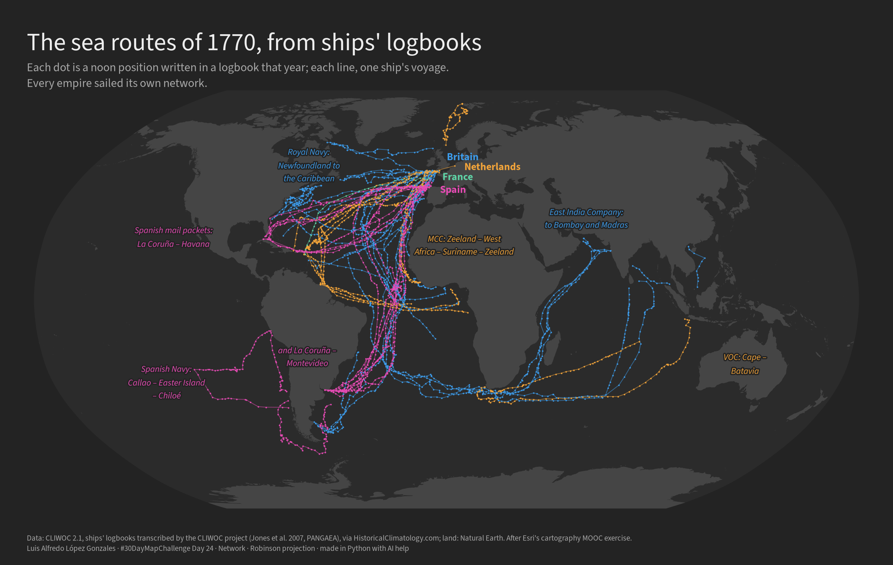
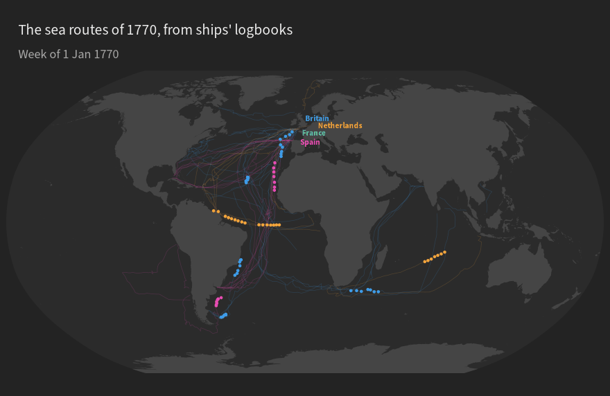

# The sea routes of 1770, from ships' logbooks

Today's theme asks for a *"route network, transit network, human network or
something completely different"*.

In the 18th century every ship kept a logbook: each day at noon the officer
wrote down the position, the wind and the weather. The CLIWOC project
(Climatological Database for the World's Oceans) transcribed thousands of
British, Dutch, Spanish and French logbooks from 1750 to 1854 into a database
of daily positions [@jones2007]. One year of it, 1770, draws the sea routes the
European empires sailed, and each empire had its own network.

This map recreates in Python an exercise from Esri's cartography MOOC, where
the same year of CLIWOC is animated in ArcGIS Pro. The data here is the
CLIWOC 2.1 release as a GeoPackage from HistoricalClimatology.com; land comes
from Natural Earth [@naturalearth].

```python
import io
import subprocess
import tempfile
import zipfile
from pathlib import Path
from urllib.request import urlopen

import geopandas as gpd
import matplotlib.pyplot as plt
import numpy as np
import pandas as pd
from matplotlib import patheffects
from matplotlib.animation import FuncAnimation, PillowWriter
from shapely.geometry import LineString, Polygon

CLIWOC_URL = "https://www.historicalclimatology.com/downloads/cliwoc21-data.zip"
LAND_URL = "https://naciscdn.org/naturalearth/50m/physical/ne_50m_land.zip"
CRS = "ESRI:54030"  # Robinson, as in the original exercise
YEAR = 1770

work = Path(tempfile.mkdtemp())
# 93 MB; the site refuses Python's default user agent, curl gets it
subprocess.run(["curl", "-sSL", "-o", str(work / "cliwoc.zip"), CLIWOC_URL], check=True)
with zipfile.ZipFile(work / "cliwoc.zip") as archive:
    archive.extract("cliwoc21.gpkg", work)

columns = ["YR", "MO", "DY", "C1", "ShipName", "Company", "ShipType"]
columns += ["VoyageFrom", "VoyageTo"]
logs = gpd.read_file(work / "cliwoc21.gpkg", where=f"YR = {YEAR}", columns=columns)
logs["date"] = pd.to_datetime(
    logs[["YR", "MO", "DY"]].set_axis(["year", "month", "day"], axis=1)
)
print(len(logs), "log entries")
```

Some entries record the weather of a day but no position (often a ship at
anchor); without a place they cannot go on the map:

```python
has_position = logs.geometry.x.notna()  # empty points have no x
print((~has_position).sum(), "entries without a position")
logs = logs[has_position].copy()
print(len(logs), "positions")
```

## Who logged the year

`C1` is the country of the logbook. Each ship is one name and nation:

```python
logs.groupby("C1").agg(
    positions=("date", "size"), ships=("ShipName", "nunique")
).sort_values("positions", ascending=False)
```

The voyages, from each logbook's own *from* and *to*, show the shape of each
network:

```python
voyages = (
    logs.dropna(subset=["VoyageFrom", "VoyageTo"])
    .groupby(["C1", "Company", "VoyageFrom", "VoyageTo"], dropna=False)
    .agg(ships=("ShipName", "nunique"), days=("date", "size"))
    .reset_index()
)
voyages.sort_values(["C1", "Company", "days"], ascending=[True, True, False])
```


- **Spain** is almost all one line: the *Correos Marítimos*, the royal mail
  packets (*paquebotes*), sailing from La Coruña to Havana and to Montevideo
  and back, again and again through the year. Two Navy ships sail the Pacific
  coast, one of them to Easter Island.
- **The Netherlands**: the Middelburg company (MCC) runs the triangle from
  Zeeland to West Africa, across to Suriname and home; the VOC sails between
  the Cape of Good Hope and Batavia; a whaler goes to Spitsbergen.
- **Britain**: Royal Navy ships go everywhere in the Atlantic (Newfoundland,
  Halifax, Boston, Jamaica, West Africa, the Falklands), and the East India
  Company (EIC) sails round the Cape to Bombay and Madras.

The MCC's triangle was the slave trade: its ships bought enslaved Africans
on the West African coast (Axim, Malimba, the Gulf of Guinea in these logs)
and sold them in Suriname. On the map it is only a line; the company's
archive, in UNESCO's Memory of the World since 2011, is a record of that
trade from Middelburg across the Atlantic [@unesco-mcc].

These are only the logbooks that survived and were transcribed, not all the
ships at sea in 1770.

## From positions to routes

Each ship's daily positions, in date order, become a line. A line breaks where
the log has a gap of more than ten days (a stay in port, a missing page) or
where it crosses the 180° meridian, so it does not cut across the map.


```python
def tracks(points: pd.DataFrame) -> list[LineString]:
    points = points.sort_values("date")
    lon, lat = points.geometry.x.to_numpy(), points.geometry.y.to_numpy()
    days = points["date"].to_numpy()
    breaks = (np.diff(days) > np.timedelta64(10, "D")) | (np.abs(np.diff(lon)) > 180)
    pieces = np.split(np.arange(len(points)), np.flatnonzero(breaks) + 1)
    return [LineString(zip(lon[i], lat[i])) for i in pieces if len(i) > 1]


routes = gpd.GeoDataFrame(
    [
        {"C1": nation, "ShipName": ship, "geometry": line}
        for (nation, ship), points in logs.groupby(["C1", "ShipName"])
        for line in tracks(points)
    ],
    crs=4326,
)
print(len(routes), "route pieces")
```

## The map

```python
with urlopen(LAND_URL) as response:
    land = gpd.read_file(io.BytesIO(response.read())).to_crs(CRS)

# The edge of the world in Robinson, drawn from its meridians at ±180°
edge_lat = np.linspace(-90, 90, 181)
outline = gpd.GeoSeries(
    [
        Polygon(
            list(zip(np.full(181, -180.0), edge_lat))
            + list(zip(np.full(181, 180.0), edge_lat[::-1]))
        )
    ],
    crs=4326,
).to_crs(CRS)
xmin, ymin, xmax, ymax = outline.total_bounds

positions = logs.to_crs(CRS)
routes_r = routes.to_crs(CRS)

BG, SEA, LAND_C, INK, INK_2 = "#232323", "#2b2b2b", "#454545", "#eeeeee", "#a8a8a8"
NATION = {"UK": "#3d9be9", "NL": "#f2a43a", "ES": "#e64bb4", "FR": "#5fd3a6"}
plt.rcParams["font.family"] = "Source Sans 3"
```

The four nations get the colours of the original exercise (France, with one
ship, is added). Their names, written where each fleet starts, are the legend.

```python
TEXT = {
    "en": {
        "title": "The sea routes of 1770, from ships' logbooks",
        "subtitle": (
            "Each dot is a noon position written in a logbook that year; each "
            "line, one ship's voyage.\nEvery empire sailed its own network."
        ),
        "nations": {
            "UK": "Britain",
            "NL": "Netherlands",
            "ES": "Spain",
            "FR": "France",
        },
        "notes": [
            ("ES", -122, 24, "Spanish mail packets:\nLa Coruña – Havana"),
            ("ES", -62, -22, "and La Coruña –\nMontevideo"),
            ("NL", 8, 21, "MCC: Zeeland – West\nAfrica – Suriname – Zeeland"),
            ("UK", 64, 31, "East India Company:\nto Bombay and Madras"),
            ("NL", 134, -25, "VOC: Cape –\nBatavia"),
            ("UK", -70, 52, "Royal Navy:\nNewfoundland to\nthe Caribbean"),
            ("ES", -128, -32, "Spanish Navy:\nCallao – Easter Island\n– Chiloé"),
        ],
        "credits": (
            "Data: CLIWOC 2.1, ships' logbooks transcribed by the CLIWOC project "
            "(Jones et al. 2007, PANGAEA), via HistoricalClimatology.com; land: "
            "Natural Earth. After Esri's cartography MOOC exercise.\n"
            "Luis Alfredo López Gonzales · #30DayMapChallenge Day 24 · Network · "
            "Robinson projection · made in Python with AI help"
        ),
        "months": "Jan Feb Mar Apr May Jun Jul Aug Sep Oct Nov Dec".split(),
        "week": "Week of {d} {m} {y}",
    },
    "es": {
        "title": "Las rutas del mar en 1770, según los diarios de a bordo",
        "subtitle": (
            "Cada punto es una posición de mediodía anotada en un diario de "
            "navegación ese año; cada línea,\nel viaje de un barco. Cada imperio "
            "navegaba su propia red."
        ),
        "nations": {
            "UK": "Gran Bretaña",
            "NL": "Países Bajos",
            "ES": "España",
            "FR": "Francia",
        },
        "notes": [
            ("ES", -122, 24, "Correos marítimos:\nLa Coruña – La Habana"),
            ("ES", -62, -22, "y La Coruña –\nMontevideo"),
            ("NL", 8, 21, "MCC: Zelanda – África\noccidental – Surinam – Zelanda"),
            ("UK", 64, 31, "Compañía de las Indias:\na Bombay y Madrás"),
            ("NL", 134, -25, "VOC: el Cabo –\nBatavia"),
            ("UK", -70, 52, "Armada británica:\nde Terranova\nal Caribe"),
            ("ES", -128, -32, "Armada española:\nEl Callao – Isla de Pascua\n– Chiloé"),
        ],
        "credits": (
            "Datos: CLIWOC 2.1, diarios de a bordo transcritos por el proyecto "
            "CLIWOC (Jones et al. 2007, PANGAEA), vía HistoricalClimatology.com; "
            "tierra: Natural Earth. Basado en un ejercicio del MOOC de "
            "cartografía de Esri.\n"
            "Luis Alfredo López Gonzales · #30DayMapChallenge Día 24 · Network · "
            "proyección Robinson · hecho en Python con ayuda de IA"
        ),
        "months": "ene feb mar abr may jun jul ago sep oct nov dic".split(),
        "week": "Semana del {d} de {m} de {y}",
    },
}

# Where each nation's name sits (lon, lat): near its home ports
HOME = {"UK": (-3, 55.5), "NL": (6, 51.5), "ES": (-6, 42.5), "FR": (-5, 47.5)}


def to_xy(lon: float, lat: float) -> tuple[float, float]:
    point = gpd.GeoSeries.from_xy([lon], [lat], crs=4326).to_crs(CRS)
    return point.x.iloc[0], point.y.iloc[0]


def base_map(fig: plt.Figure, rect: list, lang: str, size: float = 10) -> plt.Axes:
    ax = fig.add_axes(rect)
    ax.set_axis_off()
    outline.plot(ax=ax, facecolor=SEA, edgecolor="none", zorder=0)
    land.plot(ax=ax, color=LAND_C, linewidth=0, zorder=1)
    for nation, (lon, lat) in HOME.items():
        x, y = to_xy(lon, lat)
        ax.text(
            x + 2.5e5,
            y,
            TEXT[lang]["nations"][nation],
            color=NATION[nation],
            fontsize=size,
            fontweight="bold",
            va="center",
            zorder=6,
        )
    ax.set_xlim(xmin, xmax)
    ax.set_ylim(ymin, ymax)
    return ax


def draw_map(lang: str) -> plt.Figure:
    """The whole year: every route and every position, text in `lang`."""
    text = TEXT[lang]
    fig = plt.figure(figsize=(12, 7.6), facecolor=BG)
    ax = base_map(fig, [0.02, 0.1, 0.96, 0.74], lang)
    for nation, color in NATION.items():
        routes_r[routes_r["C1"] == nation].plot(
            ax=ax, color=color, linewidth=0.7, alpha=0.55, zorder=2
        )
        pts = positions[positions["C1"] == nation]
        ax.scatter(pts.geometry.x, pts.geometry.y, s=2.2, color=color, lw=0, zorder=3)
    for nation, lon, lat, note in text["notes"]:
        x, y = to_xy(lon, lat)
        ax.text(
            x,
            y,
            note,
            color=NATION[nation],
            fontsize=8.5,
            style="italic",
            ha="center",
            va="center",
            zorder=6,
            linespacing=1.1,
            path_effects=[patheffects.withStroke(linewidth=2.5, foreground=BG)],
        )
    fig.text(0.03, 0.955, text["title"], fontsize=24, color=INK, va="top")
    fig.text(0.03, 0.895, text["subtitle"], fontsize=11.5, color=INK_2, va="top")
    fig.text(0.03, 0.025, text["credits"], fontsize=7.5, color=INK_2)
    return fig


for lang in ("en", "es"):
    fig = draw_map(lang)
    fig.savefig(f"day24-sea-routes-1770-{lang}.png", dpi=200, facecolor=BG)
    plt.close(fig)
```



## Through the year

As in the original exercise, the animation keeps the map still and moves the
time: each frame shows the positions logged in one week, over the faint lines
of the whole year, so the only thing that moves is the ships.

```python
WEEKS = pd.date_range(f"{YEAR}-01-01", f"{YEAR}-12-31", freq="7D")


def animate(lang: str) -> None:
    text = TEXT[lang]
    fig = plt.figure(figsize=(8, 5.2), facecolor=BG)
    ax = base_map(fig, [0.01, 0.04, 0.98, 0.8], lang, size=7.5)
    for nation, color in NATION.items():
        routes_r[routes_r["C1"] == nation].plot(
            ax=ax, color=color, linewidth=0.5, alpha=0.18, zorder=2
        )
    dots = ax.scatter([], [], s=9, lw=0, zorder=4)
    fig.text(0.03, 0.95, text["title"], fontsize=14, color=INK, va="top")
    label = fig.text(0.03, 0.885, "", fontsize=12, color=INK_2, va="top")

    def frame(start: pd.Timestamp):
        week = positions[
            (positions["date"] >= start)
            & (positions["date"] < start + pd.Timedelta(days=7))
        ]
        dots.set_offsets(np.c_[week.geometry.x, week.geometry.y].reshape(-1, 2))
        dots.set_color([NATION[n] for n in week["C1"]])
        label.set_text(
            text["week"].format(d=start.day, m=text["months"][start.month - 1], y=YEAR)
        )
        return dots, label

    movie = FuncAnimation(fig, frame, frames=WEEKS, blit=False)
    movie.save(
        f"day24-sea-routes-1770-{lang}.gif",
        writer=PillowWriter(fps=4),
        dpi=110,
        savefig_kwargs={"facecolor": BG},
    )
    plt.close(fig)


for lang in ("en", "es"):
    animate(lang)
```



## References

::: {#refs}
:::
