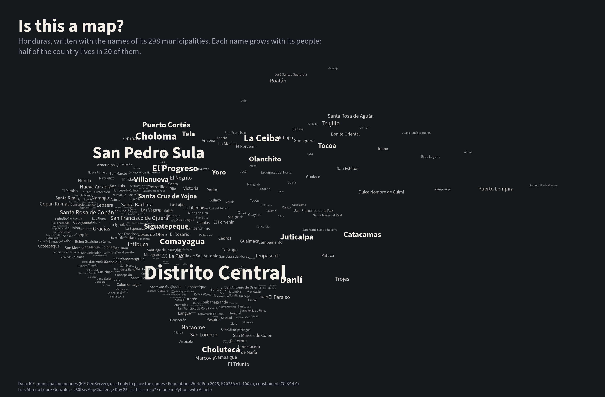

# Is this a map?

Today's theme is *Is this a map?*: stretch the limits of maps and blend a map
with an artwork or a creative data visualization. When does something become a
map, and when does it stop being one?

This map has no borders, no coast, no background, scale bar or north arrow:
only the names of Honduras's 298 municipalities, each written at its place and
sized by how many people live there. If the country's shape still shows, the
names alone make it a map.

The municipal boundaries are ICF's layer [@icf-limite-municipios], from the
ICF GeoServer [@icf-geoserver]. They place each name and are never drawn.

```python
import subprocess
import tempfile
from pathlib import Path

import geopandas as gpd
import matplotlib.pyplot as plt
import numpy as np
import rasterio
from rasterio.mask import mask
from shapely.geometry import Point, box

WFS = "https://geoserver.icf.gob.hn/icfpub/wfs"

municipalities = gpd.read_file(
    f"{WFS}?service=WFS&version=2.0.0&request=GetFeature"
    "&typeNames=limite_municipales_gp&outputFormat=application/json"
)
print(len(municipalities), municipalities.crs)
```

## People per municipality

Population comes from WorldPop's 2025 estimate [@worldpop-r2025a], a 100 m
grid (the constrained version, which puts people only where there are
buildings). Each municipality's population is the sum of its pixels.

```python
POP_URL = (
    "https://data.worldpop.org/GIS/Population/Global_2015_2030/R2025A/2025/HND/"
    "v1/100m/constrained/hnd_pop_2025_CN_100m_R2025A_v1.tif"
)
work = Path(tempfile.mkdtemp())
pop_tif = work / "hnd_pop_2025.tif"
subprocess.run(["curl", "-sSL", "-o", str(pop_tif), POP_URL], check=True)

with rasterio.open(pop_tif) as src:
    shapes = municipalities.to_crs(src.crs).geometry
    municipalities["pop"] = [
        float(mask(src, [g], crop=True, filled=False)[0].sum()) for g in shapes
    ]
print(f"Honduras, 2025: {municipalities['pop'].sum():,.0f} people")
municipalities.nlargest(8, "pop")[["nombre", "pop", "km2"]].round()
```

Half of the people live in a few municipalities:

```python
by_pop = municipalities.sort_values("pop", ascending=False)
share = by_pop["pop"].cumsum() / by_pop["pop"].sum()
HALF = int((share < 0.5).sum()) + 1
half_area = by_pop["km2"].iloc[:HALF].sum() / municipalities["km2"].sum()
print(f"Half of the people live in {HALF} of 298 municipalities, {half_area:.0%} of the land")
```

## Placing the names

Each name's font size grows with the square root of its population, so the
area of the word grows with the number of people. Names are placed from the
most populated down. Each one starts at a point inside its municipality; if
it would overlap a name already placed, it tries other points inside the
municipality (or up to 2.5 km outside it), then two lines, then smaller
sizes (down to 45%). In the densest corners, a few small names still touch:
La Lima, all of it inside the space San Pedro Sula's name takes, is one.

```python
plt.rcParams["font.family"] = "Source Sans 3"
BG, INK, INK_2 = "#14181d", "#f3efe6", "#9aa3ad"
MIN_PT, MAX_PT = 3, 40


def size(pop: float) -> float:
    """Font size in points; the word's area grows with the population."""
    return MIN_PT + (MAX_PT - MIN_PT) * np.sqrt(pop / municipalities["pop"].max())


def two_lines(name: str) -> str:
    words = name.split(" ")
    if len(words) == 1:
        return name
    return " ".join(words[: len(words) // 2]) + "\n" + " ".join(words[len(words) // 2 :])


def candidates(geom, rng, n: int = 600) -> list[Point]:
    """A point inside the municipality, then others around it, nearest first."""
    start = geom.representative_point()
    area = geom.buffer(2500)
    x0, y0, x1, y1 = area.bounds
    points = (Point(rng.uniform(x0, x1), rng.uniform(y0, y1)) for _ in range(n))
    inside = [p for p in points if area.contains(p)]
    return [start] + sorted(inside, key=start.distance)


def place_names(ax) -> int:
    """Write every name on `ax` without overlaps where possible; return the overlaps."""
    renderer = ax.figure.canvas.get_renderer()
    to_data = ax.transData.inverted()
    rng = np.random.default_rng(25)  # seeded: the same layout every run
    placed, overlaps = [], 0

    def extent(text):
        e = text.get_window_extent(renderer).expanded(1.02, 1.0)
        (a, b), (c, d) = to_data.transform([[e.x0, e.y0], [e.x1, e.y1]])
        return box(a, b, c, d)

    def fits(text, label: str, points_size: float, points: list[Point]) -> bool:
        """Move `text` to the first point where it overlaps no placed name."""
        text.set_text(label)
        text.set_fontsize(points_size)
        text.set_position((0, 0))
        w0, h0, w1, h1 = extent(text).bounds  # measured once, then only moved
        for p in points:
            moved = box(p.x + w0, p.y + h0, p.x + w1, p.y + h1)
            if not any(moved.intersects(o) for o in placed):
                text.set_position((p.x, p.y))
                return True
        return False

    for row in by_pop.itertuples():
        pt = size(row.pop)
        text = ax.text(
            0, 0, row.nombre, ha="center", va="center", color=INK, linespacing=0.9,
            alpha=0.4 + 0.6 * min(1, pt / 15), weight="bold" if pt > 12 else "normal",
        )
        points = candidates(row.geometry, rng)
        tries = [
            (label, pt * k)
            for k in (1, 0.85, 0.7, 0.55, 0.45)
            for label in (row.nombre, two_lines(row.nombre))
        ]
        if not any(fits(text, label, s, points) for label, s in tries):
            # no free spot: the smallest two-line version at its own point
            overlaps += 1
            text.set_text(two_lines(row.nombre))
            text.set_fontsize(pt * 0.45)
            text.set_position((points[0].x, points[0].y))
        placed.append(extent(text))
    return overlaps
```

## The map

Dark background, light type: only the words. The country is in UTM 16N, the
ICF layer's own CRS.

```python
TEXT = {
    "en": {
        "title": "Is this a map?",
        "subtitle": (
            "Honduras, written with the names of its 298 municipalities. Each name "
            "grows with its people:\n"
            f"half of the country lives in {HALF} of them."
        ),
        "credits": (
            "Data: ICF, municipal boundaries (ICF GeoServer), used only to place "
            "the names · Population: WorldPop 2025, R2025A v1, 100 m, constrained "
            "(CC BY 4.0)\n"
            "Luis Alfredo López Gonzales · #30DayMapChallenge Day 25 · "
            "Is this a map? · made in Python with AI help"
        ),
    },
    "es": {
        "title": "¿Es esto un mapa?",
        "subtitle": (
            "Honduras, escrita con los nombres de sus 298 municipios. Cada nombre "
            "crece con su gente:\n"
            f"la mitad del país vive en {HALF} de ellos."
        ),
        "credits": (
            "Datos: ICF, límites municipales (GeoServer del ICF), usados solo para "
            "ubicar los nombres · Población: WorldPop 2025, R2025A v1, 100 m, "
            "restringida (CC BY 4.0)\n"
            "Luis Alfredo López Gonzales · #30DayMapChallenge Día 25 · "
            "Is this a map? · hecho en Python con ayuda de IA"
        ),
    },
}


def draw_map(lang: str) -> tuple[plt.Figure, int]:
    text = TEXT[lang]
    fig = plt.figure(figsize=(16, 10.5), facecolor=BG)
    ax = fig.add_axes([0.02, 0.06, 0.96, 0.78])
    ax.set_axis_off()
    x0, y0, x1, y1 = municipalities.total_bounds
    ax.set_xlim(x0, x1)
    ax.set_ylim(y0, y1)
    ax.set_aspect("equal")
    overlaps = place_names(ax)
    fig.text(0.03, 0.965, text["title"], fontsize=34, color=INK, va="top", weight="bold")
    fig.text(0.03, 0.91, text["subtitle"], fontsize=15, color=INK_2, va="top")
    fig.text(0.03, 0.015, text["credits"], fontsize=8.5, color=INK_2)
    return fig, overlaps


for lang in ("en", "es"):
    fig, overlaps = draw_map(lang)
    fig.savefig(f"day25-names-{lang}.png", dpi=200, facecolor=BG)
    plt.close(fig)
print(f"{overlaps} names still touch another")
```



```python
import shutil

shutil.rmtree(work)  # the downloaded WorldPop raster
```

## References

::: {#refs}
:::
