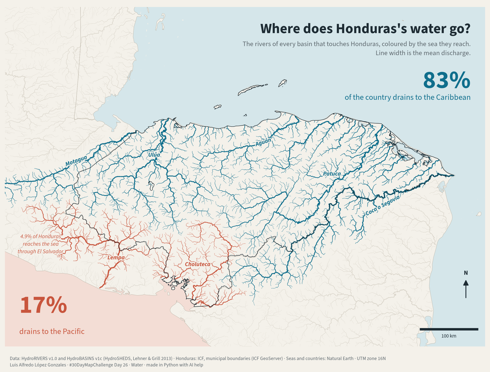

# Water

Today's theme is *Water*: "About 71% of the Earth's surface. That wet thing,
you know?"

Every drop of rain that falls on Honduras ends up in one of two seas, the
Caribbean or the Pacific. This map follows the rivers to find out how much of
the country drains to each, and which rivers carry Honduran water out through
a neighbour.

Rivers come from HydroRIVERS v1.0 and catchments from HydroBASINS v1c, both
part of HydroSHEDS [@lehner2013]. The country's outline is ICF's municipal
boundaries layer [@icf-limite-municipios], from the ICF GeoServer
[@icf-geoserver]; seas and neighbouring countries are Natural Earth
[@naturalearth].

```python
import subprocess
import sys
import tempfile
import zipfile
from pathlib import Path

import geopandas as gpd
import matplotlib.pyplot as plt
import numpy as np
from matplotlib import patheffects
from shapely.geometry import Point, Polygon

sys.path.append("../..")  # maps/, for the shared scale bar and north arrow
from cartography import add_north_arrow, add_scale_bar

CRS = 32616  # WGS 84 / UTM zone 16N, in metres
BBOX = (-91.5, 11.5, -82.0, 18.5)  # lon/lat box around Honduras and its basins
WFS = "https://geoserver.icf.gob.hn/icfpub/wfs"
DOWNLOADS = {
    "rivers": "https://data.hydrosheds.org/file/HydroRIVERS/HydroRIVERS_v10_na_shp.zip",
    "basins": "https://data.hydrosheds.org/file/hydrobasins/standard/hybas_na_lev12_v1c.zip",
    "ocean": "https://naciscdn.org/naturalearth/10m/physical/ne_10m_ocean.zip",
    "countries": "https://naciscdn.org/naturalearth/10m/cultural/ne_10m_admin_0_countries.zip",
}

work = Path(tempfile.mkdtemp())
for name, url in DOWNLOADS.items():
    subprocess.run(["curl", "-sSL", "-o", str(work / f"{name}.zip"), url], check=True)
with zipfile.ZipFile(work / "rivers.zip") as z:
    z.extractall(work)  # the shapefile sits in a folder inside the zip

rivers = gpd.read_file(
    work / "HydroRIVERS_v10_na_shp" / "HydroRIVERS_v10_na.shp", bbox=BBOX
)
basins = gpd.read_file(f"zip://{work / 'basins.zip'}", bbox=BBOX)
ocean = gpd.read_file(f"zip://{work / 'ocean.zip'}", bbox=BBOX)
countries = gpd.read_file(f"zip://{work / 'countries.zip'}", bbox=BBOX)
municipalities = gpd.read_file(
    f"{WFS}?service=WFS&version=2.0.0&request=GetFeature"
    "&typeNames=limite_municipales_gp&outputFormat=application/json"
)
honduras = municipalities.dissolve().to_crs(4326)
print(len(rivers), "river reaches;", len(basins), "level-12 catchments")
```

## Which sea each catchment drains to

HydroBASINS splits the land into small catchments (level 12, the finest), and
each one records `NEXT_SINK`, the catchment where its water finally leaves the
land. Inside the box, the ocean is two separate pieces, the Caribbean and the
Pacific, because the isthmus cuts them apart. Each sink goes to the piece it
touches (the nearest one), and every catchment takes its sink's sea.

```python
seas = ocean.clip(BBOX).explode(ignore_index=True)
seas = seas[seas.to_crs(CRS).area > 1e9]  # the two open seas, not lagoons
caribbean_point = Point(-84, 17.5)
seas["sea"] = np.where(seas.contains(caribbean_point), "Caribbean", "Pacific")
seas = seas.dissolve("sea").to_crs(CRS)

sinks = basins.set_index("HYBAS_ID").geometry.to_crs(CRS)
sink_sea = {
    sink: seas.distance(sinks[sink]).idxmin()
    for sink in basins.NEXT_SINK.unique()
    if sink in sinks.index
}
basins["sea"] = basins.NEXT_SINK.map(sink_sea)
print(basins.sea.value_counts(dropna=False))
```

## How much of Honduras drains to each sea

The catchments are cut to the country's outline and their areas summed in an
equal-area projection:

```python
EQUAL_AREA = "+proj=laea +lat_0=15 +lon_0=-86.5"
inside = gpd.overlay(
    basins[["HYBAS_ID", "NEXT_SINK", "ENDO", "sea", "geometry"]],
    honduras[["geometry"]],
    how="intersection",
).to_crs(EQUAL_AREA)
inside["km2"] = inside.area / 1e6
total = inside.km2.sum()
print(
    f"Honduras: {total:,.0f} km²; endorheic: {inside[inside.ENDO > 0].km2.sum():.0f} km²"
)
share = (inside.groupby("sea").km2.sum() / total * 100).round(1)
share
```

Four of every five hectares drain to the Caribbean. The Pacific gets only the
south: the Choluteca, the Nacaome, the Goascorán and the Honduran tributaries
of the Lempa.

The largest river systems, by the Honduran land they drain:

```python
systems = inside.groupby(["NEXT_SINK", "sea"]).km2.sum().reset_index()
systems["share_%"] = (systems.km2 / total * 100).round(1)
systems["mouth_lon_lat"] = [
    tuple(np.round(sinks.to_crs(4326)[s].representative_point().coords[0], 2))
    for s in systems.NEXT_SINK
]
systems.sort_values("km2", ascending=False).head(8).round({"km2": 0})
```

Matched to their mouths, the top ones are the Patuca (21%), the Ulúa (19.5%),
the Aguán (9.6%), the Choluteca (7%), the Sico (5.8%), the Coco (4.9%)
and the Lempa (4.9%). The Patuca and the Ulúa alone drain two fifths of the
country.

## Water that leaves through a neighbour

A system's water leaves Honduras before the sea when its sink lies outside the
country. The ones that matter here have their sink in El Salvador, or run on
the border itself:

```python
hn_line = honduras.to_crs(CRS).geometry.iloc[0]
systems["sink_km_from_honduras"] = [
    round(sinks[s].representative_point().distance(hn_line) / 1000)
    for s in systems.NEXT_SINK
]
systems[systems.km2 > 500].sort_values("sink_km_from_honduras", ascending=False).head(6)
```

The Lempa carries 4.9% of Honduras to the Pacific through El Salvador, and the
Goascorán, the Coco (or Segovia) and the Motagua run along the borders with
El Salvador, Nicaragua and Guatemala.

## The map

Each river reach takes the sea of its catchment. The reaches in a system that
drains any part of Honduras are coloured; the rest are grey. Line width grows
with the mean discharge (`DIS_AV_CMS`, modelled by HydroRIVERS) on a log
scale, and reaches with less than 30 km² upstream are left out.

```python
honduran_sinks = set(gpd.sjoin(basins, honduras, predicate="intersects").NEXT_SINK)
by_basin = basins.set_index("HYBAS_ID")
rivers["sea"] = rivers.HYBAS_L12.map(by_basin.sea)
rivers["honduran"] = rivers.HYBAS_L12.map(by_basin.NEXT_SINK).isin(honduran_sinks)
drawn = rivers[rivers.UPLAND_SKM >= 30].to_crs(CRS)
drawn["width"] = 0.15 + 0.75 * np.log10(1 + drawn.DIS_AV_CMS)

frame = gpd.GeoSeries(
    [Polygon([(-90.3, 12.35), (-82.7, 12.35), (-82.7, 17.6), (-90.3, 17.6)])],
    crs=4326,
).to_crs(CRS)
x0, y0, x1, y1 = frame.total_bounds
land = countries.clip(BBOX).to_crs(CRS)
outline = honduras.to_crs(CRS)
outline["geometry"] = outline.buffer(100).buffer(-100).simplify(150)  # close slivers
```

```python
plt.rcParams["font.family"] = "Source Sans 3"
BG, INK, INK_2 = "#f4f1ea", "#1d2b33", "#5d676d"
COLOR = {"Caribbean": "#0f6e8c", "Pacific": "#c8553d"}
SEA_FILL = {"Caribbean": "#d5e6ea", "Pacific": "#f3ddd5"}
GREY, BORDER = "#c9c3b6", "#b4ad9f"
HALO = [patheffects.withStroke(linewidth=3, foreground=BG)]
CAR, PAC = share["Caribbean"], share["Pacific"]

# River labels: lon, lat, sea, rotation
RIVERS = {
    "Lempa": (-88.55, 13.75, "Pacific", 0),
    "Choluteca": (-87.25, 13.65, "Pacific", 0),
    "Coco o Segovia": (-84.3, 14.55, "Caribbean", 28),
    "Ulúa": (-87.95, 15.35, "Caribbean", 0),
    "Patuca": (-85.1, 15.05, "Caribbean", 0),
    "Aguán": (-86.2, 15.55, "Caribbean", 18),
    "Motagua": (-89.2, 15.25, "Caribbean", 20),
}
LEMPA_SHARE = 4.9

TEXT = {
    "en": {
        "title": "Where does Honduras's water go?",
        "subtitle": (
            "The rivers of every basin that touches Honduras, coloured by the sea "
            "they reach.\nLine width is the mean discharge."
        ),
        "car": "of the country drains to the Caribbean",
        "pac": "drains to the Pacific",
        "lempa": f"{LEMPA_SHARE}% of Honduras\nreaches the sea\nthrough El Salvador",
        "pct": "{:.0f}%",
        "credits": (
            "Data: HydroRIVERS v1.0 and HydroBASINS v1c (HydroSHEDS, Lehner & "
            "Grill 2013) · Honduras: ICF, municipal boundaries (ICF GeoServer) · "
            "Seas and countries: Natural Earth · UTM zone 16N\n"
            "Luis Alfredo López Gonzales · #30DayMapChallenge Day 26 · Water · "
            "made in Python with AI help"
        ),
    },
    "es": {
        "title": "¿A dónde va el agua de Honduras?",
        "subtitle": (
            "Los ríos de cada cuenca que toca Honduras, según el mar al que "
            "llegan.\nEl grosor es el caudal medio."
        ),
        "car": "del territorio drena al Caribe",
        "pac": "drena al Pacífico",
        "lempa": f"{LEMPA_SHARE} % de Honduras\nllega al mar\npor El Salvador",
        "pct": "{:.0f} %",
        "credits": (
            "Datos: HydroRIVERS v1.0 y HydroBASINS v1c (HydroSHEDS, Lehner y "
            "Grill 2013) · Honduras: ICF, límites municipales (GeoServer del ICF) "
            "· Mares y países: Natural Earth · UTM zona 16N\n"
            "Luis Alfredo López Gonzales · #30DayMapChallenge Día 26 · Water · "
            "hecho en Python con ayuda de IA"
        ),
    },
}


def label(ax, lon, lat, text, color, **kw):
    point = gpd.GeoSeries([Point(lon, lat)], crs=4326).to_crs(CRS).iloc[0]
    kw.setdefault("fontsize", 10.5)
    ax.text(
        point.x,
        point.y,
        text,
        color=color,
        ha="center",
        va="center",
        style="italic",
        path_effects=HALO,
        **kw,
    )


def draw_map(lang: str) -> plt.Figure:
    text = TEXT[lang]
    fig = plt.figure(figsize=(12, 9.1), facecolor=BG)
    ax = fig.add_axes([0.01, 0.06, 0.98, 0.93])
    ax.set_facecolor(BG)
    for sea, geom in seas.geometry.items():
        gpd.GeoSeries([geom], crs=CRS).plot(ax=ax, color=SEA_FILL[sea], lw=0)
    land.boundary.plot(ax=ax, color=BORDER, lw=0.4)
    other = drawn[~drawn.honduran]
    other.plot(ax=ax, color=GREY, linewidth=other.width * 0.5, alpha=0.6)
    for sea, color in COLOR.items():
        part = drawn[drawn.honduran & (drawn.sea == sea)]
        part.plot(ax=ax, color=color, linewidth=part.width)
    outline.boundary.plot(ax=ax, color=INK, lw=0.7)
    ax.set_xlim(x0, x1)
    ax.set_ylim(y0, y1)
    ax.set_aspect("equal")
    ax.set_axis_off()

    t = ax.transAxes
    ax.text(
        0.97,
        0.965,
        text["title"],
        transform=t,
        fontsize=25,
        weight="bold",
        color=INK,
        ha="right",
        va="top",
    )
    ax.text(
        0.97,
        0.905,
        text["subtitle"],
        transform=t,
        fontsize=12,
        color=INK_2,
        ha="right",
        va="top",
    )
    ax.text(
        0.97,
        0.835,
        text["pct"].format(CAR),
        transform=t,
        fontsize=44,
        weight="bold",
        color=COLOR["Caribbean"],
        ha="right",
        va="top",
    )
    ax.text(
        0.97,
        0.75,
        text["car"],
        transform=t,
        fontsize=14,
        color=COLOR["Caribbean"],
        ha="right",
        va="top",
    )
    ax.text(
        0.03,
        0.075,
        text["pct"].format(PAC),
        transform=t,
        fontsize=44,
        weight="bold",
        color=COLOR["Pacific"],
        va="bottom",
    )
    ax.text(
        0.03,
        0.06,
        text["pac"],
        transform=t,
        fontsize=14,
        color=COLOR["Pacific"],
        va="top",
    )
    for name, (lon, lat, sea, rotation) in RIVERS.items():
        label(ax, lon, lat, name, COLOR[sea], weight="bold", rotation=rotation)
    label(ax, -89.75, 13.95, text["lempa"], COLOR["Pacific"], fontsize=10)

    add_scale_bar(ax, loc="lower right", color=INK)
    add_north_arrow(ax, xy=(0.96, 0.2), color=INK)
    fig.text(0.02, 0.015, text["credits"], fontsize=8.5, color=INK_2)
    return fig


for lang in ("en", "es"):
    fig = draw_map(lang)
    fig.savefig(f"day26-water-{lang}.png", dpi=200, facecolor=BG)
    plt.close(fig)
```



```python
import shutil

shutil.rmtree(work)  # the downloaded HydroSHEDS and Natural Earth files
```

## References

::: {#refs}
:::
